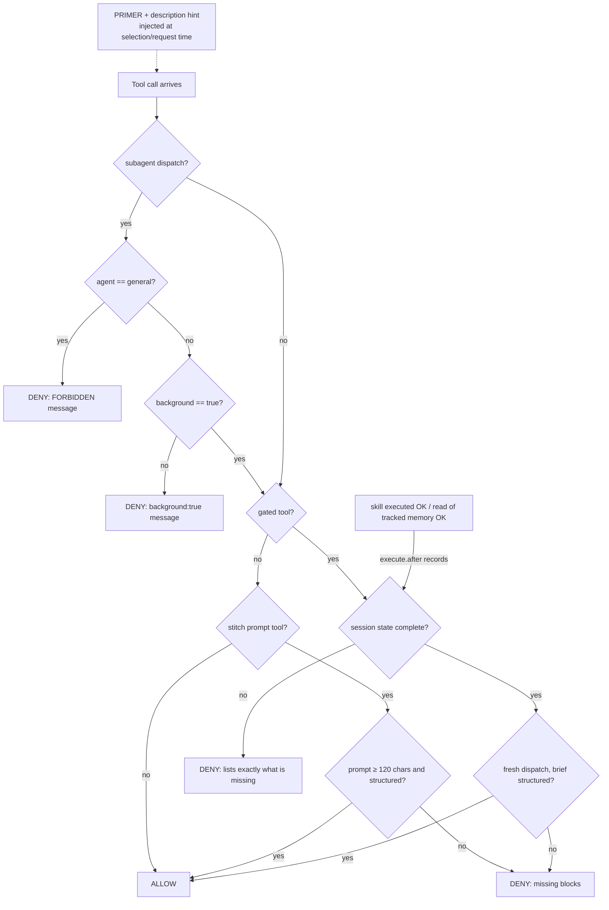

# 🛡️ opencode-mandator

<div align="center">

**Deterministic enforcement for OpenCode v2 — the owner's dispatch policy as a plugin, so the model cannot forget it.**

[](https://bun.com/docs/cli/test)
[](https://opencode.ai/)
[](#-quick-start)
[](#-security-notes)

[](LICENSE)

[Installation](#-quick-start) · [Configuration](#-configuration) · [Brief spec](docs/BRIEFS.md) · [Examples](docs/CONFIG-EXAMPLES.md)

</div>

---

## 📑 Table of Contents

- [What is enforced](#-what-is-enforced)
- [Architecture](#-architecture)
- [Project Structure](#-project-structure)
- [Configuration](#-configuration)
- [Quick Start](#-quick-start)
- [Security notes](#-security-notes)
- [Design rationale](#-design-rationale)
- [Testing](#-testing)
- [License](#-license)

---

## 📖 What is enforced

**Opt-in enforcement — an unconfigured plugin enforces nothing.** The built-in defaults
are empty: with no plugin options the plugin is completely INERT (no gates, no denies,
no primer injection, no description hint). Configure it via `opencode.json` plugin
options (see [`docs/CONFIG-EXAMPLES.md`](docs/CONFIG-EXAMPLES.md); canonical setup:
[`tests/fixtures/mandator-setup.json`](tests/fixtures/mandator-setup.json)). The table
below describes the configured (canonical) enforcement.

Twelve deterministic layers, enforced in-process by an OpenCode v2 plugin
(`@opencode/plugin` `Plugin.define`). Full normative spec: [`docs/RULES.md`](docs/RULES.md).

| # | Rule | Scope |
| :-- | :-- | :-- |
| 1 | `agent: "general"` dispatches are **FORBIDDEN** | `subagent`, any session state |
| 2 | Every dispatch requires **`background: true`** — deny, never rewrite | `subagent`, strict (`false` and omitted both deny) |
| 3 | **Skill gate**: calls denied until the session loaded `brainstorming` + `grilling` + `build-with-exa` + `context7-mcp` via `skill`… | `edit`, `write`, `shell`, `bash`, `apply_patch`, `subagent`, `webfetch`, `websearch`, `execute`, any `*exa*` MCP tool, `context7*` / `adb_mcp*` MCP tools (ext 7.1) |
| 4 | **Memory gate**: …and read `~/.config/opencode/MEMORY.md`; dispatches additionally need `subagent-driven-development` + `dispatching-parallel-agents` + `prompt-engineering-patterns` + reads of `memory/topics/workflow.md` + `workflow-git-pr.md` | same gated set (+ orchestrator preflight on `subagent`) |
| 5 | **PRIMER** injected as a system text part before every model request + one-line policy hint on the `subagent` tool description; brief spec: docs/BRIEFS.md | every agent request / tool selection |
| 6 | **Prompt-structure gate**: a fresh dispatch brief must contain Role / Task / Context / Constraints / Output format (per `prompt-engineering-patterns`); the 3 Stitch free-text prompt tools need a 4-block profile on prompts ≥ 120 chars | `subagent` (fresh) + `stitch_generate_screen_from_text` / `stitch_edit_screens` / `stitch_generate_variants` |
| 7 | **Memory-mandate keyword** (ext 6.1): a fresh dispatch brief must mandate reading global memory (`MEMORY.md` / `memory/topics` / `memory/projects` / "global memory" / RU «глобальная память» forms) | `subagent` (fresh; continuations exempt) |
| 8 | **Memory whole-file overwrite guard** (ext 6.6): `write` over an EXISTING global memory file (memory tree incl. root `MEMORY.md`) is denied — append/supersede via `edit`; creating NEW memory files passes; stat failures allow (hygiene backstop) | `write` |
| 9 | **Agent-missing deny** (ext 6.7): dispatches with `agent` missing/empty get an actionable deny; the `general` ban still wins for `agent: "general"` | `subagent`, any session state |
| 10 | **Identical-dispatch circuit breaker** (ext 6.4): the same (agent, prompt) pair on fresh dispatches is denied when it reaches 4 per session — 3 identical executions pass; per-session djb2 counter; the deny carries **no** compliance trailer and **no** re-run instruction (deliberate — it is final for identical resends) | `subagent` (fresh; continuations exempt) |
| 11 | **Continuation-chain cap** (ext 6.3): the 7th continuation of the same child session within one parent session is denied (6 pass; increment-then-check — continuations denied by earlier gates never increment, cap-denied and override-carrying ones do); a prompt carrying `[chain-cap-override] <reason>` may deliberately pass beyond the cap (one-shot, no config); the deny teaches the recovery — fresh agent + git branch + structured brief | `subagent` (continuations only; fresh dispatches exempt) |
| 12 | **MCP→skill gate** (ext 7.1): an MCP tool whose server has a related skill is denied until that skill is loaded — prefix match on the flat `<server>_<tool>` name: `context7*` → `context7-mcp`, `adb_mcp*` → `adb-mcp`; the deny carries a per-skill usage hint (resolve-library-id before query-docs / read the accessibility tree before tapping). Honest inertness note: the `context7` entry cannot fire while `context7-mcp` is mandatory (rule 3) — live enforcement = `adb_mcp*`. No mappings for the 5 skill-less MCP servers (docs/BACKLOG.md) | MCP tools matching a prefix; check site: after the skill/memory gate, before the structure chain |

Deny messages list **exactly what is missing**, then the comply-then-rerun instruction,
then a **COMPLIANCE WARNING** trailer: output violating the applied skills' requirements —
including a badly written subagent brief — is declared REJECTED. The trailer is a declarative
deterrent (owner decision); nothing in the plugin mechanically audits skill compliance.
The ext-6.4 identical-dispatch deny is the deliberate exception: it carries neither the
trailer nor a re-run instruction, because re-dispatching the identical call is exactly what
that guard denies (differentiate the briefs or escalate instead).
Absolute bans (rules 1–2) are checked before the skill gate.

## 🗺 Architecture



Both flows describe a **configured** plugin — an unconfigured one gates nothing
(empty defaults; see [Configuration](#-configuration)).

**Request-flow 1 — compliance cycle (any gated call):**

1. Gated call arrives → plugin checks the calling session's recorded state.
2. **DENY** — the message lists exactly the missing skills/reads; nothing ran.
3. The agent invokes `skill` for each missing skill and `read`s the missing memory files.
4. The **same call is re-run unchanged** → state complete → **ALLOW**.

**Request-flow 2 — orchestrator preflight (a `subagent` dispatch):**

1. Ban checks first: `agent` missing/empty → deny (ext 6.7); `agent: "general"` → deny;
   `background !== true` → deny.
2. Base gate: 4 skills (+ `context7-mcp`, ext 7.1) + the `MEMORY.md` read must already
   be in session state.
3. Dispatch gate: + `subagent-driven-development`, `dispatching-parallel-agents`,
   `prompt-engineering-patterns`, `workflow.md`, `workflow-git-pr.md` reads.
4. Prompt-structure check on the brief: Role / Task / Context / Constraints /
   Output format must all be present (continuations with `sessionID` exempt).
5. Memory-mandate check on fresh briefs: the brief must mandate reading global memory
   (ext 6.1; continuations exempt).
6. Identical-dispatch breaker on fresh dispatches (ext 6.4): the 4th identical
   (agent, prompt) pair in the session is denied — 3 identical executions pass; the deny
   is final for identical resends (no trailer, no re-run instruction).
7. Continuation-chain cap on continuations only (ext 6.3): with the bans and gates passed,
   the 7th continuation of the same child session within one parent session is denied
   (6 pass); `[chain-cap-override] <reason>` in the prompt is a one-shot deliberate pass
   beyond the cap. Continuation-only: a dispatch runs this check OR the fresh-path breaker
   in step 6 — never both.
8. All present → dispatch proceeds; anything missing → one exact-missing deny.

## 📂 Project Structure

```text
opencode-mandator/
├── src/
│   ├── dispatch-policy.ts        # the plugin — enforcement hooks, PRIMER, deny messages (single source of truth)
│   ├── defaults.ts               # the EMPTY defaults — the all-off config; unconfigured = completely inert (opt-in)
│   └── config.ts                 # options resolver — 36 options in 7 groups, hybrid failure semantics
├── plugin-package/               # package-mode entry — the object-form plugins entry loads THIS directory (carries options)
│   ├── index.ts                  # re-exports the plugin + test seams from src/
│   └── package.json              # package manifest (exports "./index.ts")
├── scripts/
│   ├── probe-options.sh          # live options probe — proves options reach the plugin in a fresh process (not a unit test)
│   └── probe-mock-server.ts      # local OpenAI-compatible mock provider for the probe (loopback only)
├── tests/
│   ├── dispatch-policy.test.ts   # probe suite port 1:1 — real Plugin.define wrapper + mock ctx
│   ├── config.test.ts            # resolveOptions + the wired knobs — hybrid failure semantics
│   ├── opt-in.test.ts            # the INERT suite — no options → no gates, no denies, no primer
│   ├── setup-parity.test.ts      # canonical setup fixture contract (supersedes defaults-parity)
│   ├── probe-original.ts         # the original /tmp probe script, kept as provenance (not run by bun test)
│   └── fixtures/
│       └── mandator-setup.json   # canonical owner setup — 8 option groups, the values RULES.md shows
├── docs/
│   ├── RULES.md                  # normative enforcement spec: gated set, prerequisites, deny messages
│   ├── BRIEFS.md                 # normative dispatch-brief specification (per-block content bar)
│   ├── BACKLOG.md                # enforcement deferrals (6.2, 6.5, ext-7 follow-ups) with owner-decided status
│   └── CONFIG-EXAMPLES.md        # worked opencode.json options examples
├── install.sh                    # atomic install (symlink-first, --copy, verify, uninstall)
├── package.json                  # private; scripts: test = bun test; devDep @opencode/plugin
├── LICENSE                       # MIT
├── README.md
├── bun.lock                      # lockfile (bun)
└── .gitignore                    # node_modules, *.log
```

## ⚙️ Configuration

**Empty defaults = inert.** Enforcement exists only via explicit configuration
(owner ruling "Empty defaults, setup in JSON"). The vehicle is the **object form**
of the `plugins` array entry in the global `~/.config/opencode/opencode.json` —
file-discovered plugins carry no options:

```jsonc
{
  "plugins": [
    { "package": "~/projects/opencode-mandator/plugin-package",
      "options": { /* 36 options in 7 groups — see below */ } }
  ]
}
```

- **Canonical setup** — [`tests/fixtures/mandator-setup.json`](tests/fixtures/mandator-setup.json):
  8 option groups (`dispatch`, `skills`, `gates`, `structure`, `caps`, `paths`, `messages`,
  `primer`) carrying the pre-flip defaults verbatim; the owner setup RULES.md documents.
- **Worked examples** — [`docs/CONFIG-EXAMPLES.md`](docs/CONFIG-EXAMPLES.md):
  alternative setup, minimal override, primer append.
- **Normative spec** — [`docs/RULES.md` §6](docs/RULES.md): the full option table,
  guard on/off conditions, and failure semantics.
- **Failure semantics** — enforcement groups fail **closed per guard** with a
  CONFIG-ERROR deny naming the option path; an invalid cap means effective cap 1;
  presentation groups (`messages`, `primer`) fail **soft** (fallback + warn).
- **Applying any option change = `opencode service restart`** (the reload command does
  not re-load plugin code — see the restart subsection below).

## 🚀 Quick Start

### 1. Test & install

Run the suite first: `bun install && bun test` — all four suites must be green.
Then install (atomic, symlink-first): `./install.sh` — or force a byte-copy with
`./install.sh --copy`.

| Command | Effect |
| :-- | :-- |
| `./install.sh` | Tries **symlink** (single source of truth: the repo file IS the live plugin), probes the loader via `opencode plugin list` (3 attempts, 2s apart), falls back to an **atomic copy** if the loader refuses the symlink. |
| `./install.sh --copy` | Skips the symlink attempt; installs a byte-copy. |
| `./install.sh verify` | Reports installed mode + byte-parity vs `src/` + loader registration. Non-zero exit on drift. |
| `./install.sh uninstall` | Removes the live file (documented unlock; the gate is fail-open while the file is absent). |

**Live probe verdict (this machine, OpenCode v2.0.27): SYMLINK MODE WORKS.**
`opencode plugin list` registers `dispatch-policy` through a symlinked plugin file, so
the default install is a symlink to `src/dispatch-policy.ts` — the repo is the single
source of truth. History of the probe: the first installer revision probed exactly once,
immediately after each atomic `mv`, and both probes failed (symlink AND the copy
fallback) — yet a manual `opencode plugin list` seconds later registered the plugin.
Root cause: probe race, not symlink rejection. After adding the retry loop, the symlink
probe passes deterministically. `install.sh` still keeps the automatic copy fallback
for machines whose loader behaves differently.

### 2. Configure (opt-in)

Without configuration the plugin does nothing. Copy the canonical options from
[`tests/fixtures/mandator-setup.json`](tests/fixtures/mandator-setup.json) into the
object-form `plugins` entry of `~/.config/opencode/opencode.json` (package:
`plugin-package/`), or start from the worked examples in
[`docs/CONFIG-EXAMPLES.md`](docs/CONFIG-EXAMPLES.md). See
[Configuration](#-configuration) for semantics.

### 3. Restart

Apply any plugin or option change to the running server with `opencode service restart`
(fail-closed: all sessions re-gate afterwards).

**Hot-reload nuance (updated live 2026-10-24, supersedes the 2026-10-14 note):** in **symlink
mode the running server does NOT hot-reload the plugin at all.** Verified live: atomic rename
onto the path, byte-identical in-place rewrites, and real byte changes to the repo target all
failed to apply — a dispatch that the new code must deny kept passing, and the log showed only
`loading plugin` re-registrations (per session attach) with the ES module cached by URL from
process start. The watcher does subscribe to the plugin path, but no reload event fires for a
symlinked target. Fresh processes (`opencode plugin list`, new sessions) load the current file
immediately. **Applying a plugin update to the running server = restart the server** (fail-closed:
all sessions re-gate afterwards). The 2026-10-14 "in-place edits are the hot-reload trigger"
observation predates symlink mode and described copy-mode installs. Verify a live update with a
behavioral probe (a dispatch the new version must deny), never with log lines.

### 4. Verify & use

`./install.sh verify` — installed mode, byte-parity, and `opencode plugin list`
registration. Then use it: in any OpenCode session, a gated call is denied with the exact
missing list — invoke the listed `skill`s, `read` the listed memory files, re-run the call
unchanged.

### 5. Uninstall

`./install.sh uninstall` — the gate disarms (fail-open while the live file is absent).

## 🔒 Security notes

- **Atomic writes or nothing.** In copy mode OpenCode hot-reloads plugin files on change; a broken
  interim file at the live path fail-closes **every** gated call with no in-session
  recovery (all writers are gated). `install.sh` materializes a temp entry in the same
  directory and installs with one `mv -Tf` — never edit the live file in place.
  In symlink mode the running server does not hot-reload at all (see the hot-reload
  nuance above) — a broken repo file still breaks every fresh process.
- **Kill switch.** `OPENCODE_ENFORCE_OFF=1` disables all plugin behavior — but it is
  read from the server process env at hook-call time, so it only affects **future**
  server starts. The immediate off-switch is removing the file (hot-reload unloads it).
- **Fail-closed by design.** Server restart or plugin hot-reload wipes per-session
  compliance state — sessions re-gate. A broken hook build denies everything (safe
  direction); recovery is `rm ~/.config/opencode/plugin/dispatch-policy.ts` + reinstall.
- **Recording is honest.** Only `status: "completed"` skill loads and reads of tracked
  memory files count; failed invocations never count; state is strictly per-session.

## 🧭 Design rationale

- **Deterministic hooks > prose.** The policy lived in memory files and prompts; models
  forget. Hooks in `execute.before` cannot be forgotten — the denial happens before the
  tool runs, and the deny message teaches the rule (honest failure, never silent rewrite).
- **Memory-restart = fail-closed.** Per-session in-memory state is deliberate: no
  persistence path exists that could let a stale "compliant" flag survive a restart.
  The cost — one compliance round per session/hot-reload — is accepted by design.
- **Byte-migration, no refactors.** `src/dispatch-policy.ts` is the battle-tested live
  plugin moved verbatim (231 lines, `cmp`-identical); behavior changes only via tested
  edits in this repo.

## ✅ Testing

`bun test` runs four suites against the real `@opencode/plugin` `Plugin.define` wrapper
with a mock ctx (194 tests, all green):

- `tests/dispatch-policy.test.ts` — the wave3-a2 probe suite ported 1:1
  (same events, sessions, and state-mutation order) — gated sets, deny messages, partial
  compliance, whitelist, per-session isolation, kill switch, primer, description hint.
- `tests/config.test.ts` — `resolveOptions` + the wired knobs: hybrid failure semantics
  (enforcement groups fail closed per guard, invalid caps ⇒ 1, unknown keys warn+ignore)
  and the opt-in flip, run against the canonical setup fixture.
- `tests/opt-in.test.ts` — the INERT suite: with no options the plugin is completely
  inert — no gates, no denies, no primer injection, no description hint, no config problems.
- `tests/setup-parity.test.ts` — the canonical setup fixture contract (supersedes
  defaults-parity): the fixture parses, resolves to the owner setup, and carries zero
  config problems.

Live probes (runtime facts bun cannot see; not part of `bun test`):
`scripts/probe-options.sh` + `scripts/probe-mock-server.ts` prove that options set in
`opencode.json` actually reach the plugin in a fresh process loaded through the
`plugin-package/` layout.

## 📄 License

Released under the MIT License — see [LICENSE](LICENSE).

---

<p align="center"><sub>Owner: 4q4r · License: MIT</sub></p>
