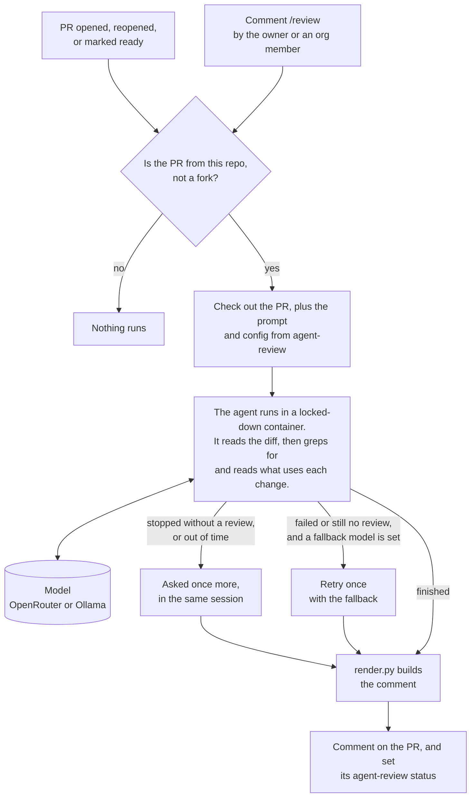
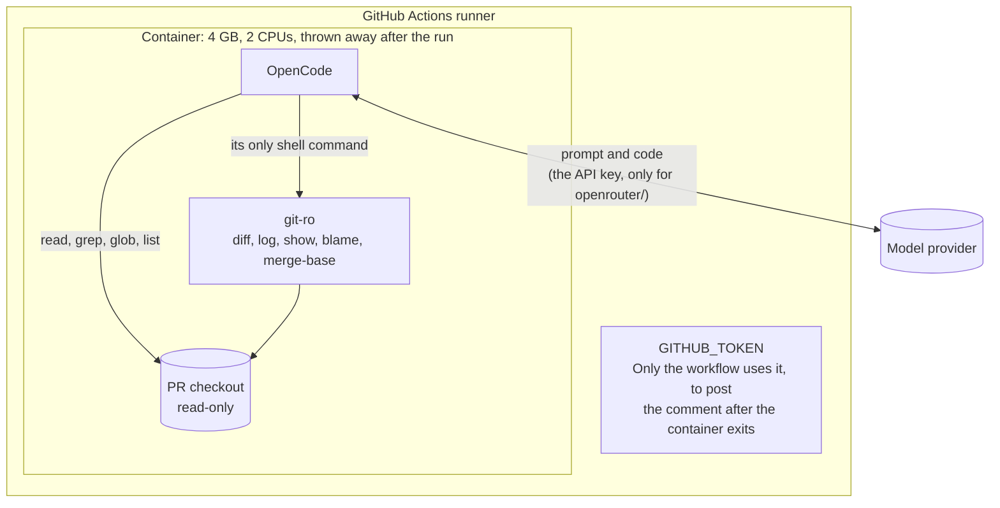

# agent-review

An AI reviewer for pull requests, run in GitHub Actions. It reads the change, follows it to the code that uses it, and comments with what breaks and how to fix it.

[OpenCode](https://github.com/anomalyco/opencode) does the work, with whichever model you pick. The default, GLM 5.3 Flash on [OpenRouter](https://openrouter.ai), costs about **$0.03–0.25 a review**, more for a big PR. A local Ollama model works too.

A review looks like this:

> **1 finding**: 1 high
>
> 1. 🔴 **High** · `k3s/base/data/postgrest.yml:88`: Service selector changed to a label no pod carries.
>    - **Breaks:** the `postgrest` Service selects zero pods, so every consumer of `postgrest.data.svc:3000` gets connection refused.
>    - **Affected:** `k3s/base/data/swe-ingest.yml`, `k3s/base/data/river-history.yml`, and 10 more
>    - **Fix:** revert the selector to `app.kubernetes.io/name: postgrest`.

If it finds nothing, it says ✅ `No issues found.` and adds one `Checked:` line on what it read.

Low findings are folded below the others: they're real, but they don't block a merge. When only low ones are left, the review starts with ✅ **Nothing blocking**, so you know another round isn't needed.

## How it works

The agent only reads. It can't change the code, push or comment. The workflow posts the comment after the agent's container is gone.

## Quick start

1. Copy [`examples/agent-review.yml`](examples/agent-review.yml) into your repo as `.github/workflows/agent-review.yml`.
2. In that file, keep one `with:` block and delete the other:
   - **Public repo:** `runner: ubuntu-latest`.
   - **Private repo:** your self-hosted runner, and optionally a local fallback model (see [Self-hosted runners](#self-hosted-runners)).
3. Add the repo secret `OPENROUTER_API_KEY`. You don't need it if your `model` is an `ollama/…` model.
4. Merge it. Reviews start on the **next** PR: GitHub runs this workflow from the default branch, so the PR that adds it can't review itself.

**Easier:** `./deploy/add-repo.sh <repo>` does all of this, including the runner for a private repo. [DEPLOY.md](DEPLOY.md) is the step-by-step guide: adding a repo, releasing a change to every repo, and undoing it.

## When it runs

- **By itself:** when a PR is opened, reopened, or marked ready for review. Drafts are skipped.
- **When asked:** when the repo owner or an org member comments `/review`. That comment gets 👀 when the run starts, then 🚀 when the review is posted, or 👎 if the run failed. A new `/review` cancels a run still going, and the cancelled run posts no comment.
- **Never:** for PRs from forks, or for `/review` from anyone else.

**The result shows on the PR as an `agent-review` status** on its latest commit: pending while it reviews, ✅ once the review is posted, with the finding counts (`2 findings: 1 high, 1 low`), ❌ if the run failed. Check that, not the run's own check. GitHub attaches a `/review` run's check to the default branch's latest commit, so it never shows on the PR, and a run replaced by a newer `/review` leaves a cancelled check behind.

You can require the `agent-review` status in branch protection. It's green whenever a review was posted, findings or not, so it means "reviewed", not "nothing found". Pushing doesn't start a review, so after a push it stays on the old commit until you comment `/review`.

**Re-reviews look only at what's new.** Once a PR has a review, the next one checks that review's high and medium findings and reviews only the commits added since. Earlier low findings aren't repeated. The footer says `re-review since <commit>`.

It reviews the whole PR instead when the PR was rebased, when a merge came in, when there are no new commits, or when the last review was written by the fallback model. Comment `/review full` to review the whole PR on purpose.

## Settings

| Input | Default | What it does |
|---|---|---|
| `runner` | `ubuntu-latest` | The runner to use (`runs-on`) |
| `model` | `openrouter/z-ai/glm-5.3-flash` | Any [OpenCode `provider/model`](https://opencode.ai/docs/models/) |
| `fallback_model` | none | Tried once if the first model fails, writes no review, or has no key |
| `ollama_base_url` | none | Your Ollama endpoint for `ollama/` models, e.g. `http://host:11434/v1` |
| `config_ref` | `v1` | The version of this repo to read the prompt and config from. Keep it the same as the `@ref` in `uses:` |

Secret: `OPENROUTER_API_KEY`, needed only for `openrouter/` models.

**Ollama models** set up in [`review/opencode.json`](review/opencode.json): `gemma4:26b`, `gpt-oss:20b`, `hf.co/unsloth/Qwen3.5-35B-A3B-GGUF:UD-IQ4_XS`. To add one, list it under `provider.ollama.models`. In testing, local models caught simple breaks but missed subtle ones, so they make a better fallback than a main model. For the fallback, pick a model your Ollama host already keeps loaded, so it doesn't have to wait for the GPU.

## What the comment means

| Heading | Meaning | Job |
|---|---|---|
| **🔎 Agent review** | Up to 5 findings, worst first, each with **Breaks**, **Fix**, and sometimes **Affected**, with low ones folded. Or ✅ `No issues found.` | passes |
| **⚠️ No review** | The agent finished but didn't write a review, even when asked again. Whatever it did write is folded away. | fails |
| **⚠️ Agent review failed** | The agent crashed, ran out of time and wrote no review when asked for one, or couldn't start (for example, no key and no fallback). | fails |

To retry, comment `/review`.

**When the agent stops early.** A model sometimes ends its turn before the review: it says what it will look at next and makes no tool call, or writes nothing. The workflow then asks it once more, in the same session, to write the review from what it has read, and the footer says `asked again for the review`. A finished review that only lacks its markers is posted as it is.

**When the agent runs out of time.** On a large PR a model can read for the whole 15 minutes and never write. The workflow then asks it, in the same session, for the review from what it has read so far, with no more tool calls. The footer says `hit the time limit, then asked for the review`: such a review may cover less than the model meant to, and it is told to say what it did not get to.

**Every run keeps the agent's events** as an artifact on the run (`agent-review-events-1`; the number is the run attempt): each tool call, each step's finish reason and token counts, and a log that starts with the runner the review ran on. 7 days for a posted review, 14 for a run that ended without one.

**Reasoning is capped for the default model**, at 8,000 tokens a step, in [`review/opencode.json`](review/opencode.json). OpenCode stops a model's turn at 32,000 output tokens, reasoning included, and GLM sometimes reasoned all the way there and wrote nothing. Another `openrouter/` model can be given the same cap under `provider.openrouter.models`.

The model writes the findings. `render.py` adds the 🔴 high / 🟠 medium / 🟡 low icons, the count line, and links from each `file:line` to the PR's code, so every model's review looks the same. The footer shows the model, the commit, tool calls, tokens, cost, time, whether it was a re-review, and a link to the run.

## Tell it about your repo

Add `.github/agent-review.md` with anything the reviewer should know: generated files, what usually breaks, what to ignore. It's added to the prompt, up to 4,000 characters. It's read from the PR's **base** branch, so a PR can't rewrite its own review instructions.

The agent also reads `README.md`, plus `AGENTS.md`, `CLAUDE.md` or `.github/copilot-instructions.md` if you have them.

## Security

The PR's code is untrusted, and the agent can run commands. Here is what it can reach:

- **Who can start it:** same-repo PRs, and `/review` from the owner or an org member. The workflow checks this twice: once in your repo's caller and again inside the reusable workflow.
- **A PR can't change how it's reviewed.** The prompt, config and tools come from this repo. OpenCode is told to ignore any `opencode.json` or `AGENTS.md` the PR adds.
- **Read-only, in a throwaway container.** The PR checkout is mounted read-only.
- **One shell command:** [`git-ro`](review/git-ro). It allows only the five git subcommands above, with a fixed list of options. Every path must stay inside the checkout, and git runs with an empty environment. Shell quoting can get past OpenCode's own command rules, so `git-ro` is the real check. Those rules still block `$`, `` ` ``, `<` and `>`.
- **Symlinks** in the PR that point outside the checkout are replaced with a placeholder first.
- **Secrets:** `OPENROUTER_API_KEY` goes into the container only for `openrouter/` models. `GITHUB_TOKEN` never does.

## Where your code goes

The code under review is sent to the model provider: OpenRouter, then whoever serves the model. For private code, choose a provider whose data policy you're OK with, and avoid `:free` models, which may log prompts. Or use a local `ollama/…` model and the code never leaves your network.

Every run keeps the agent's events, which include the code it read, as an artifact on that run: 7 days for a posted review, 14 for a run that ended without one. Whoever can see the repo's Actions runs can download it.

The comment is posted with the job's own `GITHUB_TOKEN`. No third-party GitHub App is involved.

## Self-hosted runners

GitHub-hosted runners need nothing extra. A self-hosted runner needs:

- **Docker** that the runner's user can run.
- **`gh`, `python3` and `git`** on the host.
- **Network access** to GitHub, `ghcr.io` (pulled once per image version), `models.dev` (OpenCode's model list) and your model provider.

Use self-hosted runners for private repos only. Anyone can open a PR on a public repo, so public repos belong on GitHub-hosted runners.

A local fallback model is only there when its GPU is free. If another job holds the GPU, the fallback waits and can hit its time limit.

## Limits

- **Time:** 15 minutes per attempt, 5 more when an attempt stopped early or ran out of time and is asked for its review, 2 attempts with a fallback, 45 minutes for the whole job.
- **Comment size:** 60,000 characters.
- **x86-64 runners only:** the image isn't built for ARM.

## The container image

The agent runs in `ghcr.io/aachtenberg/agent-review`, built from [`image/`](image/Dockerfile). It holds OpenCode, git and ripgrep, so a run downloads no code. Everything is pinned:

- the image, by digest, in `review.yml`
- its base image, by digest
- OpenCode `1.19.3`, by its npm integrity hash
- ripgrep `15.1.0`, by sha256

To update: change `image/`, let [`image.yml`](.github/workflows/image.yml) build and push it, then copy the new digest from that run's summary into `review.yml`. The image has to stay public, because runs pull it without logging in. `image.yml` fails if it isn't.

## Versions, and what you're trusting

`v1` is a tag that moves: it's moved to each tested change on `main`, and repos that use `@v1` get the change on their next run. To stay on one version, set both `uses: …@<commit-sha>` and `config_ref: <commit-sha>`.

Using `@v1` means trusting whoever can move that tag, which is this repo's owner. Whatever `v1` points to, including the image it pins, runs with your PR code, your `OPENROUTER_API_KEY`, and a `GITHUB_TOKEN` that can read your repo and write PR comments and commit statuses. That's fine for the owner's own repos. If you're anyone else, pin a commit SHA you've read, and update it on purpose.

## Files

| Path | What it is |
|---|---|
| `.github/workflows/review.yml` | The reusable workflow |
| `review/prompt.md` | What the agent is told to do, and the review format |
| `review/opencode.json` | Models and permissions |
| `review/git-ro` | The read-only git wrapper |
| `review/scope-full.md`, `review/scope-rereview.md` | How a full review and a re-review start, put into the prompt |
| `review/previous.py` | Finds the last review, and decides between a re-review and a full one |
| `review/render.py` | Turns the agent's output into the comment |
| `image/` | The container image, built by `.github/workflows/image.yml` |
| `examples/agent-review.yml` | The workflow to copy into your repo |
| `DEPLOY.md` | The deploy guide |
| `deploy/` | Scripts: `add-repo.sh`, `release.sh`, `list-repos.sh`, and `perms.py`, which checks a repo's workflow grants what the reviewer asks for |
| `.github/workflows/agent-review.yml` | This repo reviewing its own PRs |

## License

[MIT](LICENSE). OpenCode is MIT too.
