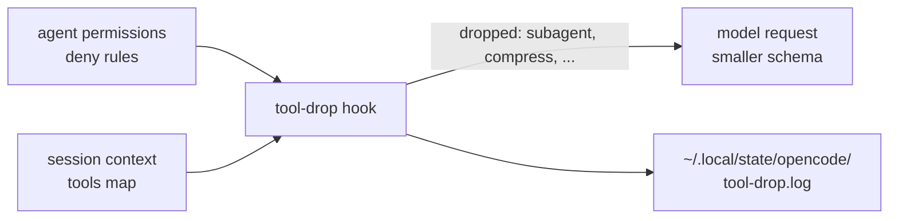
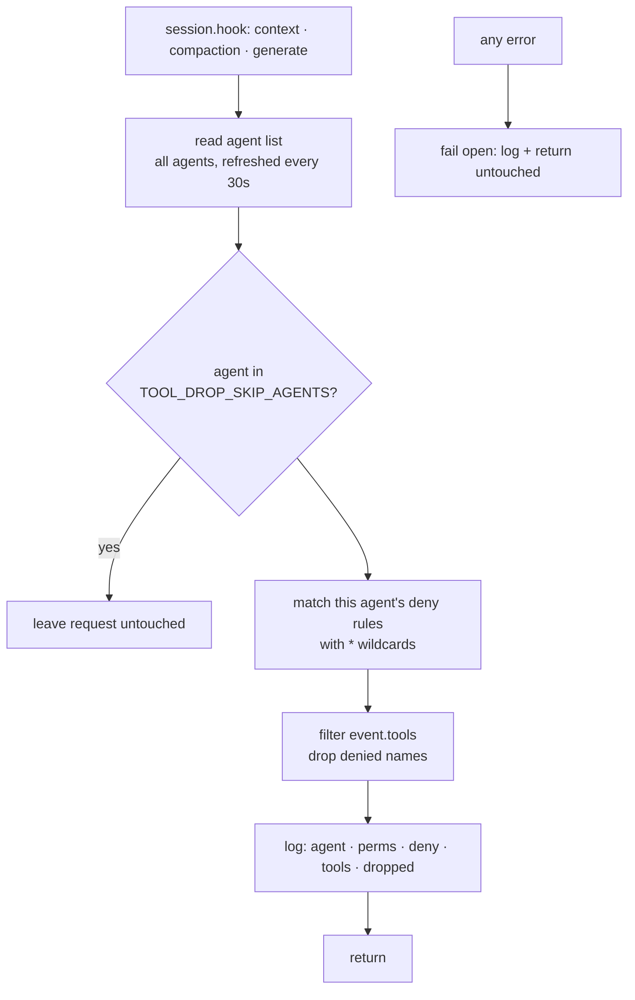

# opencode-tool-drop

Permission-aware tool schema filter for [OpenCode](https://opencode.ai).

Strips tools an agent's `permissions` deny out of the tool schema before it reaches the model — smaller payloads, faster first tokens, and an audit line per request.



## Why

Every tool's JSON schema ships with every model request. Tools an agent is denied never help and always cost:

| Agent setup | Tools | Schema | First turn (cold) |
|---|---|---|---|
| no deny rules | 27 | ~25 KB ≈ 6.3k tokens | ~6.4 min on a local model |
| 6 deny rules | 24 | ~20 KB ≈ 5.0k tokens | ~4 min |

`tool-drop` makes the cut explicit and observable: it reads the deny list, drops matching tools from the schema, and logs what it did — so you can see exactly which tools each agent was offered.

## Install

npx + GitHub (no clone needed):

```bash
npx opencode@latest plugin add github:abdullah1116/opencode-tool-drop
```

Or with the OpenCode CLI directly:

```bash
opencode plugin add github:abdullah1116/opencode-tool-drop
```

Track the `main` branch for auto-updates (checked at startup and every 24 h):

```bash
opencode plugin add github:abdullah1116/opencode-tool-drop#main
```

Or add it manually to `opencode.json`:

```json
{
  "plugin": ["github:abdullah1116/opencode-tool-drop#main"]
}
```

Local development:

```bash
git clone git@github.com:abdullah1116/opencode-tool-drop.git
opencode plugin add ./opencode-tool-drop
```

> Requires OpenCode with package-plugin support (`opencode plugin add`). Changes under watched config directories reload automatically.

## How it works



**No agent is hardcoded.** Every agent returned by `ctx.agent.list()` is processed; the active agent comes from the hook event, and its deny rules come from that agent's own `permissions`.

- Hooks: `context`, `compaction`, `generate` (where the tools map is built)
- Agent lookup: `ctx.agent.list()`, cached 30 s, refreshed on a timer
- Matching: permissions are an **ordered list — last match wins** (a `*` deny first, then specific allows, keeps only the allowed tools). Only tool-wide rules — `resource: "*"` or no resource — affect the schema; a resource-scoped rule (e.g. `read:src/**`) leaves tool presence untouched. Wildcards work in both fields (`compress`, `chronicler_*`).
- **Fail-open**: every hook body is wrapped — a failure logs and returns the request untouched, never kills the model call
- If OpenCode already removed a denied tool upstream, the log shows `dropped=none` — the filter is a safety net, not a bypass

## Log

One line per request:

```
~/.local/state/opencode/tool-drop.log
2026-11-24T21:38:00Z setup start options={} skip=none log=...
2026-11-24T21:38:03Z hook agent=builder tools=24 patterns=compress|subagent dropped=compress
```

Rotate or delete it freely; it is recreated on demand.

## Environment variables

| Variable | Default | Effect |
|---|---|---|
| `TOOL_DROP_SKIP_AGENTS` | *(empty)* | Comma-separated agent ids (or `*` globs) the plugin ignores entirely — e.g. `TOOL_DROP_SKIP_AGENTS=explore,plan*` |
| `TOOL_DROP_LOG` | `$XDG_STATE_HOME/opencode/tool-drop.log` | Log file path |
| `XDG_STATE_HOME` | `~/.local/state` | Base directory for the default log |

Skipped agents are logged once per request as `skipped(SKIP_AGENTS)` so exclusions stay visible.

## Plugin options

Extra deny patterns per agent, in the plugin entry of `opencode.json`:

```json
{
  "package": "github:abdullah1116/opencode-tool-drop",
  "options": { "block": { "builder": ["git-push-*"] } }
}
```

Options are merged with the agent's own `permissions` deny rules.

## Configure deny rules

Per agent, in `opencode.json`:

```json
{
  "agent": {
    "qwen-local": {
      "permissions": [
        { "action": "subagent", "resource": "*", "effect": "deny" },
        { "action": "compress", "resource": "*", "effect": "deny" }
      ]
    }
  }
}
```

`tool-drop` picks these up automatically — no plugin config of its own.

## License

MIT — Copyright (c) 2026 Abdullah Hasan. See [LICENSE](LICENSE).
