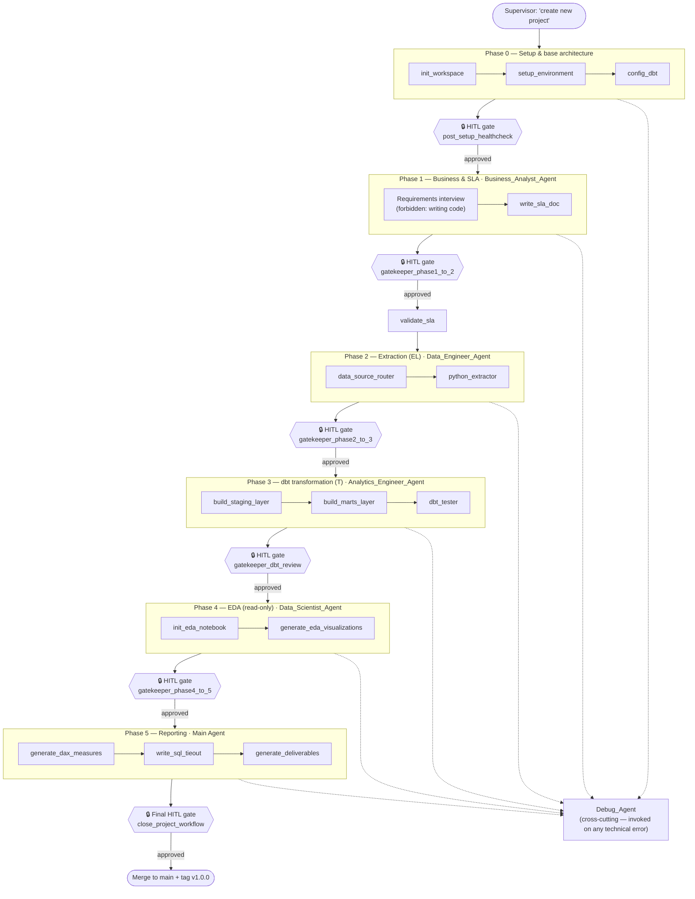

# hitl-analytics-team

[](LICENSE)
[](https://github.com/adriansoriacastellano/hitl-analytics-team/tags)

A multi-agent orchestration framework for analytics engineering projects. It simulates a small, specialized data team — Business Analyst, Data Engineer, Analytics Engineer, Data Scientist — each running as a sandboxed subagent with its own permitted stack and directory scope, coordinated by a Main Agent under a strict **Human-in-the-Loop (HITL)** contract.

No phase runs to completion unboxed. Every phase transition stops, presents a summary of what changed, and waits for explicit human approval before continuing. The framework executes; the human decides.

> Internal agent instructions (`AGENTS.md`, the skills, the subagent prompts) are written in Spanish, my native language. That doesn't affect how the framework runs — it just means you'll see Spanish prose if you open `.agents/`.

---

## Table of Contents

- [Why Human-in-the-Loop](#why-human-in-the-loop)
- [Architecture](#architecture)
- [Technology decision matrix](#technology-decision-matrix)
- [Project lifecycle — Phases 0 to 5](#project-lifecycle--phases-0-to-5)
- [Error handling and self-updating memory](#error-handling-and-self-updating-memory)
- [Quick start](#quick-start)
- [Repository structure](#repository-structure)
- [Proof this works](#proof-this-works)
- [Scope — who this is for](#scope--who-this-is-for)
- [Project status](#project-status)
- [Contributing](#contributing)
- [License](#license)

---

## Why Human-in-the-Loop

An agent that runs a data project end-to-end unsupervised is a liability, not a feature — it can silently bake a wrong assumption into a KPI definition, or hash the wrong column. Every architectural decision in this framework starts from the opposite premise: business judgment stays with the Supervisor (the human), and the agent layer's job is to make that judgment easy to exercise consistently, not to replace it.

Concretely, that means:

- The `Business_Analyst_Agent` is explicitly **forbidden from writing or suggesting code**. Its only job is to interview the Supervisor and turn answers into a documented SLA.
- Every phase ends with an explicit approval gate — a hook that stops execution and asks a direct yes/no question before the next phase can start.
- Subagents are sandboxed by directory and by stack (see below) — a subagent that shouldn't touch business logic *cannot*, structurally, not just by convention.
- The `Debug_Agent`'s authority is bounded by an explicit domain table: syntax errors and broken paths, yes; KPI formulas and business logic, no — those always escalate to the Supervisor.

## Architecture



Each subagent is restricted to a specific stack and directory — not as a style guideline, but as an enforced rule in its own system prompt:

| Subagent | Allowed stack | Directory scope | Hard restriction |
|---|---|---|---|
| `Business_Analyst_Agent` | None (interview only) | — | Cannot write, suggest, or execute code |
| `Data_Engineer_Agent` | Python (`requests`, `pandas`, `json`) | `src/` | Cannot clean data or apply business joins |
| `Analytics_Engineer_Agent` | dbt Core, SQL (DuckDB), Jinja | `dbt_project/` | Cannot touch ingestion or visualization |
| `Data_Scientist_Agent` | Python (`pandas`, `matplotlib`, `seaborn`, `duckdb`) | `notebooks/` | Read-only on the database — no `INSERT`/`UPDATE`/`CREATE` |
| `Debug_Agent` | bash, Python, SQL, dbt CLI | Global (invoked only by the Main Agent) | Business logic and KPI formulas are out of domain — always escalated |

## Technology decision matrix

To avoid tool overlap and technical debt, every project instantiated from this framework follows the same stack assignment:

| Tool | Role | Explicitly forbidden for |
|---|---|---|
| **DuckDB** | Local data warehouse and compute engine | — |
| **Python** (pandas/requests) | API connectivity in `src/`, statistical EDA in `notebooks/` | Heavy tabular transformations or cleaning solvable in SQL |
| **dbt Core** | Cleaning, PII hashing, joins, dependency graph, testing | Any static business logic living outside `dbt_project/` |
| **Power BI** | Semantic layer, DAX, visualization | Any data cleaning in Power Query |
| **Excel** | Phase 1 prototyping, or Pivot Tables as a final access point | Ever being used as a database or ETL engine |

## Project lifecycle — Phases 0 to 5

0. **Setup** — scaffolds the project, initializes Git, sets up the Python environment and the dbt/DuckDB connection.
1. **Business understanding & SLA** (`Business_Analyst_Agent`) — interviews the Supervisor on objective, data sources, grain, KPI formulas, refresh cadence, and PII. Produces `docs/SLA.md`.
2. **Extraction (EL)** (`Data_Engineer_Agent`) — routes to local files or API extraction, following a strict pre-flight order: validate the SLA → route the source → check for incremental checkpointing on large paginated APIs.
3. **dbt transformation (T)** (`Analytics_Engineer_Agent`) — proposes the dimensional model, waits for approval, then builds staging → marts → tests.
4. **Exploratory Data Analysis** (`Data_Scientist_Agent`) — read-only notebook against the marts layer.
5. **Reporting, tie-out & delivery** (Main Agent) — DAX measures, SQL audit queries against Power BI, `outputs/final_analysis.md`, and the final Git close (feature branch → PR → tag `v1.0.0`).

`docs/DESIGN_RULES.md` is consulted throughout — it's not a set of prohibitions but contextual design criteria (fact table grain, JOIN fanout risk, `DIVIDE()` over `/`, PII masking discipline, free-text normalization) that subagents evaluate against their specific project before acting.

## Error handling and self-updating memory

Technical errors are never resolved inline by the subagent that hit them — they escalate to the Main Agent, which invokes the `Debug_Agent`. It logs the error in `logs/errors.md`, checks `docs/SYSTEM_MEMORY.md` for a known fix, applies it if in-domain, or escalates to the Supervisor if it isn't (business logic, KPI formulas, credentials, and unexpectedly low data volume are always out of domain). Once resolved entries in a project cross a threshold, they're compiled back into `docs/SYSTEM_MEMORY.md` — the framework's error knowledge base grows across projects instead of resetting each time.

## Quick start

**Requirements:** [OpenCode](https://opencode.ai) installed, Python 3.10+, git.

```bash
git clone https://github.com/adriansoriacastellano/hitl-analytics-team.git
cd hitl-analytics-team
opencode
```

Inside OpenCode, tell the Main Agent: *"crear proyecto nuevo"* (create a new project). It will ask for a project name, scaffold a sibling directory with its own copy of the agentic layer, and offer to start Phase 0. Everything else — the Python environment, the dbt/DuckDB setup, the SLA interview — is bootstrapped by the framework itself; you don't need dbt or DuckDB pre-installed.

## Repository structure

```
.agents/
  hooks/        # HITL gateways and automatic validations (SKILL.md per hook)
  skills/       # Executable skills, one per phase step
  subagents/    # System prompts for each role (BA, DE, AE, DS, Debug)
docs/
  DESIGN_RULES.md    # Proactive design rules (modeling, DAX, PII, data quality)
  SYSTEM_MEMORY.md   # Accumulated knowledge base of resolved errors
meta/
  PORTING_NOTES.md   # File/architecture mapping to the Claude Code implementation
logs/
  errors.md     # Error log managed by the Debug_Agent
AGENTS.md        # Main Agent system prompt — the governing document
NEW_PROJECT.md   # Instantiates a new project from this base
opencode.json    # OpenCode watcher configuration
README.md        # This file
CHANGELOG.md      # Record of what's been ported from the active Claude Code version
CONTRIBUTING.md   # How to propose changes and report bugs
LICENSE          # MIT
```

Only `.agents/`, `AGENTS.md`, `opencode.json`, `docs/`, and `logs/` get copied into a new project when you instantiate one — everything else (this README, the license, the changelog, `meta/`) stays only in this base repo.

## Proof this works

This framework isn't a demo — it shipped [**clinical_trials_analysis**](https://github.com/adriansoriacastellano/clinical_trials_analysis) end to end: 137,556 clinical trials extracted from a public API, modeled through dbt into a Kimball star schema in DuckDB, audited via SQL tie-out, and delivered as a Power BI-ready package. The project write-up documents a real data-quality bug the pipeline caught (an API query precedence error that silently inflated the dataset by ~37%) — the kind of thing this framework's tie-out and design-rule discipline exists to catch.

## Scope — who this is for

This is built for a solo analyst or a small team running end-to-end analytics projects on a local-first stack (DuckDB + dbt + Power BI), who wants the discipline of a structured, governed workflow without a full data platform. It is **not** an enterprise orchestration platform, it doesn't scale to distributed compute, and it's opinionated about the stack — if your project doesn't fit DuckDB/dbt/Power BI, you'll be fighting the framework more than using it.

## Project status

This repository reflects the version that built `clinical_trials_analysis` on OpenCode. Active development has since moved to a Claude Code implementation of the same architecture. This repo is updated after each completed project or significant milestone from that active version — expect batches of changes rather than a continuous commit history. See [`CHANGELOG.md`](CHANGELOG.md) for the record of what's been ported and when, and [`meta/PORTING_NOTES.md`](meta/PORTING_NOTES.md) for how the two implementations map to each other.

## Contributing

Issues and PRs are welcome — see [CONTRIBUTING.md](CONTRIBUTING.md) for how changes to skills, hooks, and design rules get reviewed, and how bug reports are triaged.

## License

MIT — see [LICENSE](LICENSE).
