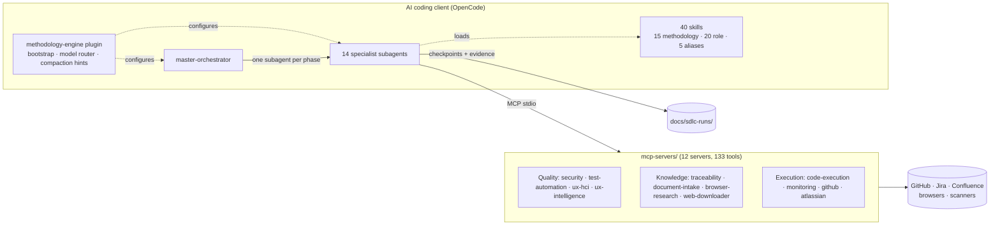

<div align="center">

# Agentic SDLC

**A multi-agent software delivery framework, and the MCP tool servers that make it trustworthy.**

One command takes a feature from idea to a reviewed pull request. Specialist AI agents handle
research, backlog, design, architecture, build, test, review, security and release. Every step
leaves evidence a human can audit, and the things that must be correct are tool calls, not prompts.

[](https://github.com/aideveloper1976-arch/agentic-sdlc/actions/workflows/ci.yml)
[](https://github.com/aideveloper1976-arch/agentic-sdlc/actions/workflows/codeql.yml)
[](LICENSE)


[Architecture](docs/architecture.md) · [Lifecycle](docs/sdlc-lifecycle.md) · [Model routing](docs/model-routing.md) · [Tool catalogue](docs/tool-catalog.md) · [Case study](docs/case-studies/observability-run.md) · [Verification status](docs/verification.md)

</div>

<!-- DEMO: add docs/assets/demo.gif here once recorded. See docs/demo.md. -->

```text
> /run-full-sdlc "Add CSV export to the reports page"
```

---

## At a glance

| | |
|---|---|
| **Agents** | 1 orchestrator + 14 specialist subagents, each with scoped permissions |
| **Lifecycle** | Research → backlog → design → architecture → build → regression → UX → code review → security → traceability → UAT → PR → release, with **3 human approval gates** |
| **MCP servers** | 12 TypeScript servers exposing **133 tools** (security scanning, Playwright testing, traceability, UX, GitHub, Jira/Confluence…) |
| **Model routing** | Each agent gets the cheapest configured model that meets its capability tier, from local Ollama models up to frontier models. Verified in a live OpenCode run |
| **Clients** | OpenCode (framework + servers); installer also writes MCP config for Claude Code, VS Code and Zed |
| **Quality gates in CI** | Build, strict typecheck, 49 unit/integration tests, MCP smoke test of all 12 servers, gitleaks, CodeQL, Dependabot |
| **Used for real** | 18 delivery runs on a production B2B SaaS platform |

## The problem it solves

AI coding agents are fast but hard to trust on real delivery work. They lose context on long
tasks, skip steps nobody checks, report success without evidence, and burn frontier-model
budget on trivial work. This project treats those as engineering problems:

| Problem | Approach |
|---|---|
| Long workflows overflow the context window | The orchestrator gives each phase to a **fresh subagent** and keeps only a one-line pointer to the checkpoint it wrote. Runs resume from disk with `/continue-sdlc`. |
| Agents claim work is done without proof | **Evidence-gated phases.** A story isn't done without linked research, tests and review evidence, recorded in a traceability graph that reports gaps. |
| Correctness-critical steps done "by vibe" | **Tools, not prompts.** Secret scans, WCAG contrast maths, E2E runs, visual diffs and dependency audits are deterministic MCP tool calls with structured output. |
| Agents act without oversight | **Human gates** for design, architecture and UAT. Command allowlists, `ask`-by-default permissions, no credentials in config. |
| Every task runs on the most expensive model | **Capability-tiered routing** sends routine agents to local or cheap models and reserves frontier models for orchestration and hard reasoning. |

## How a run works

```mermaid
sequenceDiagram
    autonumber
    actor Dev as Developer
    participant O as master-orchestrator
    participant A as Specialist subagent
    participant M as MCP servers
    participant FS as docs/sdlc-runs/&lt;run&gt;

    Dev->>O: /run-full-sdlc "feature"
    loop Research, backlog, design, architecture
        O->>A: task(phase instructions)
        A->>M: tool calls (search, parse, trace…)
        A->>FS: write checkpoint
        A-->>O: DONE + checkpoint path
    end
    O-->>Dev: Human gate: approve architecture sign-off
    Dev->>O: APPROVE
    loop Build, regression, browser tests, UX, code review, security, traceability
        O->>A: task(phase instructions)
        A->>M: tool calls (run tests, scan, diff, record evidence…)
        A->>FS: write checkpoint + evidence
        A-->>O: DONE, or FAIL → fix loop
    end
    O-->>Dev: Human gate: approve UAT sign-off
    Dev->>O: APPROVE
    O->>M: github: branch, commit, PR with evidence links
    O-->>Dev: PR ready for review
```

The orchestrator keeps one line per phase in its own context, which is what lets a full run fit
in a single session.

See [docs/sdlc-lifecycle.md](docs/sdlc-lifecycle.md) for every phase, its agent and its exit evidence.

## Architecture



Design rationale is recorded as [Architecture Decision Records](docs/adr/).

## Model routing, verified

The plugin classifies every model configured in OpenCode into a capability tier and assigns each
agent the cheapest model that meets its needs. With Opus, Sonnet, Haiku and a local Llama 3.1 8B
configured, a real OpenCode 1.19.6 session (against a stub model server that logged each request)
routed:

| Agent | Needs | Routed to |
|---|---|---|
| `master-orchestrator` | reasoning tier | `anthropic/claude-opus-4-5` |
| `architect` | complex (code-review tier or better) | `anthropic/claude-sonnet-4-6` |
| `story-writer` | standard | `ollama/llama3.1:8b` (local) |

How it works, and what is and isn't verified: [docs/model-routing.md](docs/model-routing.md).

## Quick start

**Requirements:** Node.js 20+, git. Optional: Docker, Trivy, gitleaks, Ollama.

```bash
git clone https://github.com/aideveloper1976-arch/agentic-sdlc.git
cd agentic-sdlc
npm ci
npm run build     # compile all 12 servers
npm run check     # typecheck + unit tests + framework tests
npm run smoke     # boot every server and list its tools over MCP
```

**Use the framework in your project**

```bash
cp -r framework/.opencode framework/AGENTS.md /path/to/your-project/
cp framework/opencode.example.json /path/to/your-project/opencode.json   # set paths and env vars
cd /path/to/your-project && opencode
> /run-full-sdlc "your feature"
```

**Or install the servers into every AI client you use**

```bash
cd installer && ./scripts/install.sh        # Windows: .\scripts\install.ps1
```

Full guide: [docs/getting-started.md](docs/getting-started.md).

## Commands

| Command | Use it for |
|---|---|
| `/run-full-sdlc <idea>` | A new feature, idea to PR, with all gates |
| `/discover-and-write-backlog <idea>` | Research, competitor analysis, USP and an EPIC → Feature → Story backlog |
| `/build-story <story>` | Build, test, review, secure and trace one existing story |
| `/fix-issue <bug>` | Reproduce → failing test → fix → verify → commit, without the full lifecycle |
| `/quick-change <change>` | Small UI tweaks or UAT feedback with the minimum safe gates |
| `/traceability-check` | Gap report across the traceability graph |
| `/continue-sdlc <phase>` | Resume a run from its checkpoints in a new session |
| `/show-routing` | Show which model each agent and role is using |
| `/compact-session` | Free context in a long session |

## Repository layout

```text
agentic-sdlc/
├── framework/                  OpenCode framework: copy into a project
│   ├── .opencode/
│   │   ├── plugins/            methodology-engine + model router + profiler
│   │   ├── agents/             15 agent definitions (role, tier, permissions)
│   │   ├── commands/           9 slash commands
│   │   └── skills/             methodology + role skills
│   ├── AGENTS.md               phase rules and gates the orchestrator follows
│   ├── opencode.example.json   example config, secrets via {env:VAR}
│   └── test/                   router, profiler and end-to-end routing tests
├── mcp-servers/                12 MCP servers (npm workspaces)
├── packages/browser-pool/      reusable Chromium pool library
├── installer/                  bash + PowerShell installer, multi-client config generator
├── scripts/mcp-smoke.mjs       boots every server over MCP; generates the tool catalogue
└── docs/                       architecture, lifecycle, routing, ADRs, case study
```

## Engineering practices

- **TypeScript strict mode** in every package; tool inputs validated with **zod** in 11 of 12 servers (the Atlassian server validates manually).
- **Tests at three levels:** unit tests for core logic (WCAG maths, BM25 ranking, command allowlist, secret scanning, traceability gaps, document parsing), end-to-end routing tests through the real plugin hooks, and an MCP protocol smoke test that boots every server.
- **Security by default:** no credentials in the repo, `{env:VAR}` config, gitleaks and CodeQL in CI, allowlisted command execution, `ask` permissions for anything destructive.
- **Honest docs:** what is verified and what isn't is tracked in [docs/verification.md](docs/verification.md).

## Roadmap

- [ ] Record the demo GIF ([docs/demo.md](docs/demo.md))
- [ ] Unit tests for the five servers covered only by the smoke test (GitHub, Atlassian, monitoring, UX/HCI, web-downloader)
- [ ] Wire the dynamic agent factory into a command so unmatched tasks get a generated agent
- [ ] Optional live model discovery from provider APIs (today the router reads OpenCode config)
- [ ] Publish the servers to npm

## Credits and license

The methodology skills are adapted from [obra/superpowers](https://github.com/obra/superpowers)
(MIT). Upstream tools the installer can fetch are listed in
[THIRD_PARTY_NOTICES.md](THIRD_PARTY_NOTICES.md).

Released under the [MIT License](LICENSE).
