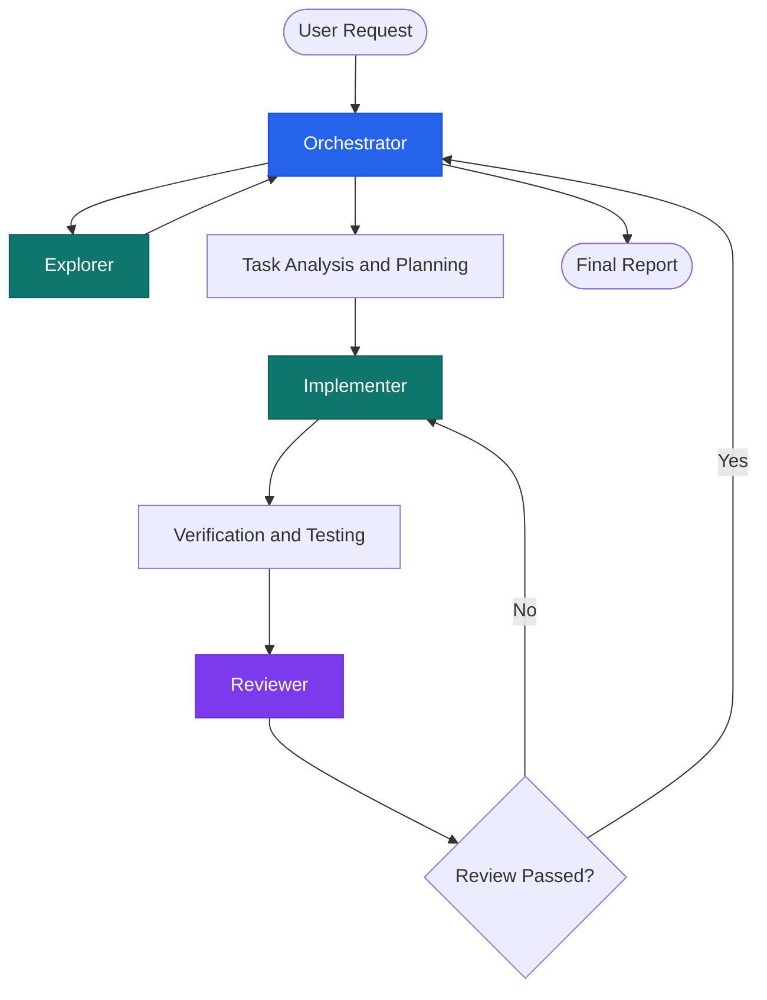
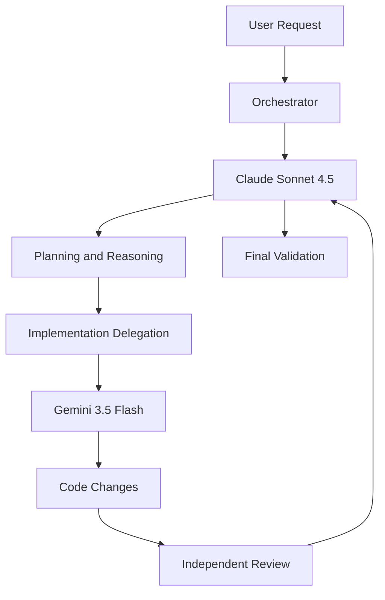
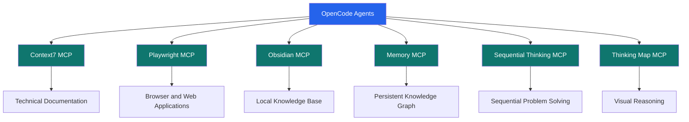
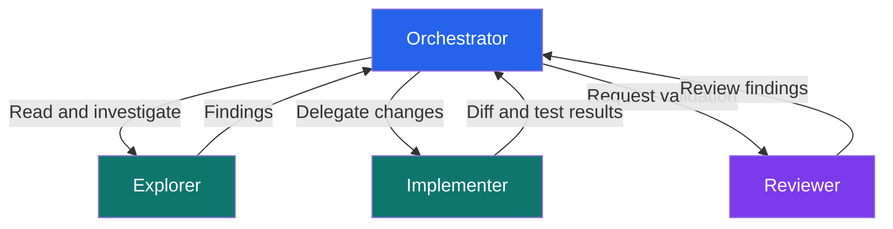
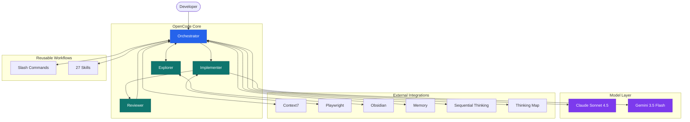

# OpenCode — Agentic Development Environment

A modular, multi-agent development environment built with **OpenCode v2.2.5**. Designed around clear separation of concerns, delegated execution, independent code review, reusable skills, and MCP integrations.

The architecture follows the core ideas of **OpenCode Fusion**: a reasoning-oriented coordinator delegates implementation to specialized execution agents, while independent reviewers validate the results.

---

## 1. Quick Start

### Requirements

- macOS, Linux, or Windows
- [OpenCode](https://opencode.ai/) v2.2.5
- Node.js (if required by your MCP servers)
- API access to configured model providers

### Configuration location

OpenCode stores its global configuration in:

```bash
~/.config/opencode/
```

### Directory overview

```text
~/.config/opencode/
├── opencode.json
├── AGENTS.md
├── agents/
├── commands/
├── skills/
├── package.json
├── package-lock.json
└── README.md
```

### Getting started

1. Install OpenCode and configure your model providers.
2. Ensure your global configuration is located in `~/.config/opencode/`.
3. Verify that your agents, commands, and skills are recognized.
4. Confirm that the configured MCP servers connect successfully.
5. Start OpenCode inside a project directory.

```bash
opencode
```

Useful commands:

```bash
# Check OpenCode version
opencode --version

# Display available models
opencode models

# Display CLI help
opencode --help
```

> **Important:** Configuration changes may require restarting OpenCode. Always validate your actual runtime configuration rather than assuming a file was loaded successfully.

---

## 2. Core Agents

The environment uses four custom agents with distinct responsibilities.

| Agent | Responsibility | Access pattern |
|---|---|---|
| `orchestrator` | Coordinates tasks, analyzes requirements, delegates work, and validates results | Primary coordinator |
| `implementer` | Executes implementation tasks, modifies files, and runs appropriate tests | Execution |
| `reviewer` | Independently reviews code, identifies defects, and reports improvements | Review |
| `explorer` | Investigates codebases, traces dependencies, and gathers technical context | Read-only exploration |

### Agent responsibilities

**Orchestrator**

The central coordinator and entry point for complex development tasks.

- Understands user requirements.
- Breaks complex tasks into manageable units.
- Explores the existing codebase before proposing changes.
- Delegates implementation to the implementer.
- Requests independent reviews.
- Evaluates test results and implementation quality.
- Reports completed work and remaining issues.

**Implementer**

The execution-focused agent.

- Implements approved requirements.
- Modifies existing files and creates new ones.
- Follows project conventions and architecture.
- Runs relevant tests and verification commands.
- Reports changed files, implementation decisions, and unresolved issues.

**Reviewer**

The independent quality-control agent.

- Reviews implementation against requirements.
- Identifies bugs, regressions, security issues, and maintainability problems.
- Checks edge cases and error handling.
- Provides actionable findings.
- Does not silently modify the implementation.

**Explorer**

The codebase investigation agent.

- Maps project structure.
- Finds relevant files and dependencies.
- Explains existing implementation patterns.
- Investigates unfamiliar APIs and libraries.
- Provides findings without modifying project files.

### Agent architecture



The orchestrator owns coordination; the implementer owns execution; the reviewer owns independent validation.

---

## 3. Slash Commands

The environment provides reusable workflows through slash commands.

| Command | Purpose | Typical use |
|---|---|---|
| `/plan` | Analyze requirements and create an implementation plan | Before complex changes |
| `/implement` | Execute an approved implementation plan | Building features |
| `/review` | Review code and identify potential issues | After implementation |
| `/debug` | Investigate and diagnose bugs | Troubleshooting |
| `/research` | Research technical subjects, documentation, and alternatives | Before adopting unfamiliar technologies |

### Recommended workflow

```text
/plan
  ↓
Review the proposed approach
  ↓
/implement
  ↓
/review
  ↓
Fix identified issues
  ↓
Verify tests and behavior
```

For debugging:

```text
/debug
  ↓
Reproduce the issue
  ↓
Identify the root cause
  ↓
Implement a targeted fix
  ↓
Run regression tests
  ↓
/review
```

For unfamiliar technologies:

```text
/research
  ↓
Consult documentation
  ↓
Compare possible approaches
  ↓
/plan
  ↓
/implement
```

Commands are workflow entry points, not replacements for agent responsibilities.

---

## 4. Model Strategy

The environment uses a two-model strategy to balance reasoning quality, implementation speed, and resource consumption.

| Model | Assigned responsibility | Primary objective |
|---|---|---|
| `claude-sonnet-4-5` | Reasoning | Planning, architectural decisions, coordination, and review |
| `gemini-3.5-flash` | Implementation | Code generation, modifications, and execution-oriented tasks |

### Reasoning model — Claude Sonnet 4.5

Used for tasks requiring deeper analysis:

- Understanding complex requirements.
- Designing implementation strategies.
- Evaluating architectural decisions.
- Identifying edge cases.
- Reviewing implementation quality.
- Coordinating multi-step tasks.

### Implementation model — Gemini 3.5 Flash

Used for execution-oriented tasks:

- Writing and modifying code.
- Implementing approved specifications.
- Refactoring existing code.
- Generating tests.
- Performing repetitive implementation work.

### Model delegation



> Model assignments describe the intended strategy. Actual model availability, tool-calling reliability, context limits, and performance depend on the configured provider.

---

## 5. MCP Integrations

Model Context Protocol (MCP) servers extend OpenCode with access to external tools and information.

The environment currently integrates three MCP servers.

| MCP Server | Purpose | Capabilities |
|---|---|---|
| Context7 | Up-to-date technical documentation | Library documentation and API references |
| Playwright | Browser automation | Navigation, interaction, and browser testing |
| Obsidian Local REST API | Personal knowledge base integration | Accessing and working with Obsidian vault content |
| Memory | Persistent knowledge graph | Store and retrieve context across sessions |
| Sequential Thinking | Structured problem solving | Break down complex problems into steps |
| Thinking Map | Visual reasoning aid | Map reasoning chains and decision trees |

### Context7

Useful for consulting current documentation instead of relying exclusively on model knowledge.

Typical use cases:

- Looking up library APIs.
- Checking framework-specific patterns.
- Understanding breaking changes.
- Finding correct usage examples.

### Playwright

Provides browser automation capabilities.

Typical use cases:

- Testing web applications.
- Interacting with browser interfaces.
- Reproducing frontend issues.
- Verifying application behavior.

### Obsidian

Connects OpenCode to a local Obsidian knowledge base.

Typical use cases:

- Searching technical notes.
- Reading project documentation.
- Maintaining development notes.
- Connecting research with implementation work.

### Memory

Provides persistent knowledge graph storage that survives across sessions.

Typical use cases:

- Remembering user preferences across conversations.
- Storing project-specific context.
- Tracking implementation decisions.
- Building organizational knowledge.

### Sequential Thinking

Breaks down complex problems into structured, sequential steps.

Typical use cases:

- Planning complex implementations.
- Breaking down ambiguous requirements.
- Debugging multi-step issues.
- Designing system architectures.

### Thinking Map

Visual thinking tool for mapping reasoning through complex problems.

Typical use cases:

- Exploring design alternatives.
- Tracing decision trees.
- Visualizing architectural tradeoffs.
- Tracking reasoning chains.

### MCP architecture



MCP integrations provide capabilities; agents decide when and how to use them.

---

## 6. Skills

Skills provide reusable knowledge, workflows, and operating procedures that agents can apply across projects.

The environment currently includes **27 available skills**.

### Development and engineering

| Skill | Purpose |
|---|---|
| `codebase-design` | Design maintainable modules and clear interfaces |
| `domain-modeling` | Model business domains and define domain concepts |
| `tdd` | Apply test-driven development |
| `diagnosing-bugs` | Investigate difficult bugs and regressions |
| `code-review` | Review changes against requirements and standards |
| `prototype` | Build disposable prototypes to validate ideas |
| `implement` | Support implementation workflows |
| `implement-spec` | Translate specifications into implementation tasks |
| `improve-codebase-architecture` | Identify architectural improvement opportunities |

### Planning and problem-solving

| Skill | Purpose |
|---|---|
| `grilling` | Challenge assumptions and stress-test decisions |
| `triage` | Classify and prioritize issues |
| `to-spec` | Convert ideas into structured specifications |
| `to-tickets` | Break work into actionable tickets |
| `to-questionnaire` | Generate structured discovery questions |
| `wayfinder` | Help navigate complex tasks and decisions |
| `handoff` | Structure task handoffs |
| `wait-what` | Clarify ambiguity and resolve misunderstandings |

### Research and documentation

| Skill | Purpose |
|---|---|
| `research` | Perform structured technical research |
| `writing-for-agents` | Write agent instructions, skills, and documentation |
| `find-skills` | Discover and install useful skills |
| `pr` | Prepare pull request descriptions |
| `report` | Generate structured reports |
| `teach` | Explain concepts and implementation details |
| `opencode` | Assist with OpenCode configuration and usage |
| `wizard` | Guide interactive setup workflows |

### Skill usage principles

- Use skills when they match the current task.
- Avoid loading unrelated skills.
- Prefer existing skills over duplicating their functionality.
- Keep skills focused and reusable.
- Verify that a skill is actually recognized before relying on it.

---

## 7. Permissions Model

The environment follows the Fusion-inspired principle of separating reasoning from execution.

The intended permission boundaries are:

| Component | Intended responsibility | Permission philosophy |
|---|---|---|
| Orchestrator | Coordinate and delegate | Minimize direct modification privileges |
| Explorer | Investigate code | Read-only |
| Implementer | Modify and test code | Controlled write and execution access |
| Reviewer | Inspect and validate changes | Read-only review |

### Separation of concerns



### Security principles

1. Give each agent only the permissions it needs.
2. Keep exploration and review separate from implementation.
3. Restrict destructive shell operations.
4. Avoid unnecessary access to credentials and secrets.
5. Review file modifications before accepting them.
6. Require explicit approval for sensitive operations where configured.
7. Do not assume a prompt instruction is equivalent to an enforced permission boundary.

**Important:** These are intended boundaries. Their actual enforcement depends on the permissions configured in `opencode.json` and the behavior supported by the installed OpenCode version. Verify effective permissions through runtime testing.

---

## 8. Files and Directory Structure

The global configuration is organized around a central configuration file and reusable agent resources.

```text
~/.config/opencode/
│
├── opencode.json
│   └── Global configuration
│       ├── Model configuration
│       ├── Agent definitions
│       ├── MCP servers
│       └── Permissions
│
├── AGENTS.md
│   └── Global agent instructions
│
├── agents/
│   ├── orchestrator.md
│   ├── implementer.md
│   ├── reviewer.md
│   └── explorer.md
│
├── commands/
│   ├── plan.md
│   ├── implement.md
│   ├── review.md
│   ├── debug.md
│   └── research.md
│
├── skills/
│   ├── grilling/
│   ├── research/
│   ├── codebase-design/
│   ├── domain-modeling/
│   ├── tdd/
│   ├── diagnosing-bugs/
│   ├── code-review/
│   └── ... additional skills
│
├── package.json
├── package-lock.json
│
└── README.md
```

*This is a logical overview of the configuration. The exact locations of skill files and additional resources may vary depending on how they were installed.*

### Important files

| File or directory | Description |
|---|---|
| `opencode.json` | Main global configuration |
| `AGENTS.md` | Shared agent instructions |
| `agents/` | Custom agent definitions |
| `commands/` | Reusable slash commands |
| `skills/` | Reusable skills |
| `package.json` | Node.js dependencies, if required |
| `README.md` | Configuration documentation |

---

## 9. Core Principles

The environment is built around ten fundamental principles.

1. **Separation of Concerns** — Each agent has a clearly defined responsibility. Avoid overlapping roles.

2. **Reasoning Before Execution** — Understand the task, inspect the codebase, and establish an implementation plan before making substantial changes.

3. **Delegation Over Monolithic Execution** — Break complex tasks into smaller, independently manageable units.

4. **Independent Code Review** — Implementation should be reviewed separately to reduce blind spots and catch defects.

5. **Least Privilege** — Give agents only the permissions necessary to perform their responsibilities.

6. **Documentation-Driven Development** — Prefer authoritative documentation and verified APIs over assumptions.

7. **Test-Driven Quality** — Validate behavior through appropriate tests rather than relying solely on generated code.

8. **Context Efficiency** — Load relevant files, skills, and documentation instead of flooding agents with unrelated information.

9. **Transparency and Auditability** — Track decisions, changed files, tool usage, and verification results.

10. **Continuous Improvement** — Refine agent instructions, skills, model assignments, and workflows based on actual results.

---

## 10. Troubleshooting

### OpenCode does not recognize a custom agent

Check:

- The agent definition exists in the expected directory.
- Its filename and frontmatter follow the supported format.
- The agent name matches the expected identifier.
- OpenCode has been restarted after configuration changes.

### Slash commands are unavailable

Check:

- The command definition exists in the commands directory.
- The filename matches the command name.
- The command uses supported frontmatter and syntax.
- The command is available in the current OpenCode session.

### MCP server fails to connect

Check:

1. Whether the MCP server process starts successfully.
2. Whether required environment variables are configured.
3. Whether API keys and authentication are valid.
4. Whether the server command and arguments are correct.
5. Whether the MCP server is compatible with the installed OpenCode version.

### Model request fails

Check:

- Provider configuration.
- Model identifier spelling.
- API credentials.
- Provider availability.
- Context and usage limits.
- Whether the selected model supports the required tools.

### Agent does not delegate work

Check:

- Whether subagent delegation is supported and enabled.
- Whether the agent has access to the required delegation tools.
- Whether the target agent name is correct.
- Whether permissions allow the requested operation.

### Permission errors

Inspect:

- Global permissions in `opencode.json`.
- Agent-specific permission overrides.
- Tool-specific restrictions.
- Whether the requested operation is intentionally blocked.

### Useful diagnostic commands

```bash
# OpenCode version
opencode --version

# Available models
opencode models

# CLI help
opencode --help

# Inspect global configuration
cat ~/.config/opencode/opencode.json

# Inspect agent definitions
ls -la ~/.config/opencode/agents/

# Inspect slash commands
ls -la ~/.config/opencode/commands/

# Inspect installed skills
ls -la ~/.config/opencode/skills/
```

---

## 11. Version History

| Version | Changes |
|---|---|
| `2.2.5` | Current OpenCode runtime baseline |
| `1.0` | Initial agentic environment structure |
| `1.1` | Added custom agents and reusable slash commands |
| `1.2` | Integrated Context7, Playwright, and Obsidian MCP servers |
| `1.3` | Integrated Context7, Playwright, and Obsidian MCP servers |
| `1.4` | Added Memory, Sequential Thinking, and Thinking Map MCP servers |
| `1.5` | Introduced Fusion-inspired separation of reasoning, execution, and review |

*The version history above describes the documented configuration milestones, not official OpenCode releases.*

---

## Architecture Summary



**The goal is simple:** build a development environment where models reason, agents collaborate, tools execute, skills provide expertise, and independent verification protects code quality.

---

**OpenCode Agentic Development Environment**  
*Think clearly. Delegate intelligently. Implement deliberately. Review independently.*