# alpha-omega — Agent Harness

## What is this? (in plain words)

Think of it as a **standard operating procedure (SOP) for an AI coding tool.**

Run `install.sh` in a project — it **references** the harness (it doesn't copy it).
When you open the project with an AI coding tool (opencode, Claude Code, Cursor,
Copilot, Gemini), the AI reads the gate and **stops improvising**. Instead of just
doing whatever you type, it follows a disciplined process: read the config →
understand your request → decompose it → plan it → ask you to approve → execute in
the right order → verify only if you asked.

**The result:** more consistent, higher-quality code, and fewer wasted tokens
(it picks the right model/tier per task, and never reads more than it needs).

**Who it's for:** developers who use AI coding tools (opencode, Claude Code, Cursor,
Copilot, Gemini) and want consistent, quality code without burning tokens.

**What it does:** turns a coding AI into a disciplined, token-efficient team that
follows a clear loop. **What it does NOT do:** it is not a model, not a framework
you code against, not a CI/CD system, and not a replacement for your project.

> Each project holds a **thin gate** (`AGENTS.md` / `.claude/CLAUDE.md` /
> `.cursor/rules/nsp-rev.mdc` / …) that reads `.alpha-omega/config.json`, then goes
> to the **harness source** (where `install.sh` ran) and follows the loop. The
> harness is **referenced, not copied**.

### TL;DR — quick setup for a new project (about 2 minutes)

```bash
cd /path/to/alpha-omega
./install.sh /path/to/my-project --dry-run     # 1. see what it WOULD add (writes nothing)
./install.sh /path/to/my-project               # 2. add it (never deletes or overwrites anything)
node scripts/doctor.js /path/to/my-project     # 3. verify, then RESTART your AI session
```

Once per machine, optionally: `node scripts/link-skills.js` makes the harness skills visible to Claude Code.

**What you get:** `.alpha-omega/config.json` (the control panel), a compiled gate digest, hooks that
enforce the config, and traceability files. **What you never lose:** every file that already exists
in the project stays byte-identical. The installer only adds (see "Add-only guarantee" below).

---

## The 3 things that make it work

1. **`config.json`** — the control panel. The AI reads this first.
2. **The instructions** (`.claude/CLAUDE.md`, `protocol.md`, `GUIDE.md`, `rules/`, `skills/`) — the process it follows.
3. **The gates** — one thin entry per AI tool that points to the generic content (no duplication, no auto-registration).

### `config.json` — the control panel (explained, dummy-level)

| Key | What it does | Example |
|-----|-------------|---------|
| `ai_org` | **which ONE AI tool to read.** Only that folder is read. | `"opencode"` |
| `language_policy` | `follow_user` = answer in the user's language. `force_config` = always use `language`. | `"follow_user"` |
| `switch.stacks` | **the active stacks** (array). Each stack's knowledge lives at `skills/<stack>/`. | `["nestjs", "react"]` |
| `switch.components` | which content folders are on (`core`, `rules`, `skills`, `evals`). | `["core","rules","skills","evals"]` |
| `switch.meta_prompting` | `true` = AI asks context once + shows a plan to approve. `false` = acts directly. | `true` |
| `switch.feature_registry` | `true` = AI tracks every task in `features.json` (status + metrics). | `true` |
| `mcp` | **MCP servers to use.** `servers` = names; `urls` = optional name to http url, so `install.sh` can register missing ones (scope local, never in the repo); `message` = what the AI must do when one is **not** connected. | `{"servers":["pulsar"],"urls":{"pulsar":"https://..."}}` |
| `blocked_files` | **file patterns the AI must NEVER read** (secrets, .env, keys). | `[".env","*.pem","*.key"]` |
| `scripts` | **which scripts the AI may run** (on/off). Sole gate — independent of `actions`. | `{"lint":true,"test":true}` |
| `budget` | token caps. `tier_tokens` = per-task cap by tier; `session_tokens` = optional session cap (`null` = none). The harness cannot count tokens: report only what the tool shows. | `{"session_tokens":null}` |
| `actions` | **what the AI may do**, by power (git, files, execution, network, deploy). `true`/`false`. A hook enforces it. | `{"power_git":{"commit":false}}` |
| `writable_paths` | folders OUTSIDE the project the AI may write without asking (anything else outside asks). The OS temp dir and the AI tool's memory folder are always allowed. | `["/path/to/alpha-omega"]` |
| `gate` | `enforce` (hooks on/off) · `approval.required_for` (`mutating` \| `always` \| `never`) and `approval.scope` (`plan` \| `prompt`) · `protected_paths` (never deleted, moved or overwritten) · `consolidate_on_stop` · `remind_each_prompt`. | `{"approval":{"required_for":"mutating","scope":"plan"}}` |
| `templates` | `files` = harness reference files that are read-only for everyone (copy a spec to a new file instead). | `{"files":["specs/TEMPLATE.md"]}` |

**The three most important for control:** `blocked_files` (secrets it must never read), `actions` (what it's
allowed to do) and `gate` (how much approval, and which project files are untouchable). A hook enforces them;
see "What the hooks enforce, key by key".

**Multiple stacks & skills (your point 5) — it's simple:**
A skill's stack is just **the folder it lives in** (`skills/<stack>/`). To use a
frontend + a backend stack, list both:

```json
"switch": { "stacks": ["nestjs", "react"] }
```
- `skills/nestjs/` → the backend stack (its skills).
- `skills/react/` → the frontend stack (its skills).

Each skill belongs to a stack by being inside that stack's folder. That's it.

---

## What happens on the first prompt

### Do you need to do something before? **Just install + configure.** Everything else the AI does itself.

```mermaid
flowchart TD
    subgraph ACTIVATION["① ACTIVATION — the 2 human steps"]
        direction TB
        A1[1 · Install the harness into the project<br/>./install.sh /path/to/project] --> A2[2 · Edit config.json<br/>set the knobs: ai_org · switch.* · mcp · blocked_files · scripts · actions]
    end
    subgraph PROMPT["② THE FIRST PROMPT — the AI runs this. Each step is governed by a config key (shown in [brackets])"]
        direction TB
        P0[User writes a prompt] --> P1["Read config.json FIRST<br/>[ai_org] which folder to read"]
        P1 --> P1b["Check blocked_files<br/>[blocked_files] NEVER read those files"]
        P1b --> P1c["Check mcp<br/>[mcp] which servers to use"]
        P1c --> P2["Read the gate entry (CLAUDE.md / AGENTS.md)<br/>[switch.components] then your adapter state"]
        P2 --> P2b{adapter state exists?}
        P2b -->|no| P2c[AI CREATES its adapter state<br/>from memory/ templates — by itself]
        P2b -->|yes| P3{"[switch.meta_prompting]?"}
        P2c --> P3
        P3 -->|yes| P4[Normalize to META-PROMPT<br/>ask context once if empty]
        P3 -->|no| P5[Operate directly]
        P4 --> P6[Decompose into sub-acts<br/>multi-intent: 1 prompt = several questions]
        P5 --> P6
        P6 --> P7[Route each sub-act<br/>ROUTING.md §11 synapse<br/>complexity+intent → neuron → tier T1-T4]
        P7 --> P8["Check budget<br/>[budget] Σ budget_i ≤ session_tokens"]
        P8 --> P9["Load active stack knowledge<br/>[switch.stacks] skills/stack/ just-in-time"]
        P9 --> P10[Plan + APPROVAL GATE]
        P10 -->|A Approve| P11["Execute T1→T4, cheap first<br/>[actions] only what's allowed"]
        P10 -->|C Change| P9
        P10 -->|X Cancel| P14[Cancel]
        P11 --> P12["Verify ONLY if you asked<br/>[scripts] or a script is enabled"]
        P12 --> P13[Reinforce<br/>write routes.jsonl]
        P13 --> P14[Consolidate<br/>your adapter state]
        P14 --> P14b{"[switch.feature_registry] on?"}
        P14b -->|yes| P14c["Update features.json<br/>[switch.feature_registry] status + metrics"]
        P14b -->|no| P15[Deliver result + evidence]
        P14c --> P15
    end
    A2 --> P0
```



**Which config key governs each step?**

| Config key | Governs | Where in the flow |
|-----------|---------|-------------------|
| `ai_org` | which gate is read (opencode→`AGENTS.md`, claude→`.claude/CLAUDE.md`, etc.) | P1 — reading config |
| `switch.stacks` | which stacks are active → `skills/<stack>/` | P9 — loading knowledge |
| `switch.components` | which content folders are on (`core`/`rules`/`skills`/`evals`) | P2 — what's available to read |
| `switch.meta_prompting` | ask context once + show a plan to approve, or act directly | P3/P4 — the meta-prompt gate |
| `switch.feature_registry` | track every task in `features.json` | P14b/P14c — consolidate |
| `mcp` | which MCP servers to use | P1c — before reading files |
| `blocked_files` | files the AI must NEVER read | P1b — before reading files |
| `scripts` | which scripts the AI may run (lint/test/build…) | P12 — verify step |
| `budget` | token limits per session | P8 — budget check |
| `actions` | what the AI may do, by power (git/files/execution/network/deploy) | P11 — execute (and everywhere it acts) |

**Key points:**
- **You only do 2 things before** (install + edit config). No manual state setup.
- **The AI self-initializes**: if its adapter state is missing, the AI creates it
  (from the `memory/` templates — the format) so it can keep control over time.
- **Verification is on-demand** (your point 6): lint/tests run only when **you ask**
  or when the script is **enabled** in `config.json → scripts`.
- **Once configured, it's on from the first read of `config.json`** — no mid-session activation.

---

## The map (where everything is)

| Need | File |
|------|------|
| The law (loop, tiers, contracts) | `protocol.md` |
| The agent manual (how to operate, what NOT to do) | `GUIDE.md` |
| Master entry (the model reads this first) | `.claude/CLAUDE.md` |
| The control panel (ai_org, stacks, scripts, actions) | `config.json` |
| Routing (single source: situation → agent + complexity → tier) | `ROUTING.md` |
| Action control by powers | `actions.md` |
| State — **the live one, written by the AI** | your adapter folder (e.g. `.claude/memory/STATE.md`) |
| State — **the template, never written** | `<harness>/memory/STATE.md` |
| Generic agent roster (all adapters) | `agents/` |
| Generic rules (never omit) | `rules/` |
| Generic commands (what you can run) | `commands/` |
| Universal skills | `skills/<name>/` |
| **Active stack knowledge** (`skills/<stack>/` per stack) | `skills/nestjs/` |
| The pattern linter (deterministic quality gate) | `scripts/lint-patterns.js` |
| Honest pheromone + budget allocation | `scripts/routes.js` · `scripts/budget.js` |
| The gates — **one thin entry per tool** (points to generic, no auto-registration) | `AGENTS.md` (opencode) · `.claude/CLAUDE.md` (claude) · `.cursor/rules/nsp-rev.mdc` · `.github/copilot-instructions.md` · `.gemini/GEMINI.md` |

> **Gates are thin, not copies.** The generic content (agents, rules, commands,
> skills, neurons, config) lives at the root and is loaded **just-in-time**. Each
> gate is ONE file that reads `config.json` and points to the generic content.
> Nothing is auto-registered, so there is no token leakage.

---

## Feature tracking (when features.json / features.schema.json activate)

These two files are **one feature tracker** (NOT "for Anthropic" or "for GPT" — they
work together as data + schema):

- **`features.json`** — the state of your features (id, status, tier, tokens, score, time).
- **`features.schema.json`** — the contract that validates `features.json` (JSON Schema).
- `scripts/features.js` validates the data against the schema.

**When do they activate?** Only when `config.json → switch.feature_registry` is `true`
(default). When on, **every task** the AI does registers/updates a feature entry and
moves it through its lifecycle:

```
proposed → planned → in_progress → blocked → done | rejected
```

It records real metrics per feature (time_actual_ms, tokens_actual, score, retries).
**If you don't want feature tracking**, set `switch.feature_registry: false` (and you can
delete `features.json` + `features.schema.json`).

---

## Setup (do this once per project)

> The `config.json` inside the alpha-omega folder holds the **defaults** every new project starts from.
> Usually you do NOT edit it: install first, then tune `<project>/.alpha-omega/config.json`
> (or pass `--blocked`, `--writable`, `--ai-org` to the installer). Edit the harness default only when you
> want every future project to start that way.

### Step 0 — Decide (about 5 minutes)

| Decide | Key in `<project>/.alpha-omega/config.json` | Default | Ask yourself |
|---|---|---|---|
| Which AI tool | `ai_org` | `claude` | opencode, claude, cursor, copilot or gemini. Hooks are installed for `claude` only. |
| Stack knowledge | `switch.stacks` | `["nestjs"]` | which `skills/<stack>/` folders apply (only `nestjs` exists today) |
| Required MCP servers | `mcp.servers` + `mcp.urls` | none | name and http url; the installer registers them (scope local) |
| Files it must never read | `blocked_files` | `.env`, keys, certs | add the project's generated secret files |
| Folders outside the project it may write | `writable_paths` | none | e.g. the harness folder if you maintain skills |
| May it commit, push, delete, use the network, deploy? | `actions.*` | all `false` | flip only what you accept; a denial tells the AI which key to ask you about |
| How much approval | `gate.approval.required_for` | `mutating` | `mutating`, `always` or `never` |
| Files it must never overwrite | `gate.protected_paths` | `AGENTS.md`, `CLAUDE.md`, `.gitignore`, settings, `package.json`, lockfiles | add your own |

### Step 1 — Install into a project (references the harness, never copies or replaces anything)

```bash
cd /path/to/alpha-omega
./install.sh /path/to/my-project --dry-run    # plan only
./install.sh /path/to/my-project              # apply
```

It adds, only where the path does not exist yet:
- `.alpha-omega/config.json` (copy of step 0), `.alpha-omega/GATE.md` (compiled digest), `.alpha-omega/manifest.json`.
- `<ai_org>/memory/*`, `features.json`, `routes.jsonl`: the project's traceability.
- The gate: `.claude/CLAUDE.md` for Claude (a NEW file; Claude reads it next to your root `CLAUDE.md`).
- Claude Code hooks in `.claude/settings.json` (or `settings.local.json`), whichever is not tracked by git. If both are tracked it prints the snippet and writes nothing.
- Local git excludes in `.git/info/exclude`. `.gitignore` is never edited.

Flags: `--upgrade` refresh what alpha-omega wrote (new default config keys are added, your values are kept) ·
`--enhance` append the alpha-omega block at the END of an existing gate file such as `AGENTS.md` (backup kept) ·
`--no-hooks` · `--no-mcp` · `--link-skills` · `--ai-org=<x>` · `--blocked=a,b` · `--writable=p1,p2`.

### Step 2 — Open the project with your AI tool

Open `my-project` with opencode / Claude Code / Cursor / etc. It **auto-reads the
gate** (`AGENTS.md` / `CLAUDE.md` / `.cursor/rules/nsp-rev.mdc`) — you don't invoke
the harness manually. The gate points to `.alpha-omega/config.json` and the source
harness, and the AI follows the loop.

### Step 3 — Write your first task

> *"Add a GET /users/:id endpoint. EDD: spec, implement, evaluate."*

The harness decomposes → routes → plans (asks you to approve `[A/C/X]`) → executes →
verifies → consolidates.

### Step 4 — Verify it worked

```bash
node scripts/doctor.js /path/to/my-project     # config, gate block, hooks, digest, git safety, manifest
node scripts/gate-selftest.js                  # 107 checks of the enforcement hook
node scripts/install-selftest.js               # 27 checks that the installer is add-only
```

Then restart the AI session: the gate and the hooks load at session start. The first message of the session
should begin with `# alpha-omega gate`; if it does not, run `node scripts/compile-gate.js <project>` and read it.

### A repo that already has `AGENTS.md` or `CLAUDE.md` (tracked in git)

This is the normal case, and it is safe by default:

1. `./install.sh /path/to/repo --dry-run` shows the plan. Nothing tracked is touched: the gate is a NEW file
   (`.claude/CLAUDE.md`), hooks go to an untracked `settings.json`, and ignores go to `.git/info/exclude`.
2. `git status` stays clean after installing. Your `AGENTS.md` is surfaced in the digest (its section outline) and protected at run time.
3. Optional: `node scripts/agents-md.js audit /path/to/repo` reviews it; `suggest` writes proposals to a new file.
4. Only if you WANT the alpha-omega block inside `AGENTS.md`: `./install.sh /path/to/repo --enhance`. It is appended at the end and a backup is kept.

### Upgrading an older install, uninstalling, and false alarms

- **Upgrade:** `./install.sh /path/to/project --upgrade` refreshes the block, the digest and the hooks, and adds new default config keys (your values are kept). Add `--enhance` if an old unmarked gate sits in a file that also has your own text.
- **Uninstall:** `node scripts/uninstall.js /path/to/project` prints a plan; add `--yes` to apply. It removes only what was recorded and unchanged.
- **A hook denied something legitimate:** it is the config speaking. Look at `<project>/.alpha-omega/gate.log` (tool and reason), then flip the key, add the folder to `writable_paths`, or narrow the command (for example `--exclude=secrets.ts` on a recursive grep).
- **Changing the hook itself:** develop in a copy, run `node scripts/gate-selftest.js` against it (`AO_HOOK=<copy>`), and replace the real file only when everything passes, because a broken hook blocks every tool call.

---

## How the flow works (the mental model)

```
1. Read .alpha-omega/config.json       ← this project's control panel
2. Go to the harness (source)          ← the pwd where install.sh ran
3. Execute the rules it declares       ← loop, routing, agents, skills
4. Deliver in the project
5. Leave traceability in <ai_org>/memory/
```

> The harness is **referenced, not copied**: it lives in one place and each project holds a thin pointer.
> An existing gate file such as `AGENTS.md` is the project's own and is left alone; with `--enhance` the
> block is APPENDED at the end (backup kept). Nothing is ever prepended, deleted or overwritten.

---

## Enforcement (hooks) and the compiled digest

Instructions alone get skipped, so `install.sh` also wires five Claude Code hooks into
`<project>/.claude/settings.json` (ai_org=claude). They do nothing in projects without
`.alpha-omega/config.json`.

| Hook | Script | What it does |
|---|---|---|
| `SessionStart` | `scripts/gate-hook.js SessionStart` | prints the compiled digest (about 40 lines, from `config.json`) as context, instead of reading 5-6 files per prompt |
| `UserPromptSubmit` | `scripts/gate-hook.js UserPromptSubmit` | one-line reminder (from `gate.approval`): plan + `[A]/[C]/[X]` for tasks that change something, declare skipped stepss, consolidate |
| `PreToolUse` | `scripts/gate-hook.js PreToolUse` | enforces `actions`, `blocked_files`, `scripts`, `writable_paths` and `protected_paths`: allow (silent), `ask` (writes outside the project, edits to protected files) or `deny` |
| `PostToolUse` | `scripts/gate-hook.js PostToolUse` | records the file changes that really happened (file tools, and Bash commands that write), so the Stop check is not fooled by denied or simulated calls |
| `Stop` | `scripts/gate-hook.js Stop` | blocks the stop ONCE when files changed and `STATE.md`, `routes.jsonl` or `features.json` were not updated afterwards, so consolidation is not forgotten |

- Best effort: it reads the command text. It is a guard rail, not a sandbox. `scripts/lib/bash-guard.js`
  reads a command the way a shell does: quotes, heredocs, `$(...)`, `sh -c`, `eval`, `xargs`, `find -exec`,
  globs and braces, and the inline code of `node -e` / `python -c` (network APIs, deletes, writes, and git
  commands when the code can also start processes).
- Denials and asks are logged to `<project>/.alpha-omega/gate.log` (tool and reason, never the command).
- `config.json -> gate.enforce: false` turns the PreToolUse enforcement off; `writable_paths` lists
  outside folders that may be written without asking.
- `node scripts/compile-gate.js <project> [--write]` prints or saves the digest (`.alpha-omega/GATE.md`).
- `node scripts/gate-selftest.js` runs 107 checks against a throwaway project. Run it after changing the hook.
- Hooks load at session start: restart the session after installing.

**Deviation rule:** if the AI skips, merges or reorders a step it says so in one line
(`Harness: skipped <step> because <reason>`). Declared is allowed, silent is a violation.

### What the hooks enforce, key by key (config.json)

| Key | Status | How |
|---|---|---|
| `blocked_files` | enforced | file tools; Bash tokens, globs, braces, `$(...)`, `sh -c`; recursive `grep -r` / `rg` / the Grep tool (honouring `--exclude`, `-g '!x'`); strings inside inline code |
| `power_git` and `vcs_write` | enforced | commit, push, branch create and switch, reset --hard, clean, `git rm`; also through `sh -c`, `eval`, `xargs`, inline code |
| `power_files` read, write, edit, delete | enforced | tools and Bash readers, writers and deleters |
| `power_execution` run_tests, build, install_dependencies | enforced | by command name (`npm`, `pnpm`, `yarn`, `nx`, `jest`, `vitest`) |
| `power_execution` mutating_fs, network_egress, denylist | enforced | by command and by inline-code APIs (urllib, requests, fetch, sockets, unlink, rmtree) |
| `power_execution` db_write | enforced for known clients | `psql`, `mysql`, `mongosh`, `redis-cli`, `sqlite3`... and migration tools; a statement read from a file or interactively asks |
| `power_network` | enforced | the WebFetch and WebSearch tools |
| `power_deploy` | enforced by command | `vercel`, `netlify`, `kubectl`, `helm`, `terraform`, `docker push`, `npm publish`, `deploy` scripts...; an unknown environment is treated as production |
| `scripts.<name>` | enforced | `node scripts/<name>.js` |
| `writable_paths` | enforced for tools and Bash writers | `cp`, `mv`, `tee`, `mkdir`, `touch`, redirects; not for arbitrary code |
| `templates.files` | enforced | the harness templates are read-only for every writer |
| `gate.protected_paths` | enforced | never deleted, moved, truncated or overwritten; edits ask |
| `gate.consolidate_on_stop` | enforced | blocks the stop once until STATE, routes and features are updated |
| `mcp.servers` | checked at session start only | warns if a server is not registered; it does not check the connection |
| `gate.approval` ([A]/[C]/[X]) | **instruction only** | a hook cannot know that the user approved; it only reminds |
| `switch.meta_prompting`, `metrics`, `stacks`, `components`, `neurons`, `language_policy`, `budget.*` | **instruction only** | surfaced in the compiled digest |

Known limits: a script FILE run by an interpreter (`python script.py`) is not read; shell variables are not
evaluated; deliberately obfuscated commands can slip through. The guard stops honest mistakes and shortcuts,
it is not a security boundary. The bypasses found in the audit are covered by cases in `scripts/gate-selftest.js`.

## Quality gate (on demand)

`scripts/lint-patterns.js` checks real code against `rules/coding.md`:
`file-too-long` · `console-log` · `long-function` · `too-many-params` ·
`controller-repo` · `query-returns-entity` · `vo-not-frozen`.

It's deterministic (~0 tokens) and exits `1` on violations. Run it **only when you
ask**: `node scripts/lint-patterns.js` or `/lint`. It only runs if
`config.json → scripts.lint` is `true`.

---

## Actions (powers)

`config.json → actions` controls what the AI may do. `true` = allowed, `false` = forbidden.

```
power_git:         create_branch ✓  switch_branch ✓  commit ✗  push ✗
power_files:       read ✓  write ✓  edit ✓  delete ✗
power_execution:   read_only_search ✓  tests ✓  build ✓  install ✓
                   mutating_fs ✗  network_egress ✗  db_write ✗  vcs_write ✗
power_network:     fetch ✗  web_search ✗
power_deploy:      staging ✗  production ✗  rollback ✗
```

**Golden rule:** the CONFIG rules. If an action is `false`, the AI does not do it.

### Powers are grouped by EFFECT, not by tool

`bash: true|false` used to be one switch for two very different things: *looking at
your code* and *destroying it*. Turning it off to prevent `rm -rf` also blocked
`grep`, which made the harness unusable and — predictably — got ignored. So it split:

| Power | Covers | Default |
|---|---|---|
| `read_only_search` | `grep` `glob` `find` `ls` `cat` `head` `wc` `jq` | ✓ allowed |
| `run_tests` / `build` / `install_dependencies` | project tooling | ✓ allowed |
| `mutating_fs` | `rm` `mv` `dd` `truncate` `chmod -R` | ✗ |
| `network_egress` | `curl` `wget` `nc` `scp` `ssh` | ✗ |
| `db_write` | `DROP` `TRUNCATE` `DELETE FROM` | ✗ |
| `vcs_write` | `commit` `push` `reset --hard` `clean` | ✗ |

Plus a `denylist` that is refused **regardless of any power above**, even if you ask.

> **`read_only_search` never overrides `blocked_files`.** A search is harmless
> until you point it at a secret: `grep KEY .env` exfiltrates exactly as much as
> `cat .env`. Search freely — never at a blocked path.

### Scripts are not shell access

`node scripts/<name>.js` is gated by `scripts.<name>` **and nothing else**. These are
deterministic (~0 tokens, fixed output), so they are never subject to
`power_execution` — a locked-down execution power does not disable them.

**Invariant:** `switch.metrics: true` ⇒ `scripts.metrics: true` (same for
`feature_registry`/`features`). Breaking it is a config error the AI must report,
not silently skip.

---

## Add-only guarantee (the harness enhances a project, it never replaces it)

1. **The installer only adds.** Existing files are skipped and reported, never overwritten or deleted.
   The only edits to existing files need an explicit flag, keep a byte-identical backup under
   `.alpha-omega/backup/<timestamp>/`, and are recorded in `.alpha-omega/manifest.json`.
2. **`AGENTS.md` is the project's own.** It is never replaced. `--enhance` appends a small block at
   the end. The compiled digest lists its section outline so the AI reads and follows it, and
   `node scripts/agents-md.js audit .` reviews it (read-only) while `suggest .` writes proposals to a NEW file.
3. **At run time the hook protects it too.** `gate.protected_paths` (default `AGENTS.md`, `CLAUDE.md`, `.gitignore`,
   settings files, `package.json`, lockfiles) can not be deleted, moved, truncated or overwritten (`Write` is denied,
   `Edit` asks for approval).
4. **Reversible.** `node scripts/uninstall.js <project>` prints a plan; with `--yes` it removes only what the
   manifest recorded and only if unchanged, and strips only its own block. Your files stay byte-identical.
5. **Proven by tests.** `scripts/install-selftest.js` snapshots a project, installs, re-installs, enhances,
   upgrades an old duplicated gate and uninstalls, and checks every original file is intact each time.

## Other tools

| Script | Purpose |
|---|---|
| `scripts/install.js` (`install.sh`) | add-only installer, `--dry-run` first |
| `scripts/doctor.js <project>` | verify an installation (`--mcp` also contacts MCP servers) |
| `scripts/compile-gate.js <project>` | print or `--write` the gate digest |
| `scripts/agents-md.js audit\|suggest` | review the project's `AGENTS.md`, never edit it |
| `scripts/link-skills.js` | symlink harness skills into `~/.claude/skills` (once per machine) |
| `scripts/setup-mcp.js` | used by the installer: registers `mcp.servers` listed with a url in `mcp.urls` |
| `scripts/uninstall.js <project>` | reverse an install safely |
