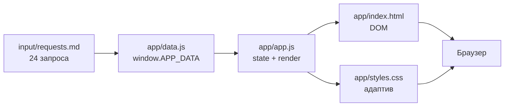
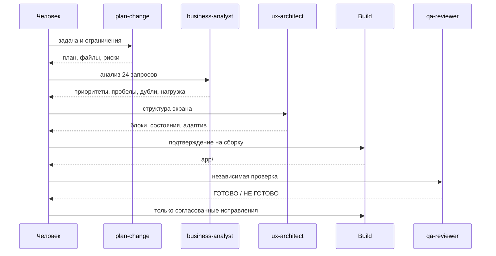

[](https://github.com/elstar883/operations-dashboard/actions/workflows/tests.yml)
[](LICENSE)
[](app/index.html)
[](app/styles.css)
[](app/app.js)
[](package.json)
[](AGENTS.md)

# Operations Dashboard — диспетчер входящих задач

Статический командный центр координатора, который превращает 24 входящих
запроса из пяти каналов в понятную картину дня: что горит сегодня, где не
хватает данных, кто перегружен, какие запросы могут быть дублями и какую
сводку отправить руководителю.

Приложение работает без сервера, сборки, фреймворков и сетевых запросов:
достаточно открыть `app/index.html`.


---

## Содержание

- [Проблема](#проблема)
- [Что умеет приложение](#что-умеет-приложение)
- [Быстрый старт](#быстрый-старт)
- [Скриншоты](#скриншоты)
- [Как это устроено](#как-это-устроено)
- [Данные](#данные)
- [Мультиагентный workflow OpenCode](#мультиагентный-workflow-opencode)
- [Проверки и CI](#проверки-и-ci)
- [Структура проекта](#структура-проекта)
- [Стек](#стек)
- [Доступность и адаптивность](#доступность-и-адаптивность)
- [Ограничения](#ограничения)
- [Дорожная карта](#дорожная-карта)
- [Лицензия](#лицензия)

---

## Проблема

Координатор получает запросы из почты, рабочего чата, встреч, формы внутренних
запросов и поручений руководителя. К ежедневной планёрке нужно быстро понять:

- какие задачи действительно срочные;
- где не указан ответственный или срок;
- кто перегружен;
- какие записи похожи на дубли;
- что происходит в конкретном проекте;
- что коротко рассказать руководителю.

Ручная сводка из прошлого урока покрывала только первые пять запросов и быстро
устарела. Этот проект заменяет её полноценным статическим дашбордом для всех
24 записей.

**Решение:** один экран с показателями, фокусом дня, поиском, фильтрами,
таблицей, нагрузкой, гипотезами о дублях и готовой сводкой для планёрки.

## Что умеет приложение

### Показатели дня

Четыре KPI-карточки: всего запросов, высокий приоритет, проблемы данных и
возможные группы дублей. Каждая карточка кликабельна и применяет
соответствующий фильтр или прокручивает к блоку дублей.

### Фокус дня

Срочные задачи на сегодня и завтра, отсортированные по времени. Записи без
ответственного поднимаются выше. Блок не зависит от фильтров, чтобы срочное не
исчезало при сужении таблицы. По умолчанию видны пять карточек, остальные
раскрываются кнопкой.

### Поиск и фильтры

- поиск по номеру, тексту, проекту, источнику, ответственному и причине
  приоритета;
- фильтры по источнику, проекту, приоритету и полноте данных;
- счётчик «Показано N из 24»;
- активные условия в виде чипов с удалением по одному;
- сброс всех фильтров;
- пустое состояние с объяснением и кнопкой сброса.

### Таблица запросов

Все 24 записи с исходными номерами `01`–`24`, источником, проектом, сроком,
ответственным, приоритетом и причиной приоритета. Отсутствующие данные явно
помечены «требует уточнения». На узком экране таблица превращается в карточки.

### Нагрузка по исполнителям

Количество записей и высоких приоритетов по каждому ответственному, отдельная
строка «Не назначено» и пояснение, кто перегружен.

### Возможные дубли

Пять групп-гипотез: что именно похоже, почему это только предположение, кого
ещё стоит проверить и какие вопросы задать человеку. Записи не объединяются
автоматически.

### Сводка для планёрки

Готовый текст с приоритетами, задачами на сегодня и завтра, пробелами в данных,
нагрузкой, дублями и решениями для планёрки. Копируется одной кнопкой, с
fallback для браузеров без Clipboard API.

### Автономность

- нет backend, базы данных и API;
- нет внешних библиотек, шрифтов и картинок;
- нет сетевых запросов и аналитики;
- приложение открывается офлайн;
- данные лежат в одном читаемом файле `app/data.js`.

## Быстрый старт

Нужен только современный браузер. Python или Node.js понадобятся лишь для
локального сервера и проверок.

```bash
git clone https://github.com/elstar883/operations-dashboard.git
cd operations-dashboard

make serve
# или:
python3 -m http.server 8080 --directory app
```

Откройте <http://127.0.0.1:8080>.

Можно и без сервера — откройте `app/index.html` двойным щелчком. Приложению не
нужны сеть, сборка или установка зависимостей.

### Проверка данных и кода

```bash
make check
# или:
node scripts/validate.mjs
node --check app/data.js
node --check app/app.js
```

Скрипт сверяет `app/data.js` с `input/requests.md`, проверяет инварианты набора,
обязательные элементы интерфейса и отсутствие внешних ресурсов.

## Скриншоты

| Десктоп | Мобильная версия |
|---|---|
|  |  |

Полные страницы: [desktop 1440 px](docs/images/dashboard-desktop.png) ·
[mobile 390 px](docs/images/dashboard-mobile.png).

## Как это устроено



1. `app/data.js` создаёт `window.APP_DATA` — снимок запросов, источников,
   проектов и групп дублей.
2. `app/app.js` проверяет данные, строит фильтры, навешивает обработчики и
   вызывает общий `render()`.
3. `render()` пересчитывает KPI, таблицу, активные условия, фокус, нагрузку,
   дубли и сводку.
4. Фильтры меняют объект `state` и перерисовывают только зависимые блоки.
5. «Фокус дня», нагрузка, дубли и сводка всегда считаются из полного набора.

Подробнее — в [docs/ARCHITECTURE.md](docs/ARCHITECTURE.md).

### Почему без фреймворка

Задача небольшая и полностью клиентская. Vanilla JavaScript позволяет показать
работу с DOM, состоянием, доступностью и адаптивом без лишнего слоя. Нет
зависимостей — нет обновлений, уязвимостей и сюрпризов при запуске. Node.js
используется только для проверки данных и CI.

## Данные

- **24 запроса** с номерами `01`–`24`;
- **5 источников:** почта, рабочий чат, встреча, форма внутренних запросов,
  поручение руководителя;
- **11 проектов:** от «Орион» и весенней рекламной кампании до переезда в CRM и
  HR-документов.

| Показатель | Значение |
|---|---:|
| Всего запросов | 24 |
| Высокий приоритет | 11 |
| Средний приоритет | 9 |
| Низкий приоритет | 1 |
| Приоритет требует уточнения | 3 |
| Пробелы в данных | 11 |
| Без ответственного | 7 |
| Без срока | 4 |
| Неточный срок | 9 |
| Группы возможных дублей | 5 |
| Записей в группах дублей | 12 |

`input/requests.md` — неизменяемый источник. `app/data.js` содержит те же
тексты, сроки и ответственных; расхождения ловит `scripts/validate.mjs`.
Сроки хранятся как в исходнике («сегодня», «завтра», «до среды») и не
переводятся в абсолютные даты, чтобы не искажать данные.

Возможные дубли — только предположения. Приложение объясняет, что похоже, чего
не хватает для вывода и что спросить у человека. Ни одна запись не объединена и
не удалена.

Подробнее — в [docs/DATA-MODEL.md](docs/DATA-MODEL.md).

## Мультиагентный workflow OpenCode

Проект собран не «одним промптом», а воспроизводимым процессом с разделением
ролей:



- **`business-analyst`** — читает данные, считает приоритеты, пропуски, дубли и
  нагрузку; не меняет файлы.
- **`ux-architect`** — проектирует экран, состояния и адаптив; не пишет код.
- **`qa-reviewer`** — независимо сверяет приложение с `AGENTS.md`; ничего не
  исправляет.
- **Build** — единственный, кто меняет `app/`, и только после разрешения
  человека.

Команды:

- `/plan-change` — план до правок;
- `/ready-check` — проверка готовности без исправлений.

Методика описана в
[`.opencode/skills/operations-dashboard/SKILL.md`](.opencode/skills/operations-dashboard/SKILL.md),
правила проекта — в [`AGENTS.md`](AGENTS.md).

## Проверки и CI

```bash
make check
```

`scripts/validate.mjs` проверяет:

- наличие обязательных файлов;
- ровно 24 запроса и порядок `01`–`24`;
- совпадение данных с `input/requests.md`;
- допустимые приоритеты и типы сроков;
- производные показатели и группы дублей;
- обязательные элементы интерфейса;
- отсутствие внешних ресурсов, `fetch`, `XMLHttpRequest` и динамических
  импортов;
- синтаксис `app/data.js` и `app/app.js`.

GitHub Actions прогоняет те же проверки на Node.js 18, 20 и 22 при push в
`main`/`develop` и на pull request.

Ручной сценарий — в [docs/QA-CHECKLIST.md](docs/QA-CHECKLIST.md).

## Структура проекта

```text
operations-dashboard/
├── app/                          # статическое приложение
│   ├── index.html                # разметка и контейнеры блоков
│   ├── styles.css                # оформление, адаптив, печать
│   ├── data.js                   # 24 запроса, источники, проекты, дубли
│   └── app.js                    # состояние, фильтры, расчёты, рендер
├── input/
│   └── requests.md               # исходные 24 запроса (только чтение)
├── docs/
│   ├── ARCHITECTURE.md           # архитектура и поток данных
│   ├── DATA-MODEL.md             # модель данных и инварианты
│   ├── QA-CHECKLIST.md           # ручная и автоматическая проверка
│   ├── TASK-BOARD-LESSON-4.md    # историческая сводка урока 4
│   └── images/                   # скриншоты desktop и mobile
├── .opencode/
│   ├── agents/                   # business-analyst, ux-architect, qa-reviewer
│   ├── commands/                 # plan-change, ready-check
│   └── skills/
│       └── operations-dashboard/
│           └── SKILL.md          # методика сборки дашборда
├── scripts/
│   └── validate.mjs              # проверка данных и ограничений
├── .github/workflows/tests.yml   # CI
├── AGENTS.md                     # правила проекта
├── CONTRIBUTING.md               # ветки, коммиты, PR-процесс
├── LICENSE                       # MIT
├── Makefile                      # make check / make serve
├── package.json                  # только скрипты, без зависимостей
├── opencode.json                 # разрешения OpenCode
└── README.md
```

## Стек

- **HTML5** — семантическая разметка, таблица, `details/summary`;
- **CSS3** — custom properties, Grid, Flexbox, медиазапросы, `prefers-reduced-motion`;
- **Vanilla JavaScript** — IIFE, состояние, DOM API, Clipboard API с fallback;
- **Node.js 18+** — только для `scripts/validate.mjs` и CI;
- **GitHub Actions** — матрица Node.js 18/20/22;
- **OpenCode** — субагенты, slash-команды и Skill.

Без фреймворков, сборщиков, пакетов и runtime-зависимостей.

## Доступность и адаптивность

- семантические ориентиры `header`, `main`, `section`, `footer`;
- skip-link «Перейти к списку запросов»;
- `aria-live` для счётчика результатов и статуса копирования;
- `aria-pressed` для чипов-фильтров;
- подписи полей и скрытые заголовки;
- видимый фокус и полная работа с клавиатуры;
- `prefers-reduced-motion` отключает плавную прокрутку;
- таблица превращается в карточки на ширине 760 px и меньше;
- проверено на 1440 px и 390 px.

## Ограничения

- данные — статический снимок, а не подключение к рабочим системам;
- нет авторизации, ролей и многопользовательской работы;
- фильтры не сохраняются в URL и не переживают перезагрузку;
- «сегодня» и «завтра» не переводятся в абсолютные даты;
- дубли не объединяются автоматически — это осознанное ограничение;
- копирование зависит от разрешений браузера, предусмотрен fallback;
- приложение не отправляет данные и не собирает аналитику.

## Дорожная карта

- [ ] сохранять фильтры в URL hash;
- [ ] добавить импорт JSON/CSV на клиенте;
- [ ] сделать печатную версию сводки;
- [ ] добавить срез по срокам и проектам;
- [ ] покрыть рендер тестами в jsdom или Playwright;
- [ ] добавить GitHub Pages для живого демо;
- [ ] подготовить английскую версию интерфейса.

## Лицензия

Проект распространяется по лицензии [MIT](LICENSE).

## Автор

**Elsa** — [@elstar883](https://github.com/elstar883)

Проект собран как портфолио-кейс: от анализа входящих запросов и проектирования
экрана до статического приложения, автоматических проверок, CI и независимой
QA-проверки.
