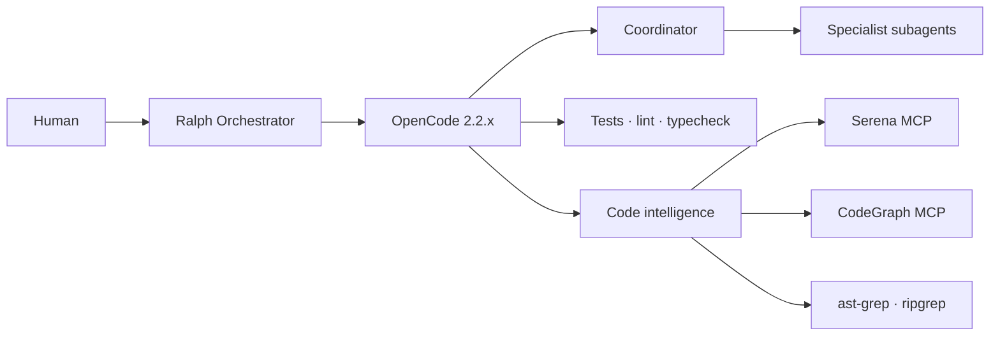

<p align="center">
  <picture>
    <source media="(prefers-color-scheme: dark)" srcset="assets/logo-dark.svg">
    
  </picture>
</p>

<h1 align="center">OPENCODE-TOOL-ENHANCER</h1>

<p align="center">
  <strong>A production-oriented OpenCode profile with sourced agents, Ralph orchestration, and a code-intelligence stack.</strong>
</p>

<p align="center">
  
  
  
</p>

<p align="center">
  <a href="https://github.com/GabrielAlmeidaFlores/OPENCODE-TOOL-ENHANCER">GitHub</a> ·
  <a href="#quick-start">Quick start</a> ·
  <a href="#daily-workflows">Daily workflows</a> ·
  <a href="#configuration">Configuration</a> ·
  <a href="#documentation-index">Documentation</a> ·
  <a href="#troubleshooting">Troubleshooting</a>
</p>

---

## Why this exists

OpenCode is a strong coding agent, but a default installation is still a single general-purpose agent with an open-ended toolset. That works for small tasks and becomes expensive, inconsistent, and hard to audit on real repositories.

This repository provides a **complete, reproducible profile** that changes the default operating model:

- a custom primary agent that plans and delegates instead of editing everything itself;
- eleven specialized subagents with least-privilege permissions;
- Ralph Orchestrator for multi-step work, review gates, and persistent state;
- a code-intelligence stack that retrieves symbols and structure instead of whole files;
- explicit rules for provenance, Git safety, and documentation comments.

The goal is not the smallest prompt. The goal is the **lowest total cost for a correct result**.

## What is included

| Area | Contents | Entry point |
| --- | --- | --- |
| OpenCode profile | Full and minimal V2 configurations | [`configs/opencode/`](configs/opencode) |
| Agents | 1 primary coordinator + 11 specialists | [`agents/`](agents) |
| Skills | 10 sourced skills with supporting files | [`skills/`](skills) |
| Commands | 8 slash commands | [`commands/`](commands) |
| Ralph | Core config + 4 official hat collections | [`configs/ralph/`](configs/ralph) |
| Code intelligence | ripgrep, ast-grep, Serena, CodeGraph | [`docs/code-intelligence/`](docs/code-intelligence) |
| Automation | Install, validate, benchmark, backup, restore | [`scripts/`](scripts) |
| CLI | `ote` install, diagnostics, update, rollback | [`packages/ote_cli`](packages/ote_cli) |
| Profiles | Declarative install profiles | [`profiles/`](profiles) |
| Catalog | Generated, verified artifact list | [`catalog/`](catalog) |
| Verification | Deterministic checks with cache and failure classes | [`docs/verification/`](docs/verification) |
| Governance | Contracts, budgets, loop detection, risk gates | [`docs/governance/`](docs/governance) |
| Memory | Markdown decisions, constraints, conventions, failures | [`docs/memory/`](docs/memory) |
| Specs | Requirements, design, tasks, evidence workflow | [`docs/specs/`](docs/specs) |
| Observability | Cost, tokens, tool failures, arm comparison | [`docs/cost-optimization/observability.md`](docs/cost-optimization/observability.md) |
| Evals and pilots | Deterministic checks and isolated real-repository runs | [`docs/evals/`](docs/evals), [`docs/pilots/`](docs/pilots) |
| Examples | TypeScript, C#, multi-agent workflows | [`examples/`](examples) |
| Benchmarks | Methodology, tasks, harness, results | [`benchmarks/`](benchmarks) |
| Documentation | Research, decisions, guides, provenance | [`docs/`](docs) |

## Evidence status

| Area | Current status |
| --- | --- |
| Static validation | Verified, including links and provenance |
| Agent discovery | Verified with OpenCode 2.2.7 |
| TypeScript and C# examples | Verified |
| Harness smoke execution | Verified on one TypeScript task; not a benchmark result |
| Command runtime | All eight commands verified on the TypeScript fixture |
| Skill runtime | All ten skills verified through the `skill` tool |
| MCP startup overhead | Narrow `debug agents` measurement recorded |
| Benchmarks | Deferred by decision; no published results |
| Real-repository pilots | Repositories selected and pinned; execution pending |
| CI | Green on Ubuntu and macOS for run [43273061721](https://github.com/GabrielAlmeidaFlores/OPENCODE-TOOL-ENHANCER/actions/runs/43273061721); six jobs including `cli` |
| Repository tests | 259 unit and integration tests; run with `make test` |
| `ote` CLI | Install, uninstall, update check, rollback, doctor verified locally and in the `cli` job |
| Profiles and catalog | Three manifests and 34 catalog entries verified locally and in run 43273061721 |
| Verification and governance | `ote verify` and `ote govern contracts` verified locally; CI runs both |
| Memory and specs | Verified locally and in run 43273061721 |
| Stats, eval, pilots | `ote stats` and `ote eval` verified locally; pilot dry-run covered in run 43273061721 |

## Architecture



Ralph owns the loop and quality gates. OpenCode owns agent behavior, permissions, tools, and context. Deterministic tools provide evidence without spending model tokens.

## Quick start

### 1. Prerequisites

- macOS or Linux. Windows is best-effort; use WSL or Git Bash.
- `git`, Node.js 20 or newer, `python3`, and `ripgrep`.
- An OpenCode provider credential, configured with `opencode auth login`.

See [OpenCode installation](docs/installation/opencode.md) for platform details.

### 2. Inspect the installer

```bash
git clone https://github.com/GabrielAlmeidaFlores/OPENCODE-TOOL-ENHANCER.git OPENCODE-TOOL-ENHANCER
cd OPENCODE-TOOL-ENHANCER

./scripts/installation/install.sh --check
./scripts/installation/install.sh --dry-run --all
```

The installer defaults to check-only, prints every action, and never edits `~/.config/opencode`.

### 3. Install the OpenCode profile

```bash
./scripts/installation/install.sh --apply --only opencode,agents,commands,skills,ralph
```

Or use the CLI, which plans first, writes a lock, and supports rollback:

```bash
uv tool install ./packages/ote_cli
ote install --profile minimal --target /path/to/project --dry-run
ote install --profile minimal --target /path/to/project --apply
```

This writes `.opencode/` and `.ralph/` in the target project. To replace an existing
managed configuration without leaving removed files behind, add `--clean`.

### 4. Install the code-intelligence tools

```bash
./scripts/installation/install.sh --apply --only ast-grep,serena
```

Serena and ast-grep are installed by the script. CodeGraph uses its upstream installer and then indexes each project with `codegraph init`; see [code intelligence installation](docs/installation/code-intelligence.md). The optional Repomix and jCodeMunch servers are present in the configuration but disabled by default.

### 5. Verify

```bash
opencode --version
opencode debug agents
opencode mcp list
./scripts/validation/validate.sh
make test
```

Expected: OpenCode 2.2.x and `coordinator` plus eleven subagents. After Serena and CodeGraph are installed, `opencode mcp list` should show both connected.

### 6. Run your first task

```bash
opencode run --agent coordinator "Summarize this repository and propose the next task"
```

For a multi-step feature with review gates, use Ralph through the isolated runner. Ralph 2.10.1 auto-commits during landing and has no switch to disable it, so do not run it directly in a repository that must remain uncommitted.

```bash
./scripts/maintenance/run-ralph-isolated.sh -- \
  -c configs/ralph/ralph.yml \
  -H configs/ralph/hats/research.yml \
  -p "Research <question>"
```

The runner keeps Ralph's commits inside a separate clone and exports the result as an unstaged patch. See [Ralph orchestration](docs/orchestration/ralph.md#git-safety).

## Installation reference

| Component | Guide | Notes |
| --- | --- | --- |
| OpenCode 2.2.x | [docs/installation/opencode.md](docs/installation/opencode.md) | Install, configure providers, verify |
| Code intelligence | [docs/installation/code-intelligence.md](docs/installation/code-intelligence.md) | ripgrep, ast-grep, Serena, CodeGraph |
| Ralph Orchestrator | [docs/installation/ralph.md](docs/installation/ralph.md) | Install, preflight, auto-commit warning |
| Validation | [docs/validation-checklist.md](docs/validation-checklist.md) | Automated and manual checks |
| Backup and restore | [scripts/maintenance](scripts/maintenance) | `backup-config.sh`, `restore-config.sh` |

Platform notes:

- **macOS:** Homebrew is used for `ripgrep`, `ast-grep`, and `uv`.
- **Linux:** use the distribution package manager for `ripgrep`; install `ast-grep` with npm or Cargo; install `uv` with the official installer.
- **Windows:** use WSL or Git Bash. The scripts are POSIX shell.

## Configuration

All configuration is documented in [docs/configuration/opencode-v2.md](docs/configuration/opencode-v2.md).

### Files

| File | Purpose | Install to |
| --- | --- | --- |
| [`configs/opencode/opencode.jsonc`](configs/opencode/opencode.jsonc) | Full profile: coordinator, permissions, MCP, compaction, tool limits | `.opencode/opencode.jsonc` |
| [`configs/opencode/minimal.jsonc`](configs/opencode/minimal.jsonc) | Native tools + ripgrep + ast-grep, no MCP | `.opencode/opencode.jsonc` |
| [`configs/opencode/model-routing.example.jsonc`](configs/opencode/model-routing.example.jsonc) | Optional per-agent model routing | Merge into `.opencode/opencode.jsonc` |
| [`configs/ralph/ralph.yml`](configs/ralph/ralph.yml) | Ralph loop, backend, memory, tasks | `.ralph/ralph.yml` |
| [`configs/ralph/hats/`](configs/ralph/hats) | Official hat collections with OpenCode routing | `.ralph/hats/` |
| [`agents/<role>/AGENT.md`](agents) | Agent prompts, modes, permissions | `.opencode/agents/<role>.md` |
| [`commands/`](commands) | Slash commands | `.opencode/commands/` |
| [`skills/`](skills) | Skills and supporting files | `.opencode/skills/` |

### Main settings

| Setting | Value | Why |
| --- | --- | --- |
| `default_agent` | `coordinator` | No reliance on the default Build agent |
| `permissions` | ordered allow/ask/deny | Least privilege and hard git denies |
| `mcp.servers` | Serena, CodeGraph; optional servers disabled | Useful defaults without schema bloat |
| `compaction.keep.tokens` | `12000` | Bounded recent context |
| `compaction.buffer` | `15%` | Room before overflow |
| `tool_output` | 2000 lines / 51200 bytes | One command cannot flood context |
| `experimental.subagent_depth` | `1` | No recursive agent spawning |

### Model routing

No model is hardcoded. OpenCode uses the user's selected model by default. To route roles to different models, set the environment variables listed in [`model-routing.example.jsonc`](configs/opencode/model-routing.example.jsonc) and merge the overlay.

Recommended shape:

| Work | Model class |
| --- | --- |
| Planning, architecture | strongest reasoning |
| Implementation | balanced |
| Review, security, performance | reasoning-capable |
| Documentation, mechanical work | economical |

### MCP and code intelligence

The full profile enables Serena and CodeGraph through MCP. V2 Code Mode groups MCP tools to reduce schema overhead. Optional servers are configured with `"disabled": true`; enable them only when needed.

The minimal profile disables MCP entirely. Use it for small repositories or when MCP startup dominates task time.

## Daily workflows

### Start a session

```bash
opencode
```

Select `coordinator` with the Tab key, or start directly with:

```bash
opencode run --agent coordinator "<task>"
```

The coordinator cannot edit files. It plans, delegates to the smallest capable specialist, and requires verification evidence.

### Invoke a specialist directly

In the TUI, mention the agent when you want a focused pass:

```text
@code-reviewer Review the current diff for regressions and missing tests.
@security-reviewer Review the authentication change for object-level authorization.
```

You can also run a specialist from the CLI:

```bash
opencode run --agent code-reviewer "Review the current diff"
```

### Load a skill on demand

Skills are loaded only when needed. Ask for one by name:

```text
Use the test-driven-development skill for this change.
Use the systematic-debugging skill; reproduce the failure before proposing a fix.
```

The agent loads the skill, its references, and its supporting files into the current session.

### Choose the right entry point

| Goal | Best entry point |
| --- | --- |
| Understand unfamiliar code | `coordinator` + Serena/CodeGraph |
| Plan a feature | `coordinator` → `planner` |
| Implement a feature | `coordinator` → `/implement` or direct prompt |
| Review a diff | `/review` |
| Reproduce and fix a bug | `/debug` |
| Security review | `/security` |
| Database change | `/db` |
| Behavior-preserving cleanup | `/refactor` |
| Documentation update | `/docs` |
| Performance investigation | `/perf` |
| Multi-step work with gates | Ralph `code-assist` |
| Read-only research | Ralph `research` |

### Explore and understand

Ask the coordinator to map the relevant area before changing it:

```text
Map how <feature> works. Identify the entry point, data flow, and tests.
Use the cheapest retrieval tool first. Do not edit files.
```

What happens: the coordinator uses repository instructions, then targeted search, ast-grep, Serena, or CodeGraph. It returns `file:line` evidence and open questions.

### Plan a feature

```text
Plan <feature>. Acceptance criteria: <criteria>.
Break it into small, verifiable tasks with exact verification commands.
Do not edit files.
```

The `planner` agent returns ordered tasks, assumptions, risks, and out-of-scope work. Use its output as the execution contract.

### Implement a feature

```text
Implement <task>. Follow the existing patterns.
Add tests for the new behavior. Run the narrow checks, then the full suite.
Return changed files, exact commands, results, and remaining risks.
```

The coordinator delegates to `backend-developer`, `frontend-developer`, or `database-specialist`, then sends the diff to `code-reviewer` and `test-engineer`. Security review is added for auth, input handling, files, network, or dependencies.

### Review a diff

In the TUI:

```text
/review
```

Or:

```text
Review the current diff against the task. Findings by severity with file:line.
Check correctness, regressions, missing tests, and unrelated changes.
```

The reviewer does not edit. Findings are ordered as blocker, major, minor, or nit.

### Debug a failure

```text
/debug <symptom>
```

Or:

```text
Reproduce this failure with the smallest command and input.
Record observed vs expected behavior, localize the cause, and add a regression test.
Do not propose a fix before reproducing it.
```

The sequence is reproduction → regression test → fix → verification.

### Security review

```text
/security <scope>
```

Focus areas: input validation, object-level authorization, injection, secrets, dependency risk, data exposure, SSRF, file handling, and cryptography.

### Database change

```text
/db <change>
```

Use expand-and-contract migrations, measure lock time, provide rollback, and test with production-like volume. Destructive statements require explicit approval.

### Refactor safely

```text
/refactor <scope>
```

Capture behavior with tests first, make one mechanical change at a time, and keep behavior unchanged.

### Documentation

```text
/docs <area>
```

Every documented command is executed before it is published. The documentation agent links instead of duplicating and updates the changelog for user-visible changes.

### Performance investigation

```text
/perf <scope>
```

The analyst captures a baseline, profiles the dominant cost, changes one thing, and re-measures with p50/p95/p99 and variance.

### Multi-step work with Ralph

Use Ralph when a task has several verifiable steps and needs gates. Run it in a **separate disposable clone**:

```bash
ralph run \
  -c configs/ralph/ralph.yml \
  -H configs/ralph/hats/research.yml \
  -p "Research <question>"
```

See [Ralph workflows](#ralph-workflows) and [docs/orchestration/ralph.md](docs/orchestration/ralph.md).

### Benchmark a setup

```bash
OPENCODE_BENCH_MODEL=provider/model ./benchmarks/harness/run.sh --arm baseline --task benchmarks/tasks/ts-validation.json
OPENCODE_BENCH_MODEL=provider/model ./benchmarks/harness/run.sh --arm optimized --task benchmarks/tasks/ts-validation.json
```

Each task declares its own working directory and verification command. Results are recorded under `benchmarks/results/`.

### Practice on the bundled examples

```bash
cd examples/typescript
npm install
npm test

cd ../csharp
dotnet test Example.Tests/Example.Tests.csproj
```

The examples contain deliberate weaknesses for the benchmark tasks: duplicated pricing logic, an N+1 loader, and a path traversal. Use them to exercise review, refactor, performance, and security workflows safely.

## Prompt patterns that work well

1. **State the outcome and acceptance criteria.** The coordinator cannot infer product intent.
2. **Ask for the smallest change.** Prevent broad rewrites and unrelated formatting.
3. **Demand evidence.** Require the exact commands and results, not claims.
4. **Use one specialist at a time.** Avoid duplicate investigation and conflicting edits.
5. **Read the diff yourself.** Agents leave changes unstaged for a reason.
6. **Prefer deterministic tools.** Tests, linters, type checkers, and AST queries are cheaper than model reasoning.
7. **Stop when the task is ambiguous.** Ask for a product decision instead of inventing one.
8. **Keep context bounded.** Reference files and line ranges instead of pasting whole documents.

## Cost optimization

| Lever | Setting | Effect |
| --- | --- | --- |
| Bounded retention | `compaction.keep.tokens: 12000` | Keeps recent context without replaying the session |
| Reserve | `compaction.buffer: 15%` | Leaves room before overflow |
| Output caps | 2000 lines / 51200 bytes | Prevents output floods |
| Delegation rules | Coordinator + role table | Avoids duplicate investigation |
| No recursive agents | `subagent_depth: 1` | Prevents agent fan-out |
| MCP Code Mode | enabled | Groups tools to reduce schema overhead |
| Optional servers | disabled | No cost until enabled |
| Memory budget | `2000` tokens | Bounds injected memory |
| Iteration ceiling | `max_iterations: 40` | Bounds runaway loops |
| Minimal profile | no MCP | Removes server startup and schema cost |
| Model routing | environment overlay | Economical models for mechanical work |

Detailed guidance: [docs/cost-optimization/README.md](docs/cost-optimization/README.md).

## The agent team

`coordinator` is the custom primary agent. It cannot edit files. It plans, delegates, and verifies.

| Agent | Mode | Edits | Responsibility |
| --- | --- | --- | --- |
| `coordinator` | primary | no | Plans, delegates, enforces verification |
| `planner` | subagent | no | Ordered, verifiable implementation tasks |
| `researcher` | subagent | no | Repository and documentation evidence |
| `architect` | subagent | no | Boundaries, contracts, architecture decisions |
| `backend-developer` | subagent | yes | Server, API, CLI, and business logic |
| `frontend-developer` | subagent | yes | UI, state, accessibility, visual consistency |
| `database-specialist` | subagent | yes | Schemas, queries, migrations, indexes |
| `code-reviewer` | subagent | no | Independent defect and regression review |
| `test-engineer` | subagent | yes | Unit, integration, and end-to-end tests |
| `security-reviewer` | subagent | no | Exploitable vulnerabilities and unsafe patterns |
| `performance-analyst` | subagent | no | Baselines, profiles, and measured regressions |
| `documentation-engineer` | subagent | docs only | Documentation that matches the code |

See [agent roles and delegation](docs/agents/roles.md) for the delegation rules and Ralph mapping.

## Skills

All skills are adapted from maintained upstream repositories and keep their original authors. Supporting references, assets, and scripts are included.

| Skill | Author | Use it for |
| --- | --- | --- |
| `test-driven-development` | Jesse Vincent | Red-green-refactor with real failing tests |
| `systematic-debugging` | Jesse Vincent | Hypotheses, reproduction, and root-cause fixes |
| `writing-plans` | Jesse Vincent | Plans that a junior engineer can execute |
| `verification-before-completion` | Jesse Vincent | Evidence before declaring done |
| `requesting-code-review` | Jesse Vincent | Preparing work for independent review |
| `api-design-principles` | Seth Hobson | REST and GraphQL contract design |
| `database-migration` | Seth Hobson | Zero-downtime, reversible migrations |
| `code-review-excellence` | Seth Hobson | Constructive, systematic code review |
| `auth-implementation-patterns` | Seth Hobson | JWT, OAuth2, sessions, and RBAC |
| `changelog-automation` | Seth Hobson | Release notes and versioning |

## Commands

| Command | Agent | Purpose |
| --- | --- | --- |
| `/implement` | `coordinator` | End-to-end feature development |
| `/review` | `coordinator` | Multi-dimensional code review |
| `/debug` | `coordinator` | Reproduce, localize, and fix a defect |
| `/security` | `security-reviewer` | Static application security testing |
| `/docs` | `documentation-engineer` | Generate and refresh documentation |
| `/refactor` | `backend-developer` | Behavior-preserving cleanup |
| `/db` | `database-specialist` | SQL migrations and zero-downtime changes |
| `/perf` | `coordinator` | Profiling to monitoring |

## Ralph workflows

Ralph collections are extracted from the official presets. Only per-hat OpenCode agent routing is added.

| Collection | Hats | Best for |
| --- | --- | --- |
| `code-assist` | planner, builder, critic, finalizer | Multi-step implementation with review |
| `review` | reviewer, analyzer, closer | Read-only multi-perspective review |
| `research` | researcher, synthesizer | Evidence gathering without code changes |
| `debug` | investigator, tester, fixer, verifier | Reproduction, hypothesis, fix, verification |

> **Auto-commit warning:** Ralph 2.10.1 commits its own changes during landing and exposes no switch to disable it. Run it only in a separate disposable clone. A linked worktree is not sufficient because it shares `.git` with your repository. See [Ralph orchestration](docs/orchestration/ralph.md#git-safety).

Inside a separate disposable clone:

```bash
ralph run -c configs/ralph/ralph.yml -H configs/ralph/hats/research.yml -p "Research <question>"
```

## Code intelligence

| Tool | Integration | Role | Default |
| --- | --- | --- | --- |
| native `read`, `glob`, `grep` | built-in | Targeted discovery | yes |
| ripgrep | CLI | Exact text and error search | yes |
| ast-grep | CLI | Structural search and rewrites | yes |
| Serena | MCP | Symbol navigation and refactoring | yes |
| CodeGraph | MCP | Cross-file dependencies and blast radius | yes |
| Repomix | MCP | Whole-repository snapshots | optional |
| jCodeMunch | MCP | Symbol retrieval; commercial license | optional |

Direct examples:

```bash
rg -n "validateCreateUser" --type ts
ast-grep -p 'if ($COND) { $BODY }' -l ts examples/typescript/src/
codegraph init
codegraph status
```

Detailed guides: [ripgrep](docs/code-intelligence/ripgrep.md), [ast-grep](docs/code-intelligence/ast-grep.md), [Serena](docs/code-intelligence/serena.md), [CodeGraph](docs/code-intelligence/codegraph.md), [optional tools](docs/code-intelligence/optional-tools.md).

## Safety and governance

This repository is intentionally strict about automation.

- **No automatic staging or commits.** Agents leave changes unstaged and return the diff. Git write commands are denied in configuration and validated per agent.
- **No greenfield artifacts.** Agents, skills, commands, and hats are sourced, pinned, attributed, and modified minimally. See [provenance](docs/provenance/README.md).
- **Documentation comments only.** File headers and function documentation; no inline comments or field-level configuration comments.
- **Destructive commands are denied.** `sudo`, `rm -rf`, force-push, and destructive git operations are blocked or require approval.
- **Installer defaults to inspection.** `--check` and `--dry-run` are safe; `--apply` is explicit and creates a backup.

These rules are documented in [AGENTS.md](AGENTS.md) Sections 2A, 2B, and 2C.

## Provenance

No skill or agent is original work. Each is adapted from a maintained MIT-licensed collection.

| Source | Author | Used for |
| --- | --- | --- |
| [VoltAgent/awesome-claude-code-subagents](https://github.com/VoltAgent/awesome-claude-code-subagents) | VoltAgent | Generic role agents |
| [wshobson/agents](https://github.com/wshobson/agents) | Seth Hobson | Coordinator, architect, database, skills, commands |
| [obra/superpowers](https://github.com/obra/superpowers) | Jesse Vincent | TDD, debugging, planning, verification, review skills |
| [mikeyobrien/ralph-orchestrator](https://github.com/mikeyobrien/ralph-orchestrator) | Ralph Orchestrator Contributors | Official hat presets |

Every artifact records its source path, commit, license, author, and local modifications in [docs/provenance/registry.yml](docs/provenance/registry.yml). License texts are in [THIRD_PARTY_NOTICES.md](THIRD_PARTY_NOTICES.md).

## Testing this repository

The repository tests its own tooling. The suite uses the Python standard library, so it
runs on a clean machine with no virtual environment.

```bash
make test        # unit and integration suites
make validate    # validator, frontmatter, provenance, permissions, docs status
make lint        # shell syntax and ShellCheck when installed
make ci          # validate + test, the default gate
make ote ARGS="doctor"   # run the CLI from the checkout
```

| Layer | Covers |
| --- | --- |
| Unit | Validator rules, fixtures, repository invariants, version file, docs status, CLI parser, lock file, installer plan |
| Integration | Validation entry points, benchmark dry-run, installer safety, OpenCode discovery, `ote` install/update/uninstall lifecycle |

See [testing the repository](docs/architecture/testing.md) for fixtures, conventions, and
how to add a test, and [CI diagnosis](docs/troubleshooting/ci.md) for real workflow failures
and their fixes.

## Benchmarks

The benchmark harness is reproducible, but **no results are published yet**. This is deliberate: token savings without correctness and rework data are not a result.

- [Methodology](docs/benchmarks/methodology.md)
- [Tasks](benchmarks/tasks)
- [Harness](benchmarks/harness)
- [Results](benchmarks/results)

## Repository map

```text
.
├── assets/                         # logo and mark
├── agents/<role>/AGENT.md          # canonical agent definitions
├── skills/<name>/SKILL.md          # sourced skills and supporting files
├── commands/                       # sourced slash commands
├── configs/
│   ├── opencode/                   # OpenCode V2 profiles
│   └── ralph/                      # core config and hat collections
├── docs/                           # research, decisions, guides, provenance
├── examples/                       # TypeScript, C#, multi-agent fixtures
├── benchmarks/                     # methodology, tasks, harness, results
├── scripts/                        # install, validate, benchmark, maintain
├── packages/ote_cli/               # the ote command line
├── profiles/                       # install profile manifests
├── catalog/                        # generated and verified artifact catalog
├── tests/                          # unit, integration, and fixtures
├── AGENTS.md                       # engineering rules
├── VERSION                         # semantic version for releases
├── THIRD_PARTY_NOTICES.md
└── README.md
```

## Documentation index

| Document | What it covers |
| --- | --- |
| [OpenCode installation](docs/installation/opencode.md) | Install, configure, verify |
| [Code intelligence installation](docs/installation/code-intelligence.md) | ripgrep, ast-grep, Serena, CodeGraph |
| [Ralph installation](docs/installation/ralph.md) | Install, preflight, first run |
| [OpenCode V2 configuration](docs/configuration/opencode-v2.md) | Agents, permissions, MCP, compaction, model routing |
| [CLI reference](docs/cli/README.md) | `ote` commands, lock file, exit codes, safety |
| [Profiles](docs/profiles/README.md) | Manifest format and available profiles |
| [Verified catalog](docs/catalog/README.md) | Catalog schema, generation, and drift checks |
| [Verification engine](docs/verification/README.md) | Checks, cache, failure classes, CI gate |
| [Governance](docs/governance/README.md) | Contracts, budgets, loop detection, risk gates |
| [Project memory](docs/memory/README.md) | Markdown memory, TTL, preamble, secret rejection |
| [Spec workflow](docs/specs/README.md) | Requirements, design, tasks, evidence |
| [Deterministic evals](docs/evals/README.md) | Profile, catalog, governance, and validator checks |
| [Pilot runner](docs/pilots/README.md) | Pinned repositories, isolation, artifacts |
| [Install the CLI](docs/installation/ote-cli.md) | uv, pipx, wheel, verification |
| [Agent roles](docs/agents/roles.md) | Responsibilities and delegation rules |
| [Artifact compatibility](docs/agents/compatibility.md) | OpenCode compatibility and runtime status |
| [Real-repository pilots](docs/pilots/README.md) | Selected repositories and pilot procedure |
| [Ralph orchestration](docs/orchestration/ralph.md) | Collections, events, gates, safety |
| [Code intelligence](docs/code-intelligence/README.md) | Retrieval strategy and tool guides |
| [Cost optimization](docs/cost-optimization/README.md) | Levers, anti-patterns, metrics |
| [Benchmark methodology](docs/benchmarks/methodology.md) | Tasks, metrics, validity rules |
| [Cost observability](docs/cost-optimization/observability.md) | Cost and token reporting |
| [MCP overhead](docs/code-intelligence/overhead.md) | Narrow startup measurement |
| [Baseline record](docs/research/baseline.md) | Environment, versions, frozen validation output |
| [Testing the repository](docs/architecture/testing.md) | Test layers, fixtures, and how to add a test |
| [CI diagnosis](docs/troubleshooting/ci.md) | Real workflow failures and fixes |
| [Release checklist](docs/RELEASE_CHECKLIST.md) | Pre-release requirements |
| [Validation checklist](docs/validation-checklist.md) | Automated and manual checks |
| [Troubleshooting](docs/troubleshooting/README.md) | Common failures and fixes |
| [Provenance](docs/provenance/README.md) | Sources, authors, modification rules |
| [Research report](docs/research/phase1-research-report.md) | Evidence and compatibility findings |
| [Architecture decisions](docs/decisions) | ADRs for version, orchestration, tools, benchmarks, CLI, catalog, memory |

## Troubleshooting

| Symptom | Fix |
| --- | --- |
| `coordinator` not found | Install the profile, then run `opencode debug agents` |
| Agent ignores permissions | Last matching rule wins; inspect `opencode debug agents` |
| MCP server disconnected | Check the binary path and raise the startup timeout |
| `git add` or `git commit` blocked | Intended behavior; the human stages and commits |
| Ralph created a commit | Expected in 2.10.1; use a separate disposable clone |
| Context overflows | Lower `tool_output`, keep compaction enabled |
| Benchmark command fails | Check the task's `working_directory` and verification command |

Full guide: [docs/troubleshooting/README.md](docs/troubleshooting/README.md).

## FAQ

**Does this work with OpenCode V1?** No. The profile targets OpenCode V2.2.x. V2 no longer runs language servers, so Serena replaces native LSP.

**Do I need every MCP server?** No. The default enables Serena and CodeGraph. The minimal profile disables MCP entirely.

**Will agents commit or stage my changes?** No. Git write commands are denied and validated per agent. Ralph is the exception: 2.10.1 auto-commits on landing, so run it in a separate disposable clone.

**Can I use my own models?** Yes. Use the environment-driven overlay in [`model-routing.example.jsonc`](configs/opencode/model-routing.example.jsonc).

**Can I add my own agent, skill, or command?** Yes, but follow the provenance rule in [AGENTS.md](AGENTS.md): source a maintained upstream artifact, pin the commit, attribute the author, and modify minimally.

## Contributing

Contributions must follow the provenance, Git safety, and documentation-comment rules in [AGENTS.md](AGENTS.md). See [CONTRIBUTING.md](CONTRIBUTING.md) for the workflow and validation commands.

## License

Repository content is MIT. Third-party artifacts keep their original licenses; see [THIRD_PARTY_NOTICES.md](THIRD_PARTY_NOTICES.md). Serena is GPL-3.0-or-later and is installed as an external tool, not vendored here.
