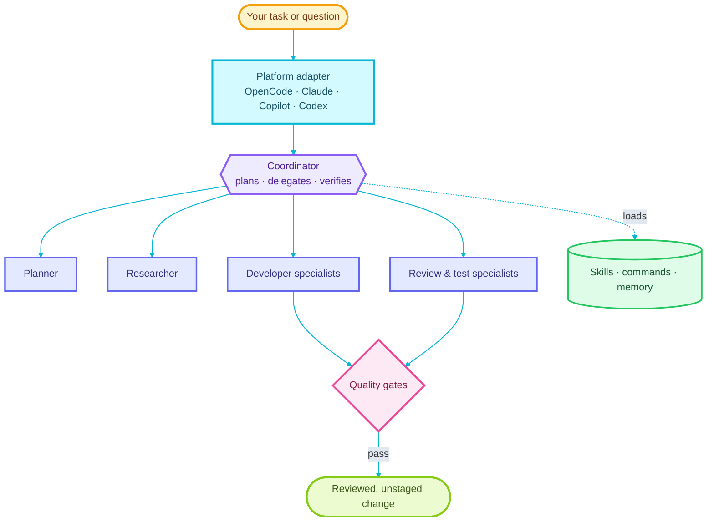
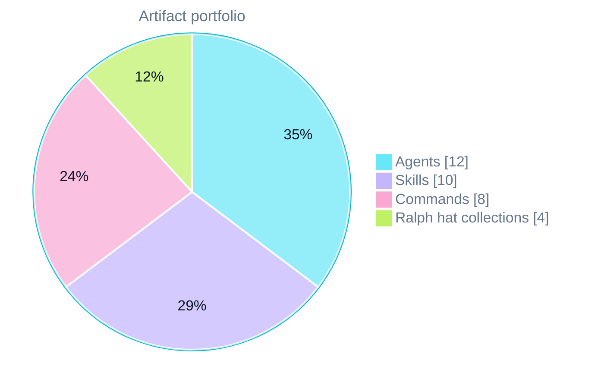
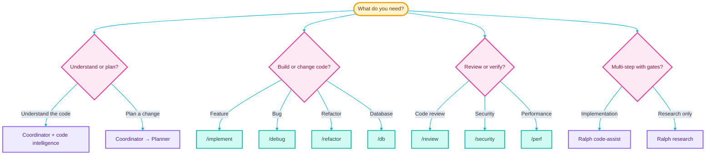
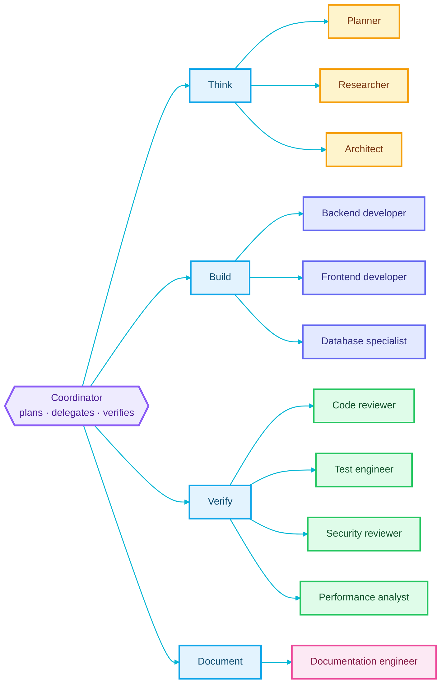
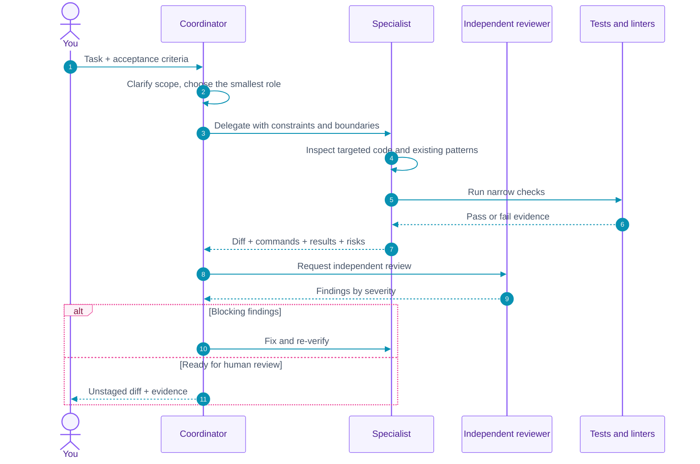
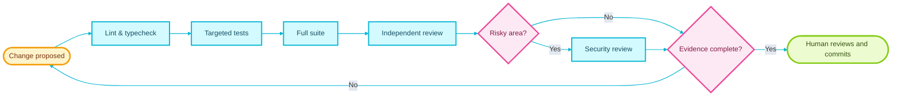

<p align="center">
  <picture>
    <source media="(prefers-color-scheme: dark)" srcset="assets/logo-dark.svg">
    
  </picture>
</p>

<h1 align="center">ToolWright</h1>

<p align="center">
  <strong>Build software with a team of specialized AI agents — on the platform you already use.</strong>
</p>

<p align="center">
  A provider-neutral core for planning, implementation, review, and verification, with adapters for OpenCode, GitHub Copilot, Claude, and GPT.
</p>

<p align="center">
  
  
  
  
  
</p>

<p align="center">
  <a href="#what-is-toolwright">What it is</a> ·
  <a href="#how-it-works">How it works</a> ·
  <a href="#quick-start">Quick start</a> ·
  <a href="#daily-workflows">Workflows</a> ·
  <a href="#evidence-status">Evidence</a> ·
  <a href="#documentation-index">Docs</a> ·
  <a href="#troubleshooting">Troubleshooting</a>
</p>

---

> [!TIP]
> **New here?** Read [What ToolWright is](#what-is-toolwright) and [How it works](#how-it-works), then follow the [Quick start](#quick-start). The short version: you get a coordinator that plans and delegates, specialists that do focused work, and deterministic checks that prove the result.

## What is ToolWright?

ToolWright is a **multi-agent development toolkit**. Instead of asking one general-purpose coding agent to do everything, it gives you a small team with clear roles:

- a **coordinator** that plans, delegates, and verifies;
- **specialists** for research, architecture, backend, frontend, databases, review, testing, security, performance, and documentation;
- **skills** and **commands** that encode proven workflows;
- **quality gates** that use tests, linters, and independent review instead of model claims;
- **platform adapters** that map the same core roles onto OpenCode, Claude Code, GitHub Copilot, or ChatGPT/Codex.

The core is plain Markdown and configuration. It is not tied to one vendor, and **OpenCode is optional**.

### The idea in one sentence

> Spend model tokens on judgment and implementation — not on re-discovering the same code, repeating the same plan, or trusting unverified claims.

### Glossary

The terms below are used throughout this README.

| Term | What it means here |
|---|---|
| **Agent** | A role with a system prompt, responsibilities, and tool permissions. |
| **Subagent** | A specialist launched by the coordinator in a separate context. |
| **Adapter** | A mapping from the provider-neutral core to one platform's file format. |
| **Orchestrator** | A loop that runs multiple steps and gates, such as Ralph. |
| **Quality gate** | A deterministic check that must pass before work is considered done. |
| **Deterministic tool** | A tool that produces a repeatable result without an LLM call: tests, linters, type checkers, `ripgrep`, `ast-grep`. |

## Why it exists

A default coding agent is convenient, but on a real repository it tends to:

- re-read the same files and repeat the same investigation;
- edit before it understands the architecture;
- produce a large diff without independent review;
- claim success without running the relevant checks;
- consume context on tool output instead of the actual task.

ToolWright changes the operating model:

| Without a structured team | With ToolWright |
|---|---|
| One agent tries to plan, edit, and review | Coordinator plans and delegates; specialists own one job each |
| Context fills with search results and logs | Targeted retrieval, bounded memory, and output caps |
| “Looks good” is the finish line | Tests, review, and evidence are the finish line |
| Every task starts from zero | Skills, commands, specs, and memory carry reusable knowledge |
| The workflow is tied to one IDE | The core maps to four platforms through adapters |

The goal is not the smallest prompt. The goal is the **lowest total cost for a correct result**.

## How it works

The diagram below follows one request from start to finish. It shows where your task enters, how the adapter hands it to the coordinator, which specialist groups do the work, and where the quality gates decide whether the result is ready.



Every diagram uses the same glass-neon pattern: a light translucent fill, a bright neon outline, and a dark readable label. The colors keep the same meaning everywhere:

| Colour | Meaning |
|---|---|
| **Amber** | Your input, a start point, or a proposed change |
| **Cyan** | Platform adapter, flow, or a normal step |
| **Violet** | Coordinator or orchestration layer |
| **Indigo** | Specialist agents and builders |
| **Green** | Resources, verification, and a ready result |
| **Magenta** | Decisions and quality gates |

1. **Choose an adapter.** The same roles install as native files for your platform.
2. **The coordinator takes the request.** It clarifies the outcome, picks the smallest capable specialist, and never edits files itself.
3. **Specialists do focused work.** They follow the repository rules, use targeted retrieval, and return evidence.
4. **Quality gates decide when work is done.** Tests, review, and security checks run before you see a change.
5. **You commit.** Agents leave changes unstaged; the human makes the final decision.

> [!NOTE]
> The OpenCode adapter is fully verified in CI. Claude Code, GitHub Copilot, and ChatGPT/Codex adapters are installer-generated. Their install, update, and uninstall paths are validated on a real repository; Copilot CLI and Codex CLI discovery checks passed, while Claude Code runtime discovery remains unverified. See [Platform compatibility](docs/compatibility/README.md) and the [adapter validation record](docs/installation/adapter-validation.md).

## Platform compatibility

The table below shows what is verified, what is installer-generated, and where to start on each platform.

| Platform | Support level | What ToolWright installs | Best entry point |
|---|---|---|---|
| **OpenCode 2.2.x** | Native adapter, CI-verified | Agents, commands, skills, MCP, Ralph | [OpenCode adapter](docs/compatibility/opencode.md) |
| **GitHub Copilot** | Installer-generated adapter | Repository instructions, path instructions, skills, prompts, [`AGENTS.md`](AGENTS.md) | [Copilot guide](docs/compatibility/github-copilot.md) |
| **Claude Code** | Installer-generated adapter | `CLAUDE.md`, `.claude/agents/`, commands, skills | [Claude guide](docs/compatibility/claude.md) |
| **ChatGPT / Codex** | Installer-generated adapter | [`AGENTS.md`](AGENTS.md), `.codex/agents/*.toml`, ChatGPT instructions | [GPT/Codex guide](docs/compatibility/openai-gpt.md) |

The reusable content is the same everywhere. Only the adapter files and permission model change.

## What you get

The chart below shows the reusable artifact mix in the repository. It is a composition overview, not a performance metric.



*Artifact counts, not a performance claim.*

| Area | What it gives you | Start here |
|---|---|---|
| **Agent team** | 1 coordinator + 11 specialists with least-privilege permissions | [`agents/`](agents) |
| **Skills** | 10 sourced workflows with references and assets | [`skills/`](skills) |
| **Commands** | 8 repeatable entry points for common tasks | [`commands/`](commands) |
| **Orchestration** | Optional Ralph loops with research, code, review, and debug hats | [`configs/ralph/`](configs/ralph) |
| **Code intelligence** | ripgrep, ast-grep, Serena, CodeGraph | [`docs/code-intelligence/`](docs/code-intelligence) |
| **Verification** | Deterministic checks with cache and failure classes | [`docs/verification/`](docs/verification) |
| **Governance** | Contracts, budgets, loop detection, risk gates | [`docs/governance/`](docs/governance) |
| **Memory and specs** | Durable decisions, constraints, conventions, and task contracts | [`docs/memory/`](docs/memory), [`docs/specs/`](docs/specs) |
| **Cost visibility** | Token, cost, and tool-failure reporting | [`docs/cost-optimization/observability.md`](docs/cost-optimization/observability.md) |
| **Pilots and benchmarks** | Isolated real-repository runs and a reproducible harness | [`docs/pilots/`](docs/pilots), [`benchmarks/`](benchmarks) |
| **CLI** | Install, diagnose, update, roll back, verify, govern, and inspect | [`packages/toolwright_cli`](packages/toolwright_cli) |
| **Task board** | Optional Markdown board with a WIP limit and worktrees | [`.toolwright/board/README.md`](.toolwright/board/README.md) |

## Quick start

### 1. Check the basics

You need:

- macOS or Linux. Windows works best through WSL or Git Bash.
- `git`, Node.js 20 or newer, Python 3.11 or newer, and `ripgrep`.
- A credential for the platform you choose. **OpenCode is not required.**

Run the following commands to clone the repository and inspect what the installer would do. Nothing is written yet.

```bash
git clone https://github.com/GabrielAlmeidaFlores/ToolWright.git
cd ToolWright

./scripts/installation/install.sh --check
./scripts/installation/install.sh --dry-run --all
```

The installer is safe by default: it checks first, prints every action, and never edits your global configuration.

### 2. Choose an adapter

**OpenCode — reference adapter, fully verified**

The following command applies the OpenCode adapter and its supporting agents, commands, skills, and Ralph configuration.

```bash
./scripts/installation/install.sh --apply --only opencode,agents,commands,skills,ralph
```

Or use the CLI, which plans first, writes a lock file, and supports rollback. The following commands install into a target project:

```bash
uv tool install ./packages/toolwright_cli
toolwright install --profile minimal --target /path/to/project --dry-run
toolwright install --profile minimal --target /path/to/project --apply
```

This writes `.opencode/`, `.ralph/`, and `toolwright.lock.json` into the target project.

**Claude Code, GitHub Copilot, or ChatGPT / Codex**

Select the platform adapter explicitly:

```bash
toolwright install --platform claude  --profile minimal --target /path/to/project --apply
toolwright install --platform copilot --profile minimal --target /path/to/project --apply
toolwright install --platform codex   --profile minimal --target /path/to/project --apply
```

These adapters write native files and track them in `toolwright.lock.json`. Update with the same
command and remove with `toolwright uninstall --target /path/to/project --apply --yes`.

- [Claude Code](docs/compatibility/claude.md)
- [GitHub Copilot](docs/compatibility/github-copilot.md)
- [OpenAI GPT and Codex](docs/compatibility/openai-gpt.md)
- [Adapter validation record](docs/installation/adapter-validation.md)

> [!IMPORTANT]
> Installation is verified for every adapter. Runtime discovery is verified for Copilot CLI and Codex [`AGENTS.md`](AGENTS.md); Claude Code runtime discovery is unverified. Do not claim support beyond the checks recorded in the validation document.

### 3. Add code intelligence

Install the deterministic retrieval tools with the following command. The full profile uses ast-grep and Serena; CodeGraph is indexed per project after installation.

```bash
./scripts/installation/install.sh --apply --only ast-grep,serena
```

Serena and ast-grep are installed by the script. CodeGraph uses its upstream installer and indexes each project with `codegraph init`. Optional Repomix and jCodeMunch servers are configured but disabled by default.

### 4. Verify the installation

Run these commands inside the OpenCode adapter to verify that it discovered the configuration, agents, and MCP servers:

```bash
opencode --version
opencode debug agents
opencode mcp list
```

Run the repository-level checks regardless of which adapter you use:

```bash
./scripts/validation/validate.sh
make test
toolwright doctor
```

For OpenCode, expect version 2.2.x, the `coordinator`, and eleven specialists. After installing Serena and CodeGraph, `opencode mcp list` should show both connected.

### 5. Run your first task

The following command starts the OpenCode adapter with the coordinator and asks it to inspect the repository:

```bash
opencode run --agent coordinator "Summarize this repository and propose the next task"
```

With another adapter, open the repository in that platform and invoke the generated coordinator instructions. See the platform guide for the exact file names.

> [!WARNING]
> Ralph 2.10.1 commits its own changes during landing and has no switch to disable it. Run it only in a separate disposable clone. A linked worktree shares `.git` and is not sufficient.

## Choose the right workflow

The decision tree below helps you pick an entry point from the kind of work you have. Follow one branch; the detailed versions are in [Daily workflows](#daily-workflows).



The detailed versions are in [Daily workflows](#daily-workflows).

## Meet the agent team

The diagram below is the team structure for one task. The coordinator delegates to a specialist group, and every branch returns evidence to the coordinator rather than editing outside its role.



The table below is the quick reference for responsibilities and edit access.

| Agent | Edits files? | Responsibility |
|---|---|---|
| `coordinator` | No | Plans, delegates, enforces evidence, never edits |
| `planner` | No | Ordered, verifiable tasks with acceptance criteria |
| `researcher` | No | Repository and documentation evidence |
| `architect` | No | Boundaries, contracts, architecture decisions |
| `backend-developer` | Yes | Server, API, CLI, and business logic |
| `frontend-developer` | Yes | UI, state, accessibility, visual consistency |
| `database-specialist` | Yes | Schemas, queries, migrations, indexes |
| `code-reviewer` | No | Independent defect and regression review |
| `test-engineer` | Yes | Unit, integration, and end-to-end tests |
| `security-reviewer` | No | Exploitable vulnerabilities and unsafe patterns |
| `performance-analyst` | No | Baselines, profiles, measured regressions |
| `documentation-engineer` | Docs only | Documentation that matches the code |

Read the delegation rules in [Agent roles](docs/agents/roles.md).

## A typical task, step by step

The sequence diagram below shows the normal lifecycle of a task, including the specialist handoff, the narrow checks, the independent review, and the evidence you receive at the end.



You always get:

- the files that changed;
- the exact commands that were run;
- the observed result;
- the remaining risks;
- an unstaged diff that you decide whether to commit.

## Quality gates

The flowchart below shows the checks a change passes through before a human sees it. A failed gate returns the work for another attempt instead of being reported as success.



The gates are intentionally boring: run the checks, read the diff, and let a human decide. Boring is what makes the result trustworthy.

## Cost optimization

ToolWright reduces cost by changing **where tokens are spent**, not by truncating important context.

| Lever | What it does |
|---|---|
| **Delegation** | The coordinator sends one focused job to one specialist instead of letting every agent explore everything. |
| **Targeted retrieval** | `ripgrep`, `ast-grep`, Serena, and CodeGraph find symbols and structure without reading whole files. |
| **Bounded context** | Compaction keeps a recent window and reserves headroom before overflow. |
| **Output caps** | A noisy command cannot flood the context window. |
| **No recursive fan-out** | Subagents cannot spawn more subagents. |
| **Optional MCP** | The minimal profile disables MCP when server startup costs more than it saves. |
| **Model routing** | Strong models plan; economical models handle routine work. |
| **Deterministic checks** | Tests and linters prove correctness without an LLM call. |
| **Memory and specs** | Decisions and task contracts survive across sessions instead of being re-discovered. |

Read the full cost model in [Cost optimization](docs/cost-optimization/README.md).

## Configuration

All OpenCode adapter configuration lives in [docs/configuration/opencode-v2.md](docs/configuration/opencode-v2.md).

| File | Purpose |
|---|---|
| [`configs/opencode/opencode.jsonc`](configs/opencode/opencode.jsonc) | Full profile: coordinator, permissions, MCP, compaction, output limits |
| [`configs/opencode/minimal.jsonc`](configs/opencode/minimal.jsonc) | Native tools plus ripgrep and ast-grep, no MCP |
| [`configs/opencode/model-routing.example.jsonc`](configs/opencode/model-routing.example.jsonc) | Optional per-agent model routing |
| [`configs/ralph/ralph.yml`](configs/ralph/ralph.yml) | Ralph loop, backend, memory, tasks |
| [`configs/ralph/hats/`](configs/ralph/hats) | Hat collections with agent routing |
| [`agents/<role>/AGENT.md`](agents) | Agent prompts, mode, permissions |
| [`commands/`](commands) | Slash commands |
| [`skills/`](skills) | Skills and supporting files |

Important defaults:

| Setting | Value | Why |
|---|---|---|
| `default_agent` | `coordinator` | Do not rely on the platform's default general-purpose agent |
| `permissions` | Ordered allow / ask / deny | Least privilege with hard Git denies |
| `compaction.keep.tokens` | `12000` | Bounded recent context |
| `compaction.buffer` | `15%` | Room before overflow |
| `tool_output` | 2000 lines / 51200 bytes | One command cannot flood context |
| `experimental.subagent_depth` | `1` | No recursive agent spawning |

### Model routing

No model is hardcoded. The platform uses your selected model by default. To route different roles to different models, set the environment variables in [`model-routing.example.jsonc`](configs/opencode/model-routing.example.jsonc).

| Work | Model class |
|---|---|
| Planning, architecture | Strongest reasoning |
| Implementation | Balanced |
| Review, security, performance | Reasoning-capable |
| Documentation, mechanical work | Economical |

## Daily workflows

### Start a session

Start an interactive session with the following command:

```bash
opencode
```

If you prefer a one-shot command, use the following form:

```bash
opencode run --agent coordinator "<task>"
```

The coordinator cannot edit files. It plans, delegates to the smallest capable specialist, and requires verification evidence.

### Understand unfamiliar code

Ask the coordinator to map the area before changing it. Use the following prompt as a template:

```text
Map how <feature> works. Identify the entry point, data flow, and tests.
Use the cheapest retrieval tool first. Do not edit files.
```

The coordinator returns `file:line` evidence and open questions.

### Plan a feature

Use the following prompt to turn a feature request into an execution contract:

```text
Plan <feature>. Acceptance criteria: <criteria>.
Break it into small, verifiable tasks with exact verification commands.
Do not edit files.
```

The planner returns ordered tasks, assumptions, risks, and out-of-scope work. Treat that as the execution contract.

### Implement a feature

Use the following prompt to delegate implementation with explicit evidence requirements:

```text
Implement <task>. Follow existing patterns. Add tests for the new behavior.
Run the narrow checks, then the full suite.
Return changed files, exact commands, results, and remaining risks.
```

The coordinator delegates to a developer, then sends the diff to review and testing. Security review is added for authentication, input handling, files, network, or dependencies.

### Review, debug, secure, refactor, document, measure

The table below is the quick command picker for day-to-day work.

| Command | Use it for |
|---|---|
| `/review` | Independent review by severity with `file:line` references |
| `/debug` | Reproduce → regression test → fix → verify |
| `/security` | Input validation, authorization, injection, secrets, data exposure |
| `/db` | Expand-and-contract migrations, lock time, rollback, production-like volume |
| `/refactor` | Capture behavior with tests, then make one mechanical change at a time |
| `/docs` | Documentation that is executed and verified before publication |
| `/perf` | Baseline → profile → one change → re-measure p50/p95/p99 |

### For a multi-step task with gates

Use Ralph in a **separate disposable clone**. The following command starts the research collection and keeps its automatic commits outside your repository:

```bash
ralph run \
  -c configs/ralph/ralph.yml \
  -H configs/ralph/hats/research.yml \
  -p "Research <question>"
```

Ralph collections:

| Collection | Hats | Best for |
|---|---|---|
| `code-assist` | planner, builder, critic, finalizer | Multi-step implementation with review |
| `review` | reviewer, analyzer, closer | Read-only multi-perspective review |
| `research` | researcher, synthesizer | Evidence gathering without code changes |
| `debug` | investigator, tester, fixer, verifier | Reproduction, hypothesis, fix, verification |

See [Ralph orchestration](docs/orchestration/ralph.md#git-safety).

## Prompt patterns that work

1. **State the outcome and acceptance criteria.** The coordinator cannot infer product intent.
2. **Ask for the smallest change.** Prevent broad rewrites and unrelated formatting.
3. **Demand evidence.** Require exact commands and results, not claims.
4. **Use one specialist at a time.** Avoid duplicate investigation and conflicting edits.
5. **Read the diff yourself.** Agents leave changes unstaged for a reason.
6. **Prefer deterministic tools.** Tests, linters, type checkers, and AST queries are cheaper than reasoning.
7. **Stop when the task is ambiguous.** Ask for a product decision instead of inventing one.
8. **Keep context bounded.** Reference files and line ranges instead of pasting whole documents.

## Skills, commands, and code intelligence

### Skills

The table below lists the sourced skills and what each one is best at.

| Skill | Author | Use it for |
|---|---|---|
| `test-driven-development` | Jesse Vincent | Red-green-refactor with real failing tests |
| `systematic-debugging` | Jesse Vincent | Hypotheses, reproduction, root-cause fixes |
| `writing-plans` | Jesse Vincent | Plans a junior engineer can execute |
| `verification-before-completion` | Jesse Vincent | Evidence before declaring done |
| `requesting-code-review` | Jesse Vincent | Preparing work for independent review |
| `api-design-principles` | Seth Hobson | REST and GraphQL contract design |
| `database-migration` | Seth Hobson | Zero-downtime, reversible migrations |
| `code-review-excellence` | Seth Hobson | Constructive, systematic review |
| `auth-implementation-patterns` | Seth Hobson | JWT, OAuth2, sessions, RBAC |
| `changelog-automation` | Seth Hobson | Release notes and versioning |

### Commands

The table below maps each command to the agent that owns it.

| Command | Agent | Purpose |
|---|---|---|
| `/implement` | `coordinator` | End-to-end feature development |
| `/review` | `coordinator` | Multi-dimensional code review |
| `/debug` | `coordinator` | Reproduce, localize, fix |
| `/security` | `security-reviewer` | Static application security testing |
| `/docs` | `documentation-engineer` | Generate and refresh documentation |
| `/refactor` | `backend-developer` | Behavior-preserving cleanup |
| `/db` | `database-specialist` | SQL migrations and zero-downtime changes |
| `/perf` | `coordinator` | Profiling to monitoring |

### Code intelligence

The table below shows the retrieval tools, how they integrate, and whether they are enabled by default.

| Tool | Integration | Role | Default |
|---|---|---|---|
| Native `read`, `glob`, `grep` | Built-in | Targeted discovery | Yes |
| ripgrep | CLI | Exact text and error search | Yes |
| ast-grep | CLI | Structural search and rewrites | Yes |
| Serena | MCP | Symbol navigation and refactoring | Yes |
| CodeGraph | MCP | Cross-file dependencies and blast radius | Yes |
| Repomix | MCP | Whole-repository snapshots | Optional |
| jCodeMunch | MCP | Symbol retrieval; commercial license | Optional |

Run these examples directly when you need exact text search, structural search, or a dependency map:

```bash
rg -n "validateCreateUser" --type ts
ast-grep -p 'if ($COND) { $BODY }' -l ts examples/typescript/src/
codegraph init
codegraph status
```

Guides: [ripgrep](docs/code-intelligence/ripgrep.md), [ast-grep](docs/code-intelligence/ast-grep.md), [Serena](docs/code-intelligence/serena.md), [CodeGraph](docs/code-intelligence/codegraph.md), [optional tools](docs/code-intelligence/optional-tools.md).

## Safety and provenance

ToolWright is deliberately strict about automation.

- **No automatic staging or commits.** Agents leave changes unstaged and return the diff.
- **No greenfield artifacts.** Agents, skills, commands, and hats are sourced, pinned, attributed, and modified minimally.
- **Documentation comments only.** File headers and contract documentation; no inline comments or field-level configuration comments.
- **Destructive commands are denied.** `sudo`, `rm -rf`, force-push, and destructive Git operations are blocked or require approval.
- **Installer defaults to inspection.** `--check` and `--dry-run` are safe; `--apply` is explicit and creates a backup.

Read [AGENTS.md](AGENTS.md) Sections 2A, 2B, and 2C for artifact and Git rules. Sections 17–23 define the change, changelog, release, benchmark, and documentation workflows.

### Provenance

No skill or agent is original work. Each is adapted from a maintained MIT-licensed collection.

| Source | Author | Used for |
|---|---|---|
| [VoltAgent/awesome-claude-code-subagents](https://github.com/VoltAgent/awesome-claude-code-subagents) | VoltAgent | Generic role agents |
| [wshobson/agents](https://github.com/wshobson/agents) | Seth Hobson | Coordinator, architect, database, skills, commands |
| [obra/superpowers](https://github.com/obra/superpowers) | Jesse Vincent | TDD, debugging, planning, verification, review skills |
| [mikeyobrien/ralph-orchestrator](https://github.com/mikeyobrien/ralph-orchestrator) | Ralph Orchestrator Contributors | Official hat presets |

Every artifact records its source path, commit, license, author, and local modifications in [docs/provenance/registry.yml](docs/provenance/registry.yml). License texts are in [THIRD_PARTY_NOTICES.md](THIRD_PARTY_NOTICES.md).

## Evidence status

This repository distinguishes **verified**, **documented**, and **not yet measured**.

| Area | Status |
|---|---|
| Static validation | Verified, including links and provenance |
| Agent discovery | Verified with the OpenCode 2.2.7 reference adapter; Copilot CLI discovers generated instructions and skills; Codex loads [`AGENTS.md`](AGENTS.md); Claude Code discovery unverified |
| TypeScript and C# examples | Verified |
| Harness execution | 30 isolated DeepSeek Flash runs; published result set |
| Command runtime | All eight commands verified on the TypeScript fixture through the reference adapter |
| Skill runtime | All ten skills verified through the `skill` tool |
| MCP startup overhead | Narrow `debug agents` measurement recorded |
| Benchmarks | One published DeepSeek Flash result set; optimized configuration cost 14.2% more overall, with task-dependent wins and losses |
| Real-repository pilots | Discovery 15/15; Hono 5/5, CleanArchitecture 5/5, turborepo 4/5 reviewed |
| CI | Green on Ubuntu and macOS for run [43402329992](https://github.com/GabrielAlmeidaFlores/ToolWright/actions/runs/43402329992); nine jobs |
| Repository tests | 305 unit and integration tests |
| `toolwright` CLI | Install, uninstall, update check, rollback, doctor verified locally and in the `cli` job |
| Profiles and catalog | Three manifests and 34 catalog entries verified locally and in CI |
| Verification and governance | `toolwright verify` and `toolwright govern contracts` verified locally; CI runs both |
| Task board and plugin | Board and worktree tests; plugin install, syntax, and live injection verified |

Claims link to local evidence or a CI run. Vendor claims are labelled. No benchmark result is published without correctness and rework data.

## Repository map

The tree below shows the main directories and what each one owns. Start with the directory that matches your task rather than reading the whole repository.

```text
.
├── assets/                         # logo and mark
├── agents/<role>/AGENT.md          # provider-neutral agent definitions
├── skills/<name>/SKILL.md          # sourced skills and supporting files
├── commands/                       # sourced workflow commands
├── configs/
│   ├── opencode/                   # OpenCode adapter configuration
│   └── ralph/                      # optional orchestration and hats
├── docs/                           # guides, research, decisions, provenance
├── examples/                       # TypeScript, C#, multi-agent fixtures
├── benchmarks/                     # methodology, tasks, harness, results
├── scripts/                        # install, validate, benchmark, maintain
├── packages/toolwright_cli/        # the toolwright command line
├── profiles/                       # install profile manifests
├── catalog/                        # generated and verified artifact catalog
├── tests/                          # unit, integration, and fixtures
├── AGENTS.md                       # engineering rules
├── VERSION                         # semantic version for releases
├── THIRD_PARTY_NOTICES.md
└── README.md
```

## Documentation index

Use this table as a map. Start with the compatibility guide or the CLI reference, then go deeper into the area you need.

| Start with | Then explore |
|---|---|
| [Platform compatibility](docs/compatibility/README.md) | [OpenCode](docs/compatibility/opencode.md) · [Copilot](docs/compatibility/github-copilot.md) · [Claude](docs/compatibility/claude.md) · [GPT/Codex](docs/compatibility/openai-gpt.md) |
| [Quick start](docs/installation/opencode.md) | [Code intelligence](docs/installation/code-intelligence.md) · [Ralph](docs/installation/ralph.md) |
| [CLI reference](docs/cli/README.md) | [Profiles](docs/profiles/README.md) · [Catalog](docs/catalog/README.md) |
| [Verification](docs/verification/README.md) | [Governance](docs/governance/README.md) · [Cost observability](docs/cost-optimization/observability.md) |
| [Agent roles](docs/agents/roles.md) | [Skills](docs/agents/roles.md) · [Commands](docs/cli/README.md) |
| [Memory](docs/memory/README.md) | [Specs](docs/specs/README.md) · [Task board](.toolwright/board/README.md) |
| [Pilots](docs/pilots/README.md) | [Benchmark methodology](docs/benchmarks/methodology.md) |
| [Architecture](docs/architecture/overview.md) | [Testing](docs/architecture/testing.md) · [Decisions](docs/decisions) |
| [Baseline record](docs/research/baseline.md) | [Research report](docs/research/phase1-research-report.md) · [Orchestration comparison](docs/research/orchestration-comparison.md) |
| [Security](docs/security/README.md) | [Provenance](docs/provenance/README.md) · [Release](docs/release/README.md) |

## Troubleshooting

The table below covers the most common symptoms. The full guide has the detailed diagnosis paths.

| Symptom | Fix |
|---|---|
| `coordinator` not found | Install the adapter, then run `opencode debug agents` |
| Agent ignores permissions | Last matching rule wins; inspect `opencode debug agents` |
| MCP server disconnected | Check the binary path and raise the startup timeout |
| `git add` or `git commit` blocked | Intended behavior; the human stages and commits |
| Ralph created a commit | Expected in 2.10.1; use a separate disposable clone |
| Context overflows | Lower `tool_output`, keep compaction enabled |
| Benchmark command fails | Check the task's `working_directory` and verification command |
| Non-OpenCode adapter seems missing | Reinstall with `--platform claude`, `copilot`, or `codex`, then confirm the generated paths in [`docs/installation/toolwright-cli.md`](docs/installation/toolwright-cli.md) |

Full guide: [docs/troubleshooting/README.md](docs/troubleshooting/README.md).

## FAQ

**Does this work with OpenCode V1?**  
No. The OpenCode adapter targets V2.2.x. V2 does not run language servers, so Serena replaces native LSP.

**Do I need OpenCode?**  
No. OpenCode is the reference adapter and the only one verified end-to-end in CI. Claude Code, GitHub Copilot, and ChatGPT/Codex install generated native files and are validated at the installer level. Copilot and Codex have additional CLI discovery evidence; Claude Code runtime discovery is still unverified.

**Do I need every MCP server?**  
No. The default OpenCode profile enables Serena and CodeGraph. The minimal profile disables MCP entirely.

**Will agents commit or stage my changes?**  
No. Git write commands are denied and validated per agent. Ralph is the exception: 2.10.1 auto-commits on landing, so run it in a separate disposable clone.

**Can I use my own models?**  
Yes. Use the environment-driven overlay in [`model-routing.example.jsonc`](configs/opencode/model-routing.example.jsonc).

**Can I add my own agent, skill, or command?**  
Yes, but follow the provenance rule in [AGENTS.md](AGENTS.md): source a maintained upstream artifact, pin the commit, attribute the author, and modify minimally.

## Testing this repository

Run the following commands from the repository root to validate the tooling, run the tests, and try the CLI:

```bash
make test        # unit and integration suites
make validate    # validator, frontmatter, provenance, permissions, docs status
make lint        # shell syntax and ShellCheck when installed
make ci          # validate + test, the default gate
make toolwright ARGS="doctor"   # run the CLI from the checkout
```

| Layer | Covers |
|---|---|
| Unit | Validator rules, fixtures, repository invariants, version file, docs status, CLI parser, lock file, installer plan |
| Integration | Validation entry points, benchmark dry-run, installer safety, OpenCode discovery, `toolwright` install/update/uninstall lifecycle |

See [testing the repository](docs/architecture/testing.md) and [CI diagnosis](docs/troubleshooting/ci.md).

## Benchmarks

The benchmark harness is reproducible. One result set is published for `deepseek/deepseek-flash`: 30 isolated runs across five tasks and three repeats. The optimized configuration cost **14.2% more overall**; it was cheaper on two tasks and more expensive on three. See the result and limitations before reusing the claim.

- [Methodology](docs/benchmarks/methodology.md)
- [DeepSeek Flash results](docs/benchmarks/results-deepseek-flash.md)
- [Tasks](benchmarks/tasks)
- [Harness](benchmarks/harness)
- [Result artifacts](benchmarks/results/deepseek-flash-2026-11-13)

## Security, support, roadmap

- [SECURITY.md](SECURITY.md) — supported versions and private reporting.
- [SUPPORT.md](SUPPORT.md) — where to ask and what to include.
- [ROADMAP.md](ROADMAP.md) — phase status and non-goals.
- [CODE_OF_CONDUCT.md](CODE_OF_CONDUCT.md) — Contributor Covenant 2.1.

The following commands install the documentation builder, verify the site in strict mode, and serve it locally:

```bash
python3 -m pip install mkdocs-material==9.8.1
mkdocs build --strict
mkdocs serve
```

## Contributing

Contributions must follow the provenance, Git safety, and documentation-comment rules in [AGENTS.md](AGENTS.md). See [CONTRIBUTING.md](CONTRIBUTING.md) for the workflow and validation commands.

## License

Repository content is MIT. Third-party artifacts keep their original licenses; see [THIRD_PARTY_NOTICES.md](THIRD_PARTY_NOTICES.md). Serena is GPL-3.0-or-later and is installed as an external tool, not vendored here.
