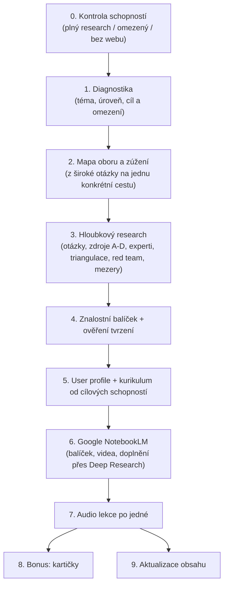

# 🧠 Learning System Agent (Systém pro naučení čehokoliv)

[](https://github.com/jardaakarb/learning-system-agent)
[](#)
[](https://notebooklm.google.com)

> **Ověřený systém učení v uzavřené smyčce:** Původně vznikl jako záchranný systém, díky kterému se podařilo zvládnout **4 roky zanedbaného studia a 75 komplexních zkouškových otázek za méně než měsíc** a odmaturovat na jedničky a dvojky.
>
> Nyní zabalený do **jednoho agentního skillu**, který vás provede celým procesem od nuly.

**Verze 2:** hlavní změna je v tom, jak vzniká kurikulum. Agent už ho nepíše z hlavy, ale nejdřív udělá skutečný research s ověřováním zdrojů. Přehled změn je v [CHANGELOG.md](CHANGELOG.md).

---

## ⚡ Jak tento repozitář použít

### Možnost 1: V Claude Code nebo Antigravity CLI
```bash
"Nainstaluj nebo spusť skill z https://github.com/jardaakarb/learning-system-agent"
```
Agent si stáhne [SKILL.md](SKILL.md) (a podle potřeby složku `references/`) a zahájí diagnostický rozhovor. **Funguje nejlépe**, protože má webové vyhledávání a čtení stránek, tedy plný research.

### Možnost 2: V Cursor / Windsurf / GitHub Copilot
Přidejte odkaz na repo nebo zkopírujte obsah [SKILL.md](SKILL.md) do systémového kontextu (např. `.cursorrules`).

### Možnost 3: Přímo ve webovém chatu (ChatGPT, Claude, Gemini)
Zkopírujte text [SKILL.md](SKILL.md) a vložte ho jako první zprávu. Když chat nemá přístup na web, skill sám přejde do **režimu C**: nevymýšlí research, ale vydá vám hotový prompt, který pustíte v nástroji s hloubkovým researchem, a výsledek pak zpracuje.

---

## 🔄 Jak celý proces funguje



### Co je jinak než ve verzi 1

| Problém | Řešení ve verzi 2 |
|---|---|
| Research závisel na třech cizích pluginech. Když chyběl, agent psal z hlavy. | Skill nezávisí na konkrétních nástrojích. Zkontroluje, co má, a podle toho zvolí režim. Pluginy jsou zrychlovač. |
| Kritérium bylo „3 000 až 8 000 slov". | Kritériem je pokrytí: zdroje podle úrovní A až D, tvrzení s jistotou, red team, hledání mezer. |
| Témata kurzu byla předem daná (a vázaná na AI agentury). | Research začíná otázkami, které jsou hypotézy. Pořadí a obsah vychází z nalezených důkazů. Znalost z v1 zůstala jako příklad v `references/domain-lenses.md`. |
| „Výdělek s AI agenty" je pět různých cest. | Fáze 2 zúží téma na jednu konkrétní cestu, kterou student vybere. |
| Kurikulum byl seznam témat. | Kurikulum se staví od cíle: výstupní schopnost, cvičení, typická selhání, opora ve zdrojích. |
| Jeden velký `research.txt`. | Modulární balíček s ledgerem tvrzení, seznamem zdrojů a ověřovacím průchodem. |
| Audio prompt obsahoval příklady z jednoho tématu (Pydantic, retainer). | Prompt je obecný a navíc vyžaduje poctivost: nevymýšlet čísla, říct, co je sporné. |

---

## 🚀 Krok za krokem: Co se bude dít

1. **Diagnostika.** Agent se zeptá na téma, úroveň, cíl s termínem a omezení (země, rozpočet, dovednosti).
2. **Mapa oboru.** U širokého tématu ukáže 3 až 5 konkrétních cest a vy si jednu vyberete.
3. **Research.** Agent zformuluje výzkumné otázky, čte primární zdroje i praktiky, hledá experty a jejich materiály, počítá vlastní čísla, cíleně hledá, proč věci selhávají, a doplní mezery. Zapisuje do složky `kurz-<téma>/`.
4. **Balíček.** Vznikne několik souborů (jeden na téma) a seznam tvrzení s jistotou. Agent namátkou ověří tvrzení u původních zdrojů a řekne vám výsledek.
5. **Profil a kurikulum.** Každý modul má cíl („po lekci umíš…"), cvičení a oporu ve zdrojích.
6. **NotebookLM.** Nahrajete balíček, `user.txt` a `curriculum.txt`, případně přidáte videa a doplníte slabá místa přes Deep Research v NotebookLM.
7. **Audio lekce.** Agent servíruje prompt pro jednu lekci po druhé. Hotovou lekci nahrajete zpět do zdrojů, aby další navazovala bez opakování.
8. **Bonus.** Kartičky z audia a pozdější aktualizace obsahu.

---

## ⚠️ Poctivé limity

- Placené kurzy, uzavřené komunity a newslettery agent nepřečte. Řekne to a použije jen veřejné části.
- Kvalita výsledku závisí na tom, co je o tématu veřejně dostupné. U tenké důkazní základny to agent přizná a označí jako mezeru.
- Limity NotebookLM (počet zdrojů, délka audia, volba jazyka) se mění. Skill je uvádí s výhradou, ověřte je v aplikaci.
- Audio lekce jsou jen tak dobré jako zdroje v sešitu. Proto největší část práce je research.

---

## 📁 Struktura repozitáře

```
├── SKILL.md                          # Plná specifikace dovednosti
├── README.md                         # Tento průvodce
├── CHANGELOG.md                      # Co se změnilo ve verzi 2
├── references/
│   ├── research-playbook.md          # Šablony poznámek, ledger, vzory dotazů, zadání pro subagenty
│   └── domain-lenses.md              # Doménové čočky + příklad Monetizace AI agentů
├── prompts/
│   ├── audio_mentor_prompt.md        # Prompt pro Audio Overview
│   ├── flashcards_bonus_prompt.md    # Prompt pro kartičky
│   └── deep_research_prompt.md       # Záložní research prompt pro režim bez webu
└── templates/
    ├── user_profile_template.md
    ├── curriculum_template.md
    └── knowledge_pack_template.md
```

---

## 👤 Autor
Vytvořil **Jaroslav Karban** ([GitHub: @jardaakarb](https://github.com/jardaakarb)).
Systém postavený na reálných zkušenostech s rychlým studiem a moderními AI technologiemi.
