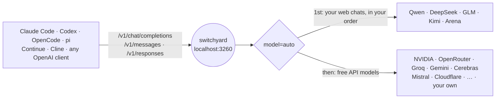
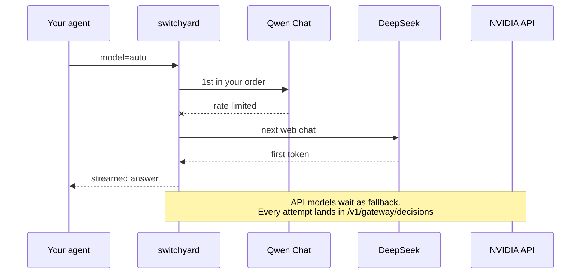

<div align="center">

<picture>
  <source media="(prefers-color-scheme: dark)" srcset="docs/images/logo-dark.png">
  
</picture>

### One local endpoint for every free model your coding agent can reach

Claude Code, Codex, OpenCode and pi talk to `localhost:3260`. Switchyard sends each request to your signed-in web chats and 25+ free model APIs, falls back when one is down, and keeps tool calls working whichever model answers.

[](https://github.com/kravchenski/switchyard/actions/workflows/ci.yml)
[](https://github.com/kravchenski/switchyard/releases/latest)
[](https://github.com/kravchenski/switchyard/releases)
[](https://github.com/kravchenski/switchyard/stargazers)
[](#api)
[](LICENSE)

[Install](#install) · [Demos](#see-it-work) · [Agents](#use-it-with-your-agent) · [Desktop app](#desktop-app) · [Providers](#providers) · [Routing](#routing) · [FAQ](#faq)


*pi fixes a failing test with `model=auto`. Every tool call came from a signed-in web chat, and the decision log shows which model answered each turn.* [MP4](docs/images/agent-demo.mp4)

</div>

## Why switchyard

- **One endpoint, many models.** Point any agent at `http://localhost:3260` and ask for `model=auto`. Switchyard picks a working model and moves to the next one when a provider is down, rate-limited or out of quota.
- **Built for coding agents.** Tool calls go natively to providers that support them and are emulated for the rest, with repair of broken JSON and vendor markup, so agents keep working whichever model answers.
- **Fewer tokens.** Tool output is compacted, unneeded tools are dropped per task, and shell commands can run through [rtk](https://github.com/rtk-ai/rtk). On one bug-fix task the agent's input went from about 69k to about 7k tokens with the same result ([how it was measured](#coding-agent-optimizations)).
- **Images both ways.** Screenshots go to models that can see them, through each site's own upload; you can also generate images through an OpenAI-compatible Images API.
- **Your providers too.** Add any OpenAI-compatible API, such as Ollama, LM Studio, vLLM or a company proxy, next to the built-in ones.
- **A desktop app.** Start the gateway, add keys and accounts, set the routing order and see how every request was routed. Installers for Linux, macOS and Windows.

## Install

Pick one. All three give you the same gateway on `http://localhost:3260`.

<table>
<tr>
<th width="33%">Desktop app</th>
<th width="33%">From source</th>
<th width="33%">Docker</th>
</tr>
<tr valign="top">
<td>

Download the installer for your system from the [latest release](https://github.com/kravchenski/switchyard/releases/latest) ([which file](#desktop-app)), or on Arch:

```bash
paru -S switchyard-bin
```

([one-time paru setup](packaging/aur/README.md#install-with-paru))

Bun is not needed; the gateway is bundled.

</td>
<td>

Needs [Bun](https://bun.sh).

```bash
git clone https://github.com/kravchenski/switchyard
cd switchyard
bun install
bun run start
```

</td>
<td>

```bash
git clone https://github.com/kravchenski/switchyard
cd switchyard
docker compose up -d
```

Mounts `.env`, `session/`, `data/` and `logs/`. Connect accounts on the host first.

</td>
</tr>
</table>

Web chats need Chrome or Chromium on the same machine. API providers need nothing but a key.

### Your first answer in three steps

**1. Connect at least one provider.** The fastest free one to start with is a key:

```bash
bun run account add nvidia --api-key        # or groq, gemini, openrouter, cerebras, …
```

or a web chat you already use, through your own browser account:

```bash
bun run account open https://chat.deepseek.com/
```

In the desktop app: **API keys** or **Accounts → Connect chats**. `bun run account` lists every provider, whether it is connected and the command that connects it.

**2. Ask for `auto`:**

```bash
curl http://localhost:3260/v1/chat/completions \
  -H "Content-Type: application/json" \
  -d '{"model": "auto", "messages": [{"role": "user", "content": "Hello!"}]}'
```

**3. Point your agent at it.** `bun run setup:agents` writes the configs for OpenCode, pi, Continue, Hermes, Aider and Cline; Claude Code and Codex need one line each ([below](#use-it-with-your-agent)).

## See it work

<table>
<tr>
<th width="50%">Screenshots go to a model that can see them</th>
<th width="50%">Every request shows how it was routed</th>
</tr>
<tr valign="top">
<td><br><sub><code>@shapes.png</code> with <code>model=auto</code>: the vision chain picks a web chat that reads images itself. <a href="docs/images/vision-demo.mp4">MP4</a></sub></td>
<td><br><sub>One request to <code>model=auto</code> and the decision log: skipped candidates, each attempt and who answered. <a href="docs/images/demo.mp4">MP4</a></sub></td>
</tr>
</table>

<p align="center">
  <picture>
    <source media="(prefers-color-scheme: dark)" srcset="docs/images/tour-dark.gif">
    
  </picture>
  <br>
  <sub>The desktop app: requests, providers, routing order and keys. Full quality: <a href="docs/images/tour-light.mp4">light</a> · <a href="docs/images/tour-dark.mp4">dark</a></sub>
</p>

## Use it with your agent

| Agent | Setup |
|---|---|
| **Claude Code** | `ANTHROPIC_BASE_URL=http://localhost:3260 ANTHROPIC_AUTH_TOKEN=<GATEWAY_API_KEY or any text> ANTHROPIC_MODEL=auto claude` |
| **OpenCode, pi, Continue, Hermes, Aider, Cline** | `bun run setup:agents` writes their configs ([details](docs/AGENT_INTEGRATIONS.md)) |
| **Codex** | OpenAI Responses API at `http://localhost:3260/v1/responses` |
| **Anything OpenAI-compatible** | base URL `http://localhost:3260/v1`, model `auto` or any id from `/v1/models` |

A bearer token is only required when `GATEWAY_API_KEY` is set.

### Command approval

Web chats answer in plain text, and Switchyard turns that text into tool calls for your agent. A file, a command output or a web page in the agent's context can carry instructions that the model repeats as a shell command, so let a person approve commands:

- `bun run setup:agents` makes OpenCode ask before `bash` and `webfetch` (`"permission": { "bash": "ask", "webfetch": "ask" }`). Values you already set are kept. Pass `--allow-commands` to skip this.
- Claude Code asks before commands and Codex runs them in its sandbox by default; keep those defaults.
- pi has no approval prompts. Use it with Switchyard only in a container, a sandbox or a throwaway checkout.

### Browser tools

With the [Switchyard extension](https://github.com/kravchenski/switchyard-extension) installed in Chrome, agents can work with your tabs: list and open tabs, group them, read pages, click, type and take screenshots. The extension connects to the gateway, and the gateway serves its tools over MCP at `/mcp`:

```bash
claude mcp add --transport http switchyard-browser http://localhost:3260/mcp
```

`bun run setup:agents -- --browser-tools` registers it for Claude Code, OpenCode and Codex instead.

With `GATEWAY_API_KEY` set, add `--header "Authorization: Bearer <GATEWAY_API_KEY>"` and enter the same key in the extension settings. The tool list is remembered, so agents started before Chrome still see the tools; calls fail with a clear message until the extension connects. `GET /v1/gateway/browser` shows whether it is connected.

## Desktop app

A native app (Rust + [GPUI](https://www.gpui.rs)) for everything the CLI does: start and stop the gateway, add API keys, custom providers and browser accounts, order the web chats, switch providers in or out of `auto`, and watch requests and model health. Click a request to see how it was routed: which models were skipped and why, each attempt with its error and time, and who answered. When a web chat loses its sign-in, a banner says so and takes you to its sign-in. Click the address in the sidebar to copy the base URL.

Every [release](https://github.com/kravchenski/switchyard/releases) has installers for x86_64 and arm64 Linux, macOS and Windows, plus `SHA256SUMS` to check the downloads. They bundle the gateway, so Bun is not needed; Chrome or Chromium is needed for the web chats. The installers are not code-signed yet.

| System | File | Install |
|---|---|---|
| Arch, CachyOS, Manjaro | `switchyard-bin-<version>-1-x86_64.pkg.tar.zst` | `sudo pacman -U switchyard-bin-*.pkg.tar.zst`, or with paru and updates from `paru -Syu` ([setup](packaging/aur/README.md#install-with-paru)) |
| Debian, Ubuntu | `switchyard-<version>-linux-x64.deb`, `-linux-arm64.deb` | `sudo apt install ./switchyard-*.deb` |
| Any Linux | `switchyard-<version>-linux-x64.AppImage`, `-linux-arm64.AppImage` | `chmod +x switchyard-*.AppImage` and run it |
| Any Linux, by hand | `switchyard-<version>-linux-x64.tar.gz`, `-linux-arm64.tar.gz` | unpack into `/` or a prefix; the app is `usr/bin/freeapi-desktop` |
| macOS | `switchyard-<version>-macos-arm64.dmg` | open and drag to Applications |
| Windows | `switchyard-<version>-windows-x64-setup.exe` | run the installer |

Check a download with `sha256sum --check --ignore-missing SHA256SUMS`. The Arch package starts the app as `switchyard`.

<details>
<summary><b>Screenshots</b></summary>
<br>

<table>
  <tr>
    <th>Requests and health</th>
    <th>Web chat order and agent options</th>
  </tr>
  <tr>
    <td></td>
    <td></td>
  </tr>
  <tr>
    <th>Models a key can use</th>
    <th>API keys and custom providers</th>
  </tr>
  <tr>
    <td></td>
    <td></td>
  </tr>
  <tr>
    <th>Dark theme</th>
    <th>Dark theme</th>
  </tr>
  <tr>
    <td></td>
    <td></td>
  </tr>
</table>

</details>

## Providers

<picture>
  <source media="(prefers-color-scheme: dark)" srcset="docs/images/providers-dark.png">
  
</picture>

Everything here has a free tier or works through your own signed-in web account.

| Provider | Connect with |
|---|---|
| **Qwen, DeepSeek, GLM, Kimi, Arena** (web chats) | your browser account: `bun run account open <url>`, `bun run account token <site>`, or `bun run auth:deepseek` |
| **NVIDIA** | `NVIDIA_API_KEY` |
| **OpenRouter, Groq, Gemini, Cerebras, Mistral, SambaNova** | `<PROVIDER>_API_KEY` |
| **Cloudflare Workers AI** | `CLOUDFLARE_API_KEY` + `CLOUDFLARE_ACCOUNT_ID` |
| **15 more** | see the full list below |
| **Your own** | `bun run account custom add <id> --url <base-url>` |

<details>
<summary><b>Full provider list</b></summary>
<br>

| Provider | Models | How to connect |
|---|---|---|
| **DeepSeek** (web) | `deepseek-default`, `deepseek-reasoner`, `deepseek-expert`, `deepseek-search`; takes images | sign in to chat.deepseek.com in a browser account (**Connect chats** in the app, or `bun run account open https://chat.deepseek.com/`); the sign-in check saves that session for the gateway. Or `bun run auth:deepseek`, or `bun run auth:deepseek -- --token` with the `userToken` from your own browser when the sign-in window keeps rejecting the captcha |
| **Qwen, GLM, Kimi, Arena** (web) | `qwen-chat`, `glm-chat`, `kimi-chat`, `arena-chat` and every model those sites offer, e.g. `glm-chat/glm-5.3`, `kimi-chat/k3`, `arena-chat/claude-sonnet-4-6`; take images | your signed-in browser: `bun run account open <url>`, or `bun run account token <site>` (`qwen-chat`, `glm-chat`, `kimi-chat`, `arena-chat`; also `deepseek`) or the token field on the provider page of the desktop app, with the token from your own browser |
| **NVIDIA** | every chat model your key can use (`nvidia/*`, `deepseek-ai/*`, `moonshotai/*`, `meta/*`, …) | `NVIDIA_API_KEY` |
| **OpenRouter** | free models, `openrouter/<model>:free` | `OPENROUTER_API_KEY` |
| **Groq, Gemini, Cerebras, Mistral, SambaNova** | free-tier chat models, `groq/<model>`, `gemini/<model>`, … | `<PROVIDER>_API_KEY` |
| **GitHub Models, Hugging Face, Zhipu BigModel, Cohere, Aion Labs, LLM7.io** | free-tier models under their prefix | `<PROVIDER>_API_KEY` |
| **Z.AI, Ollama Cloud, OpenCode Zen** | free flash GLM, Ollama Cloud models, free Zen models | `<PROVIDER>_API_KEY` |
| **Cloudflare Workers AI** | `cloudflare/@cf/<model>`, 10,000 free neurons a day | `CLOUDFLARE_API_KEY` + `CLOUDFLARE_ACCOUNT_ID` |
| **Kilo Gateway, OVHcloud AI Endpoints** | free models; work even without a key | optional key |
| **AIHubMix, AshnaAI, NaraRouter** | `aihubmix/<model>-free`, `ashna/<model>`, `nararouter/<model>`; AshnaAI and NaraRouter are off in `auto` until enabled, and AshnaAI's API needs a paid plan | `<PROVIDER>_API_KEY` |
| **Token Harbor** | free models only, `tokenharbor/<model>:free` | `TOKENHARBOR_API_KEY` |
| **xKiro** | third-party gateway, free models only, off in `auto` until enabled | `XKIRO_API_KEY` |
| **Custom** | `<id>/<model>` for any OpenAI-compatible API | `bun run account custom add <id> --url <base-url> [--name <name>]` |

</details>

<details>
<summary><b>Keys, accounts and custom providers</b></summary>
<br>

- Keys go in `.env` (see `.env.example`) or are saved encrypted with `bun run account add <provider> --api-key` or the desktop app.
- **Several keys per provider:** `GROQ_API_KEY=k1,k2,k3` or `["k1","k2"]`. Switchyard sticks to the key that works and switches to the next one in the same request when a key is rate-limited, out of quota or rejected.
- **Several web accounts:** each is its own browser profile, and requests rotate between the signed-in ones (`bun run account profile add`, `connect`, `status`).
- **Gentle on web accounts:** each account keeps requests in one chat (a request with its own `conversation_id` gets its own chat), sends one message at a time and waits `WEB_CHAT_MIN_INTERVAL_MS` (2 s) after the previous answer before sending the next message. Heavy automated traffic still breaks the sites' terms and can get an account blocked; use API providers for bots.
- **Collect keys from an account:** `bun run account auto-collect --profile <id>` signs in to the web chats and provider dashboards with that account's Google session and creates its API keys (Auto-collect keys on the desktop Accounts page). Stop the API first, because it uses the same browser profile.
- **Custom providers:** `bun run account custom add <id> --url <base-url> [--name <name>]`, or the Custom provider card on the desktop API keys page. Save a key with `bun run account add <id> --api-key` if it needs one. Models are named `<id>/<model>` and join `auto` as a fallback. Use `https://`, or `http://` only for localhost.
- Models a key cannot use are detected and hidden. `bun run models:check` checks every model of every provider at once (about a minute for ~500 API models) and hides the ones that time out, fail, or belong to a provider whose key or balance is spent; they come back after 24 hours or on the next check. Add `--web` to include browser chats and `-v` to list each failure. `bun run models:probe` measures which models answer and how fast.

</details>

## How it works



## Routing

Ask for `auto` and Switchyard builds the chain from what the request carries:

| The request has | Chain |
|---|---|
| text | one model per web chat in your order, then the best measured API models |
| images | Qwen Chat first, then the other web chats in your order, then API models that can see images |
| tools | the web chats in your order, then strong API models with native tool calling |
| images and tools | the image chain; tools are passed natively wherever the model supports them |

`agent` and `vision` still work as names for `auto`, so existing agent configs keep running.



Set the order of the web chats on the desktop Settings page or with `bun run account auto --order qwen-chat,deepseek,glm-chat,kimi-chat,arena-chat`; chats you leave out keep their default place after the ones you list. Each web chat uses its fastest measured model unless you pick one: click the chat in Settings, or run `bun run account auto --model qwen-chat=qwen-chat/qwen3.8-max` (`=fastest` goes back). If the picked model is unavailable, the chat falls back to its fastest one. A provider can be taken out of `auto` on its page in the app or with `bun run account provider <id> --auto off`.

The chains are listed in `GET /v1/gateway/status` (`autoModels`, `visionModels`, `agentModels`), and every decision (skipped candidates and why, each attempt, latency, the pick) is at `GET /v1/gateway/decisions`.

## Coding agent optimizations

For requests that carry tools. Switch each one on the desktop Settings page or with `bun run account auto --<option> on|off`:

| Option | Default | What it does |
|---|---|---|
| `--compact` | on | Trims tool output the agent sends back: colours, progress bars, repeated and near-identical lines go; long output keeps its start, end and every error or warning. |
| `--tools` | on | With more than 15 tools, keeps only the ones the task needs (core and already used tools always stay). |
| `--rtk` | on | Runs the agent's shell commands through the installed [rtk](https://github.com/rtk-ai/rtk) (`git status` → `rtk git status`) while the model keeps seeing its own commands. |

<details>
<summary><b>How the 69k → 7k tokens was measured</b></summary>
<br>

The same agent (pi, nemotron-3-super) fixed the same bug: a discount rate broken by one commit in a 22-commit history, with a test suite that prints 16 KB of debug logs. Summing the context sent to the model over the whole task gave **about 69k tokens with the options off and about 7k with them on**; both runs fixed the bug. It is one task on one model, so treat it as an illustration, not a guarantee.

The headers `x-gateway-compacted`, `x-gateway-tools` and `x-gateway-rtk` show what was saved on each request.

</details>

### Jev tools on your free models

[jevgrep](https://github.com/dzhng/jevgrep) and [fast-jev-compaction](https://github.com/tamaratran/fast-jev-compaction) ask TypeSafe's Jev model small yes/no and choice questions. Switchyard answers the same requests at `/v1/systemone` with your free models, so both run without a TypeSafe key.

| Tool | What it saves | Point it at Switchyard |
|---|---|---|
| **[rtk](https://github.com/rtk-ai/rtk)** | compacts shell output before the agent reads it | install it; `--rtk` (on by default) does the rest |
| **[jevgrep](https://github.com/dzhng/jevgrep)** | the agent finds code by asking what it does instead of reading whole folders | `jg auth` → Custom endpoint, base URL `http://localhost:3260/v1`, model `auto`; then `jg skill` in your project |
| **[fast-jev-compaction](https://github.com/tamaratran/fast-jev-compaction)** | drops tool calls and results the conversation no longer needs, keeps the rest verbatim | library: `compactMessages(transcript, { baseUrl: 'http://localhost:3260/v1/systemone', apiKey: 'local' })`; its CLI scripts: `JEV_BASE_URL=http://localhost:3260/v1/systemone`. Its Claude Code plugin always calls TypeSafe |

Each Jev question costs one request to a fast API model, so the savings pay off on long agent sessions rather than short chats.

## Images

**Vision.** Put images in a message (OpenAI `image_url` parts, data URLs or links) and send it to a model that can see. The web chats attach them through each site's own upload, DeepSeek through its file upload, and vision-capable API models get them directly.

**Models that cannot see.** If you name a model that has no vision (for example `deepseek-reasoner`), Switchyard lets a model from the vision chain describe each image in detail and sends yours the description in place of the picture. Up to the 4 latest images per request are described, and a description is reused while the same image stays in the conversation. The header `x-gateway-images: described=1,omitted=0` shows what happened; when no vision model answers, the image becomes an `[image omitted]` marker and the request still goes through. `auto` is not affected: it already sends image requests to models that can see.

**Generation.** `POST /v1/images/generations` (OpenAI Images API) with `qwen-chat/image` (your Qwen Chat, up to 2688×1536), `cloudflare/@cf/<model>` (FLUX, SDXL) or `pollinations/<model>` (no key, watermarked). Without a `model` the first available one is used.

## API

| Method | Endpoint | Description |
|---|---|---|
| `POST` | `/v1/chat/completions` | OpenAI Chat Completions, streaming and tools |
| `POST` | `/v1/messages` | Anthropic Messages |
| `POST` | `/v1/responses` | OpenAI Responses |
| `GET` | `/v1/models` | All available models, `auto` first |
| `POST` | `/v1/images/generations` · `GET /v1/images/models` | Image generation |

<details>
<summary><b>Gateway and operations endpoints</b></summary>
<br>

| Method | Endpoint | Description |
|---|---|---|
| `POST` | `/v1/decisions` (also `/v1/systemone`) | Decision API in TypeSafe's System One shape: `choice` / `noul` / `boolean` questions answered with probabilities |
| `GET` | `/v1/gateway/decisions` | Recent routing decisions |
| `GET` | `/v1/gateway/decisions/:id` | One routing decision; request logs carry its `decisionId` |
| `GET` | `/v1/gateway/status` | Providers, accounts, models, chains, web chat order, recent requests |
| `POST` | `/v1/gateway/refresh` | Reload saved keys, custom providers and model lists |
| `POST` | `/v1/gateway/providers/:id/check` | Check which models a provider key can use |
| `POST` | `/v1/gateway/models/check` | Check every model of every provider and hide the ones that do not answer; streams one JSON line per model |
| `GET` | `/metrics` | Prometheus metrics |
| `POST` | `/mcp` | Browser tools from the Switchyard extension over MCP (Streamable HTTP) |
| `GET` | `/browser/ws` | WebSocket the extension connects to |
| `GET` | `/v1/gateway/browser` | Whether the extension is connected and how many tools it offers |
| `GET` | `/health` | Liveness |

DeepSeek also runs as a standalone OpenAI-compatible service: `bun run start:deepseek` serves `/api/v1/models` and `/api/v1/chat/completions` on port 3265 and describes them in an OpenAPI 3.1 spec at `/api/openapi.json`.

</details>

<details>
<summary><b>Configuration</b></summary>
<br>

| Variable | Default | Description |
|---|---|---|
| `UNIFIED_PORT` | `3260` | Server port |
| `HOST` | `127.0.0.1` | Bind address; without `GATEWAY_API_KEY` only requests to `localhost` from local pages are accepted |
| `GATEWAY_API_KEY` | — | Require this bearer token on every request except `/health` |
| `EXTENSION_ORIGINS` | Switchyard extension | Comma-separated browser extension origins allowed to call `localhost` without `GATEWAY_API_KEY`; `none` turns it off |
| `<PROVIDER>_API_KEY` | — | One key or a list per provider (see `.env.example`) |
| `LONG_PROMPT_CHARS` | `240000` | Prompts longer than this (about 60k tokens) are sent first to a web chat that reads long prompts quickly (DeepSeek); `0` turns it off |
| `AUTO_MODELS` | — | Fixed `auto` chain instead of the measured one |
| `WEB_CHAT_MIN_INTERVAL_MS` | `2000` | Minimum pause after the previous answer (or message, whichever is later) before the next message to the same web chat account |
| `ACCOUNTS_SECRET` | Config file, then OS keyring | Encrypts saved keys in `session/credentials.enc`; `bun run account init` keeps a durable copy outside the data directory and checks it against existing saved keys |
| `ACCOUNTS_SECRET_FILE` | OS config directory | Override the durable secret file (Linux: `~/.config/free-ai-gateway/secret`) |

If saved keys cannot be decrypted, restore the original secret or unlock the system keyring. `bun run account init` can reconcile conflicting copies when one opens the vault. If the original secret is lost, `bun run account init --reset` moves the encrypted vault to a timestamped backup and creates a new secret. Add the API keys again and restart the app. A compiled installation supports the same commands through `freeapi-accounts`.

</details>

<details>
<summary><b>Docker</b></summary>
<br>

```bash
docker compose up -d
```

Runs the gateway on `127.0.0.1:3260` with `.env` and the `session/`, `data/` and `logs/` folders mounted. Connect accounts on the host first.

</details>

<details>
<summary><b>Development</b></summary>
<br>

```bash
bun run dev               # watch mode
bun run ci                # build check, strict typecheck, tests
bun run desktop           # desktop app (cargo run)
bun run build:desktop     # gateway and accounts sidecars + release app in dist/
bun run package:desktop   # the same, plus the installers for this OS (Linux: deb, AppImage, tar.gz and, with makepkg, an Arch package; macOS: dmg; Windows: exe; needs cargo-packager)
```

```
src/
  unified/server.ts   gateway: routes, agent pipeline, images, decisions
  core/               router, decision engine, model stats, key pools, agent optimizations
  providers/          API provider catalog, custom providers, web chats, DeepSeek, images
  browser/            Playwright-driven browser sessions for the web chats
  cli/                accounts CLI and agent setup
desktop/              Rust + GPUI desktop app
```

Versions follow [Conventional Commits](https://www.conventionalcommits.org) via release-please; every release publishes a Docker image and the desktop installers.

</details>

## FAQ

<details>
<summary><b>Does it cost anything?</b></summary>
<br>

Switchyard is MIT-licensed and runs on your machine. The models come from free API tiers and from web chats you sign in to with your own accounts. A few providers limit their free tier (AshnaAI's API needs a paid plan, Cloudflare gives 10,000 neurons a day); the [full provider list](#providers) says which.

</details>

<details>
<summary><b>Which model should I ask for?</b></summary>
<br>

`auto`. It looks at what the request carries (text, images, tools) and builds a chain of models that can handle it, then falls back along that chain. Name a model from `/v1/models` only when you want that exact one.

</details>

<details>
<summary><b>Where do my prompts and keys go?</b></summary>
<br>

The gateway listens on `127.0.0.1` and accepts requests only from your machine unless you set `GATEWAY_API_KEY`. Each request goes to the provider that answers it, and nowhere else. Saved API keys are encrypted with `ACCOUNTS_SECRET` in `session/credentials.enc`; web chat sessions stay in local browser profiles under `session/`.

</details>

<details>
<summary><b>Can my web chat account get blocked?</b></summary>
<br>

Switchyard keeps each account in one chat, sends one message at a time and pauses between messages, and it never bypasses captchas. Heavy automated traffic still breaks the sites' terms, so use API providers for bots and batch jobs. See [Responsible use](#responsible-use).

</details>

<details>
<summary><b>How do I see which model answered?</b></summary>
<br>

The desktop app's Requests page shows every request; click one for its route. From the command line: `curl localhost:3260/v1/gateway/decisions`. Each decision lists the skipped candidates and why, every attempt with its error and time, and the model that answered.

</details>

<details>
<summary><b>Does it work on macOS and Windows?</b></summary>
<br>

Yes. Releases include a macOS dmg and a Windows installer next to the Linux packages, and the gateway itself runs anywhere Bun runs. Details per system are in [docs/PLATFORM_SUPPORT.md](docs/PLATFORM_SUPPORT.md).

</details>

## Star history

<a href="https://star-history.com/#kravchenski/switchyard&Date">
  <picture>
    <source media="(prefers-color-scheme: dark)" srcset="https://api.star-history.com/svg?repos=kravchenski/switchyard&type=Date&theme=dark">
    
  </picture>
</a>

## Contributing

Issues and pull requests are welcome. `bun run ci` runs the build check, the strict typecheck and the tests that CI runs; commits follow [Conventional Commits](https://www.conventionalcommits.org). The project layout is in the **Development** block under [API](#api).

## Built on

Switchyard stands on these projects:

| Project | Used for |
|---|---|
| [Bun](https://bun.sh) | runtime, test runner, SQLite |
| [Hono](https://hono.dev) | HTTP server |
| [Playwright](https://playwright.dev) | driving the signed-in web chats over CDP |
| [Zod](https://zod.dev), [ofetch](https://github.com/unjs/ofetch), [yaml](https://eemeli.org/yaml) | config validation, HTTP calls, agent configs |
| [GPUI](https://www.gpui.rs) and [gpui-component](https://github.com/longbridge/gpui-component) | the desktop app |
| [cargo-packager](https://github.com/crabnebula-dev/cargo-packager) | desktop installers |
| [rtk](https://github.com/rtk-ai/rtk) | compact shell output for agents |
| [jevgrep](https://github.com/dzhng/jevgrep), [fast-jev-compaction](https://github.com/tamaratran/fast-jev-compaction) | Jev-based code search and context pruning, served by `/v1/systemone` |
| [Lobe Icons](https://github.com/lobehub/lobe-icons), [Lucide](https://lucide.dev) | provider logos and app icons |
| [Plus Jakarta Sans](https://github.com/tokotype/PlusJakartaSans), [JetBrains Mono](https://github.com/JetBrains/JetBrainsMono) | app and logo fonts (OFL) |
| [release-please](https://github.com/googleapis/release-please) | versions and changelog |

## Responsible use

Web chat providers are used through **your own** signed-in accounts and their normal web flows. Switchyard does not bypass captchas or anti-bot checks; verifications are left to you in the browser window. Follow each service's terms, and keep in mind that requests sent through third-party providers leave your machine.

## License

MIT © 2026 kravchenski
