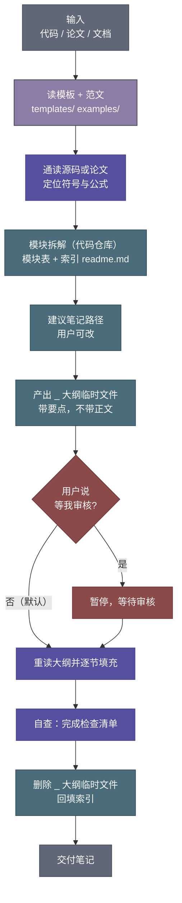

<div align="center">

# note-ai

**把 AI 代码与论文，读成一份能沉淀下来的学习笔记。**

一个面向 AI 算法场景的 Agent Skill：读代码、读论文、画计算图、按符号定位核对、写公式，最后产出结构固定的 Markdown 笔记。

<sub>Turn AI papers & source code into reusable, template-locked study notes.</sub>

[](CHANGELOG.md)


[](LICENSE)

[特性](#-核心特性) · [快速开始](#-快速开始) · [工作流](#-工作流) · [产出结构](#-产出长什么样) · [质量红线](#-质量红线) · [目录结构](#-目录结构) · [FAQ](#-常见问题)

</div>

---

## 这个 skill 解决什么问题

让 AI "讲讲这段代码"很容易，让 AI 写出**能长期复用的笔记**很难。常见的翻车方式有三种：

| 翻车方式 | 表现 | note-ai 的对策 |
| --- | --- | --- |
| 🌀 **自由发挥** | 每次章节结构都不一样，第二篇笔记就和第一篇对不上 | 模板即终点：顶层章节固定，禁止自创 |
| 👻 **幻觉引用** | 代码定位、变量名、论文公式全靠编，回头对不上源码 | 符号级定位核对（禁用行号）+ 前向图逐条对照源码 |
| 🧊 **只讲是什么** | 公式堆一屏，符号不解释，读者不知道哪个是输入、哪个是推导 | 符号三层解释：含义 / 元素组成 / 来源 |

note-ai 把这些要求写成 skill 内部的**硬约束 + 收尾检查清单**，让每次产出都落在同一条质量线上。

---

## ✨ 核心特性

| 能力 | 说明 |
| --- | --- |
| 📐 **模板即终点** | 代码笔记固定 7 章、论文笔记固定 6 章，**顶层章节不许改名、不许新增**。不适用的小节显式标注"（本节不适用）"，而不是删掉换一个自己想的。 |
| 🧩 **自动模块拆解** | 多模块仓库先按「运行时职责 + 依赖方向 + 共同变更原因」拆成 3–9 个模块，产出模块表与索引 `readme.md`，再逐篇写；命名 `NN-<主符号>.md`、编号按依赖顺序且**只追加不重排**。 |
| 🔍 **源码级核对** | 前向计算图不是"画个大概"，而是**逐行对照源码建立变量定义表**，专抓链式赋值、变量复用、分叉点位置这三类语义错误。 |
| 🎨 **统一的 Mermaid 绘图规范** | 低饱和度配色 + 三行节点（名称 / 公式 / 维度）；公式必须是严谨的 `输出 = f(输入)` 形式，变量名跟随源码，**图内不允许出现游离符号**。 |
| 🧮 **符号三层解释** | 每个数学符号都要说清三件事：① **含义** —— 它代表什么；② **元素组成** —— 复合量逐分量拆开、维度写全；③ **来源** —— 由哪条公式算出，还是数据直接给定。 |
| 🖼️ **论文图精确裁剪** | 不整页截图。用 PyMuPDF 按图注定位、按栏聚类矢量路径，只裁图区域，再以 HTML 限宽居中插入，图下配说明。 |
| 🛡️ **不编造事实** | 没有实验数据就明确写"该论文未提供实验对比"，没有流程图来源就拒绝画架构图。**宁可留白，不造数据。** |

---

## 🚀 快速开始

### 1. 安装

```bash
# macOS / Linux
git clone https://github.com/MonsterFan-Cyber/note-ai.git \
  ~/.config/opencode/skills/note-ai
```

```powershell
# Windows (PowerShell)
git clone https://github.com/MonsterFan-Cyber/note-ai.git `
  "$env:USERPROFILE\.config\opencode\skills\note-ai"
```

> 目录名必须叫 `note-ai`，且与 `SKILL.md` frontmatter 中的 `name` 字段一致。
> 使用其他 Agent 运行时（如自定义的 skill 加载器）时，把整个目录放进其 skills 搜索路径即可，`SKILL.md` 是自包含的。

### 2. 触发

在项目里任选一种方式唤起：

| 方式 | 示例 |
| --- | --- |
| 触发词 | `在 .note 里给 MoE 这个类写一篇代码笔记` |
| 触发词 | `@.note 读一下这篇论文，输出笔记` |
| 斜杠命令 | `/note` |
| 自然语言 | `读一下 src/ 这份代码，给我写份代码阅读笔记` |
| 自然语言 | `帮我给这个仓库整理一套源码笔记` |

> 只问"这段代码怎么实现的、不用写文件"属于答疑，请用 `chat`。
> 目标是**多文件仓库**时，先自动拆模块并生成索引 `readme.md`（模块表会先给你看，可要求合并/拆分），再逐篇写笔记——即使用户只说"写份代码阅读笔记"也一样。

笔记默认写入项目根目录下的 `.note/`，可通过调用参数 `allowed_dir` 改写。

### 3. 用起来是什么感觉

```text
你  > 在 .note 里分析 src/models/moe.py 的 MoE 类

AI  > 建议路径：.note/code_note_v4_pro/03-MoE.md，确认吗？

AI  > 已生成大纲 _03-MoE.md（章节要点 + 待核对符号 + 待绘图清单）

AI  > 已产出正式笔记，收尾检查清单已逐项核对，大纲临时文件已删除。
```

默认**不打断你**：除非你事先说"等我审核大纲"，否则大纲写完直接进入填充。

---

## 🔄 工作流



---

## 📄 产出长什么样

### 代码笔记（7 章）

```text
1. 模块定位            文件 / 类 / 上下游 / 一句话职责
2. 整体架构与数据流     依赖图 + 前向计算图（完整版）+ 维度变化总览
3. 模块结构            可学习参数表 / 非可学习成员表 / __init__ 参数 / 缓冲
4. forward 关键路径    主流程 + 阶段分支 + 关键子步骤 + 输出处理
5. 特殊设计            量化 / 分布式 / 缓存与状态管理
6. 与论文或相邻模块对照  一致性核查表 / 职责边界表
7. 关键设计要点        只回答"为什么"
```

> 非类模块（流程篇 / `Dataset`）按 [`templates/code-outline.md`](templates/code-outline.md) 文末的「非类模块适配表」改写第 3 / 4 章标题（含第 4 章 H3 小节）与第 1 章字段，章数仍为 7，并在头部"说明"行注明。

### 论文笔记（6 章）

```text
1. 预备知识      本文首次提出的技术 / 直接引用的已有技术（两张表）
2. 要解决的问题   旧技术短板 → 本文的核心改进
3. 整体架构概览   高层流程图 + 逐块拆解 + 维度变化总览
4. 关键公式      公式块 + 逐符号三层解释
5. 实验与结论    数据集 / 指标 / 结果 / 消融
6. 思考与延伸    优点 / 局限 / 可借鉴之处
```

完整范文见 [`examples/01-compressor.md`](examples/01-compressor.md) —— 一个模块的代码笔记，可作为详略节奏与行文风格的参照。

---

## ✅ 质量红线

每次收尾都会逐项核对下列约束（摘自 `SKILL.md` 第 7 节检查清单）：

<details>
<summary><b>结构与内容</b></summary>

- ✅ 章节树与模板对齐，无自创 / 改名顶层章节，不适用小节已标注
- ✅ 可学习参数与非可学习成员分成两个表，缓冲已标注 `(buffer)`
- ✅ 子模块未展开，仅简短介绍被调用的成员与函数（用户显式指定的 class 除外）
- ✅ 代码仓库笔记：模块表已写入 `readme.md`，索引与磁盘文件一一对应
- ✅ 代码仓库笔记：文件名为 `NN-<主符号>.md`，编号按依赖顺序且未重排既有编号
- ✅ 代码仓库笔记：各篇覆盖符号无交集、无遗漏；薄入口脚本已合并成流程篇
- ✅ 非类模块（流程篇 / Dataset）已按适配表改写第 3/4 章标题与第 1 章字段，并在头部注明"非类模块适配"
- ✅ 笔记中无任何源码行号定位（头部引用块、正文、表格、图注均用类 / 函数 / 符号名定位）
- ✅ 论文笔记头部含"开源代码"行：官方仓库给完整 URL 与 License，未开源则显式说明
- ✅ 与原始代码 / 论文无矛盾之处

</details>

<details>
<summary><b>公式与记号</b></summary>

- ✅ 论文公式符号用 `$...$` / `$$...$$`，代码标识符用 `` `...` ``，未混用
- ✅ 数学公式未用 ` ```text ` / ` ```txt ` 代码块承载（该类型仅限 ASCII 示意图）
- ✅ 每个符号满足**三层解释**：含义 / 元素组成 / 来源

</details>

<details>
<summary><b>图表与配图</b></summary>

- ✅ Mermaid 语法已检查，配色符合统一约定
- ✅ 图内节点公式为严谨的 `输出 = f(输入)`，变量名跟随源码，无游离符号
- ✅ 前向图已逐行对照源码：链式赋值合并、分叉点 = 变量定义节点、读入变量名一致
- ✅ 图片用 HTML 限宽居中、图下说明齐全、PDF 裁剪未混入正文或图注

</details>

---

## 🗂 目录结构

```text
note-ai/
├── SKILL.md                  # 技能本体：角色边界、行为准则、全部硬约束
├── README.md                 # 本文件
├── CHANGELOG.md              # 版本变更记录
├── LICENSE
├── templates/
│   ├── code-outline.md       # 代码笔记模板（章节骨架 + 填写说明）
│   ├── code-repo-index.md    # 代码仓库索引模板（模块总表 / 切分说明 / 阅读顺序）
│   └── paper-outline.md      # 论文笔记模板
├── examples/
│   └── 01-compressor.md      # 完整范文：一个模块的代码笔记
└── references/
    ├── module-decomposition.md  # 拆解手册：切分依据 / 粒度规则 R1–R5 / 命名编号
    └── troubleshooting.md       # 踩坑手册：Mermaid / PDF 裁剪 / 图片渲染
```

运行期参数（写在 `SKILL.md` frontmatter 中）：

| 字段 | 值 | 说明 |
| --- | --- | --- |
| `runAs` | `subagent` | 以子代理身份运行，拥有独立上下文 |
| `invocation` | `manual` | 需触发词或 `/note` 命令唤起 |
| `allowed-tools` | `read_file` `write_file` `edit_file` `bash` `web_search` | 工具白名单；不同运行时命名不同（如 opencode 中为 `read` / `write` / `edit` / `shell` / `websearch`），按能力对应即可 |
| `allowed_dir` | `.note` | 唯一允许写入的目录，可被调用方覆盖 |
| `model` | `deepseek-v4-flash` | 默认运行模型 |

---

## 🤝 与相邻 skill 的关系

| skill | 关系 | 怎么配合 |
| --- | --- | --- |
| `decompose` | ⬆️ 上游 | 若已产出 `.note/_arch/` 层级结构文档，本 skill 直接消费其依赖关系，不重复拆解 |
| `chat` | ↔️ 分流 | `chat` 只读答疑、不改文件；**只想问个问题用 `chat`，想沉淀笔记用 `note-ai`** |
| `testpy` | ➖ 无关 | 无协作关系 |

> 职责边界：本 skill **只承担「代码 / 论文 → 学习笔记」这一件事**。排障、写代码、写 PRD 或方案文档不属于它的职责范围。

---

## ❓ 常见问题

<details>
<summary><b>笔记会写到哪里？会不会动我的源码？</b></summary>

只写 `allowed_dir`（默认 `.note/`）。读取不限，但写入被锁在笔记目录内；需要写到目录外会先征得你同意。

</details>

<details>
<summary><b>我只说"写份代码阅读笔记"，它会先拆模块吗？</b></summary>

会。只要目标是**代码仓库**（≥2 个源文件，或单文件 ≥3 个顶层类/函数）且你没有指定具体类，就会先按「运行时职责 + 依赖方向 + 共同变更原因」拆成 3–9 个模块，生成索引 `readme.md`，并把模块表先给你看。想调整划分就在这一步说——进入大纲后不再重切。

"给我讲讲这段代码怎么实现的、不用写文件"这类纯答疑不走这条流程，用 `chat`。

</details>

<details>
<summary><b>Mermaid 渲染失败怎么办？</b></summary>

先分清是语法问题还是环境问题。`mmdc` 缺 Chromium 时会**静默输出 0 字节 SVG 且不报错**，别误判成功；无浏览器环境直接调 `mermaid.parse` 会报 `DOMPurify.sanitize is not a function`，这属于环境问题，不要硬刚。

处理办法见 [`references/troubleshooting.md`](references/troubleshooting.md)。

</details>

<details>
<summary><b>论文图是矢量绘制的，<code>get_images()</code> 拿不到？</b></summary>

正常现象。按图注定位 → 按栏过滤 `get_drawings()` 的矢量路径 → 聚类取最大簇 → 加 padding 裁剪渲染，并以"下沿高于图注上沿"作为验图标准。详见 `SKILL.md` 4.2。

</details>

<details>
<summary><b>我只想要一段快速讲解，不想生成文件。</b></summary>

用 `chat` skill。`note-ai` 是写入模式，会走完整模板流程，杀鸡用牛刀。

</details>

<details>
<summary><b>能用在 Claude Code / 其他 Agent 上吗？</b></summary>

`SKILL.md` 是自包含的 Markdown 指令，核心约束不依赖特定运行时。只需把目录放在对应运行时的 skills 搜索路径下，并保证"读文件 / 写文件 / 改文件 / 执行命令 / 联网检索"这几类能力可用（工具名各家不同，按能力对应即可）。

</details>

---

## 📅 版本

当前版本 **0.1.11**，完整变更历史见 [CHANGELOG.md](CHANGELOG.md)。

---

<div align="center">

## License

[MIT](LICENSE) © [MonsterFan-Cyber](https://github.com/MonsterFan-Cyber)

<sub>读得懂，才写得出。</sub>

</div>
