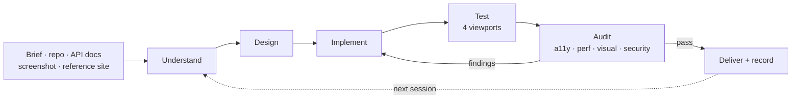
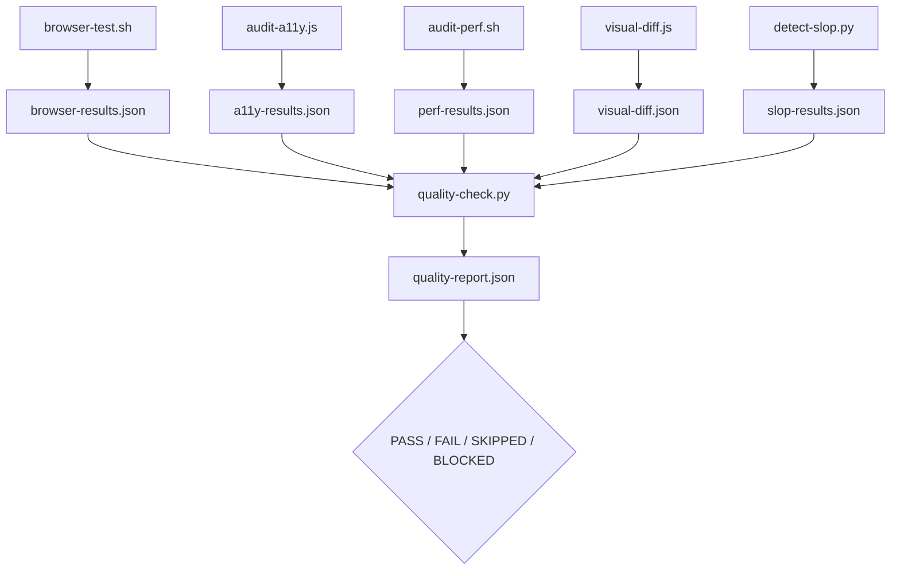

# Universal Frontend Master

**An OpenCode skill that runs the whole frontend loop — design, build, test, audit, fix, record.**

<p align="center">
  <a href="LICENSE"></a>
  <a href="https://opencode.ai"></a>
  <a href="https://nodejs.org"></a>
  <a href="https://python.org"></a>
</p>

<p align="center">
  <a href="#quick-start">Quick start</a> ·
  <a href="#whats-inside">What's inside</a> ·
  <a href="#documentation">Docs</a> ·
  <a href="CATALOG.md">Catalog</a>
</p>

Install once per user, then invoke it in **every project**:

```text
@universal-frontend-master Build a complete, professional, responsive website for this project.
```

---

Most frontend agents write code and stop. This one runs the full engineering loop:



Every finding comes from script output — axe-core, Lighthouse, pixelmatch, and a
design linter — not from eyeballing a screenshot. A required check that is
skipped or stale **blocks** delivery instead of passing quietly.

---

## What's inside

| Piece | Detail |
|-------|--------|
| **4 skills** | `universal-frontend-master`, `ufmw-frontend-design`, `ufmw-seo-protocol`, `init-frontend` — dependencies resolved automatically at install |
| **17 agents** | primaries plus specialist subagents, flat in `agents/`, invoked with `@agent-name` |
| **34 commands** | `/ufme/*`, `/ufmw/*`, and `/profile/*` |
| **4 profiles** | `lite` · `standard` · `advanced` · `autonomous` |
| **Persistent memory** | `.ufme/` per project, `~/.config/ufme/` across projects |
| **Evidence gate** | `.ufme/evidence/*.json` → `quality-report.json` |

### Skills

| Skill | Entry agent | Does |
|-------|-------------|------|
| `universal-frontend-master` | `@universal-frontend-master` | The full loop: intake → design → build → audit → fix → record |
| `ufmw-frontend-design` | `@ufmw-frontend-design` | Reference-driven design: analyze a site, adapt elements, verify intent |
| `ufmw-seo-protocol` | `@ufmw-seo-protocol` | Crawl, plan, fix, verify, and monitor technical + on-page SEO |
| `init-frontend` | `@init-frontend` | Ask every design question, then scaffold tokens and components |

### Agents

| Agent | Mode | Role |
|-------|------|------|
| `universal-frontend-master` | primary | Entry point; delegates per active profile |
| `ufmw-frontend-design` | primary | Reference-driven design entry point |
| `ufmw-seo-protocol` | primary | SEO entry point |
| `init-frontend` | primary | Project scaffolding entry point |
| `ufme-orchestrator` / `ufmw-orchestrator` | subagent | Plan, enforce the profile, pack context, accept results |
| `ufme-designer` / `ufmw-designer` | subagent | Research, PRD, sitemap, design system, critique |
| `ufme-backend-analyst` | subagent | API map, auth map, capabilities, error handling |
| `ufme-builder` / `ufmw-builder` | subagent | Architecture, pages, components, API client, integration |
| `ufme-auditor` / `ufmw-auditor` | subagent | Visual, a11y, performance, and security audits from evidence |
| `ufmw-seo-analyst` · `-technical` · `-content` · `-auditor` | subagent | Keyword, crawl, on-page, and SEO audit specialists |

The generated [CATALOG.md](CATALOG.md) has the exact path for every one.

### Profiles

Run any time in any project:

| Command | Guidance | Use for |
|---------|-----------|---------|
| `/profile/lite` | shallow research, basic checks | Small edits, quick prototypes |
| `/profile/standard` | balanced research and verification | Typical projects |
| `/profile/advanced` | deep research, thorough checks | Complex projects |
| `/profile/autonomous` | deep research, exhaustive checks | Unattended runs |

UFMW profiles are advisory guidance for research and verification depth. They never
limit agent collaboration, delegation, tool or MCP use, or parallel execution; the
entry agent chooses the strategy that fits the task.

### The audit loop



| Status | Meaning |
|--------|---------|
| `PASS` | Check ran, evidence is fresh and within threshold |
| `FAIL` | Threshold exceeded, or evidence missing/stale |
| `SKIPPED` | Preconditions missing; never counts as a pass |
| `BLOCKED` | A required check could not run |

### Safety

| Action | Policy |
|--------|--------|
| `sudo`, `pacman`, `systemctl`, `doas`, `pkexec`, `su` | Denied |
| `rm -rf /`, `rm -rf ~` | Denied |
| `git push` | Ask |
| `npm publish` | Denied |
| Dependencies | Project-local only |
| Browser sandbox | Preserved; CI flags are an explicit opt-in |

Defined in [`opencode.json`](opencode.json) and
[`core/SAFETY.md`](skills/universal-frontend-master/core/SAFETY.md).

---

## Quick start

**Requirements:** [OpenCode](https://opencode.ai), Node.js `^22.23.4` /
`^24.22.1` / `>=26.12.1`, Python 3.9+, and Chromium and/or Firefox. Selenium
Manager fetches the matching driver; nothing needs root.

### Install (user scope — all projects)

```bash
curl -fsSL https://raw.githubusercontent.com/Paranthaman-K6/ufms/main/install.sh | bash
```

The installer opens a TUI: pick scope (project / global / both), skills, agents,
commands, memory, and audit dependencies. Everything is selected by default —
press **Enter** to accept, **Space** to toggle, **←/→** to change scope, **q** to
cancel.

Install into one project:

```bash
INSTALL_DIR=/path/to/project \
  curl -fsSL https://raw.githubusercontent.com/Paranthaman-K6/ufms/main/install.sh | bash
```

Scripted install, no TUI:

```bash
INSTALL_SCOPE=both bash install.sh
INSTALL_SCOPE=global UFME_SKIP_NPM=1 bash install.sh
```

| Env var | Effect |
|---------|--------|
| `INSTALL_SCOPE=project\|global\|both` | Scope; setting it skips the TUI |
| `UFME_SKILLS=a,b` | Install only these skills |
| `UFME_SKIP_AGENTS=1` | Skip agents |
| `UFME_SKIP_COMMANDS=1` | Skip slash commands |
| `UFME_SKIP_MEMORY=1` | Skip `.ufme/` seeding |
| `UFME_SKIP_NPM=1` | Skip project-local audit dependencies |
| `UFME_NONINTERACTIVE=1` | Never open the TUI |
| `UFME_TAG` + `UFME_TARBALL_SHA256` | Pin and verify a release tarball |

Repeat installs merge into existing directories and never overwrite project
memory. The installer resolves declared skill dependencies automatically, so
`~/.config/opencode/skills/universal-frontend-master/scripts/` works outside a
checkout.

### Use it

```text
@universal-frontend-master Build a complete, professional, responsive website for this project.
/profile/standard Build a product landing page with a contact form.
```

### Uninstall

```bash
bash uninstall.sh                 # current project
bash uninstall.sh --global-only   # user scope
bash uninstall.sh --project-only  # project scope only
```

Idempotent, and it removes only UFME-managed paths — `.ufme/` memory,
`opencode.json`, `package.json`, and your files stay.

### Work on this repo

```bash
git clone https://github.com/Paranthaman-K6/ufms.git
cd ufms
npm ci
bash skills/universal-frontend-master/scripts/check-native-browser.sh
npm test
```

`.opencode/` and `CATALOG.md` are generated. Edit `skills/`, `agents/`, or
`commands/`, then:

```bash
python3 scripts/build-agents.py   # validate agents/ and mirror to .opencode/agents/
python3 scripts/catalog.py        # regenerate CATALOG.md and mirror skills/commands
```

---

## Optional shared registry

The local library registry (`~/.config/ufme/LIBRARY_REGISTRY.md`) is the default.
To share one registry across machines, deploy the MCP server in
[`registry-server/`](registry-server/README.md):

```bash
cd registry-server
npm install
npm test
vercel deploy   # set REGISTRY_ADMIN_PASSWORD, REGISTRY_API_KEY, BLOB_READ_WRITE_TOKEN
```

Sign in at `/` to create or revoke API keys (shown once, stored hashed).
`/health` returns `503` when unconfigured; `/mcp` returns `401` for a wrong key.
It fits the free Vercel Hobby plan.

---

## Documentation

| Doc | What it covers |
|-----|----------------|
| [docs/README.md](docs/README.md) | Documentation index |
| [docs/ARCHITECTURE.md](docs/ARCHITECTURE.md) | Authored vs generated, memory model, evidence gate, invariants |
| [docs/DEVELOPMENT.md](docs/DEVELOPMENT.md) | Setup, checks, CI, adding skills/agents/commands |
| [docs/SKILLS.md](docs/SKILLS.md) | Every skill, its scripts, and its commands |
| [CATALOG.md](CATALOG.md) | Generated list of all skills, agents, and commands |
| [registry-server/README.md](registry-server/README.md) | Registry endpoints, auth, storage, deploy |

---

## Contributing

Keep changes inside the existing structure: skills in `skills/<name>/`, agents in
`agents/`, commands in `commands/`, runtime state in `.ufme/`. Before a pull
request:

```bash
npm test
python3 scripts/catalog.py --check
python3 scripts/build-agents.py --check
```

See [docs/DEVELOPMENT.md](docs/DEVELOPMENT.md) for the full check matrix.

## License

MIT © [Paranthaman-K6](https://github.com/Paranthaman-K6). See [LICENSE](LICENSE).
