# Skills

<p align="center">
  <a href="https://www.npmjs.com/package/@pedroab0/skills"></a>
  <a href="https://www.npmjs.com/package/@pedroab0/skills"></a>
  <a href="https://github.com/pedroab0/skills"></a>
  <a href="LICENSE"></a>
</p>

A curated collection of modular, production-ready **Agent Skills** developed for AI coding assistants (such as Claude Code, Google Antigravity, Cursor, Kiro, OpenCode, and Codex) across diverse software engineering disciplines.

Each skill gives autonomous AI assistants specialized capabilities while upholding four core pillars:
- **Token Efficiency**: Compact instruction sets (< 500 lines) with progressive disclosure (`REFERENCE.md`) to keep agent context lean and fast.
- **Zero Dependencies**: Standalone scripts using Node.js built-ins (`fs`, `path`, `https`, `crypto`) with zero `node_modules` overhead.
- **Domain Intelligence**: Deterministic procedural workflows, normalized ASTs, resolved design tokens, and workspace orchestration.
- **Cross-Agent Portability**: 100% compliant with the open **Anthropic Agent Skills standard** (`SKILL.md`) across all major coding agents.

---

## Available Skills by Domain

### 1. Architecture & Workspace Engineering

| Skill | Focus | Description | Links |
| :--- | :--- | :--- | :--- |
| **[`generate-meta-repo`](./generate-meta-repo)** | **Architecture & Governance** | Scaffolds a Manifest-based Multi-root Workspace (Meta-Repo) with `repos.json`, zero-dependency orchestration scripts, `Makefile`, Docker Compose dev stack, `.code-workspace`, and layered AI governance (`AGENTS.md`, `CLAUDE.md`). | [Guide](./generate-meta-repo/README.md) · [Blueprint](./generate-meta-repo/meta-repo-architecture-guide.md) · [`SKILL.md`](./generate-meta-repo/SKILL.md) |

### 2. Design, UI & Spec-Driven Development (SDD)

| Skill | Focus | Description | Links |
| :--- | :--- | :--- | :--- |
| **[`figma-to-code`](./figma-to-code)** | **One-Shot / Fast Prototyping** | Direct, single-turn conversion of Figma designs into clean, production-ready UI components. Best for rapid prototyping and standalone components. | [Guide](./figma-to-code/README.md) · [`SKILL.md`](./figma-to-code/SKILL.md) |
| **[`figma-extractor`](./figma-extractor)** | **SDD Step 1 (Ingest)** | Pure specification scraper (CLI / REST API) and companion Figma Desktop plugin that extract compact layout trees, design tokens, and preview images into `./.specs/`. Never touches application code. | [Guide](./figma-extractor/README.md) · [Plugin](./figma-extractor/figma-plugin/README.md) · [Community](https://www.figma.com/community/plugin/1691244420692136789/node-json-extractor) · [`SKILL.md`](./figma-extractor/SKILL.md) |
| **[`figma-node-builder`](./figma-node-builder)** | **SDD Step 2 (Implement)** | Grounded UI builder that reads extracted Figma Node specifications (`.specs/*.json`) and companion preview images (`*.png`) to build components without CSS hallucinations. | [Guide](./figma-node-builder/README.md) · [`SKILL.md`](./figma-node-builder/SKILL.md) |

### 3. Community Ecosystem & Roadmap

We actively welcome ideas and contributions to expand the catalog across new engineering domains:
- **Backend & APIs**: OpenAPI/AsyncAPI scaffolders, RPC/gRPC contracts, and deterministic API mocking.
- **Database & Data Modeling**: Schema inspection, migration generators, and seed data synthesis.
- **Testing, QA & Security**: Deterministic test scaffolding, accessibility (a11y) audits, and benchmark rubrics.
- **DevOps & Tooling**: CI/CD pipeline synthesizers, release automation, and environment validators.

---

## Featured Agent Workflows

```mermaid
flowchart TD
    subgraph FlowArch ["🏗️ Architecture & Governance"]
        M1["Multi-Repo Stacks"] --> M2["generate-meta-repo"]
        M2 --> M3["repos.json + Docker Dev Stack + AI Rules"]
    end

    subgraph FlowSDD ["📐 Spec-Driven Development (SDD)"]
        S1["Figma Design"] --> S2["figma-extractor"]
        S2 --> S3[".specs/ Spec Contract"]
        S3 --> S4["figma-node-builder"]
        S4 --> S5["Production UI Code"]
    end

    subgraph FlowFast ["⚡ Rapid One-Shot"]
        F1["Figma URL"] --> F2["figma-to-code"] --> F3["Direct UI Code"]
    end
```



- **Architecture Scaffolding**: Use `generate-meta-repo` to scaffold clean multi-root workspaces with independent git sub-repos, automated cross-repo linking, and hierarchical agent governance.
- **Spec-Driven Frontend Development (SDD)**: Use `figma-extractor` + `figma-node-builder` when precision is essential. The design spec is extracted to disk first, reviewed, and systematically implemented without premature or hallucinated code edits.
- **Fast UI Prototyping**: Use `figma-to-code` for immediate, single-turn conversion of a Figma link directly into UI code.

---

### Zero-API Companion: Figma Desktop Plugin

<p align="center">
  
</p>

For the Design & SDD workflow, you can extract specifications directly inside Figma Desktop without API tokens or rate limits using the companion [**Node JSON Extractor**](./figma-extractor/figma-plugin/README.md) plugin:
* **Figma Community (Recommended)**: Install [**Node JSON Extractor** on Figma Community](https://www.figma.com/community/plugin/1691244420692136789/node-json-extractor) directly, or search for it under Figma Plugins.
* **Manual Manifest Import (Local Backup)**: In Figma Desktop, go to **Plugins** $\rightarrow$ **Development** $\rightarrow$ **Import plugin from manifest...** and select `manifest.json` from `<skill-dir>/figma-extractor/figma-plugin/manifest.json`.

---

## Quick Install via `npx`

Install any skill or full suites into your AI coding assistant with a single interactive command:

```bash
# Recommended (npm registry):
npx @pedroab0/skills@latest

# Or directly from GitHub:
npx github:pedroab0/skills
```

The installer features an interactive terminal UI:
* **Navigate**: Use keyboard arrows (`↑` / `↓`) or vim keys (`k` / `j`) to move between options.
* **Select**: Press `[Enter]` or press number keys (`1` - `6`) to select directly.
* **Exit**: Press `[ESC]` or `q` at any time to cancel cleanly.

### Selection Options & Presets

* `[Enter / 1]` **All skills**: Installs full suite (recommended)
* `[2]` **SDD Suite**: `figma-extractor` + `figma-node-builder`
* `[3]` **`figma-to-code`**: Fast prototyping (URL ──► UI Code)
* `[4]` **`figma-extractor`**: Figma scraper (AST, tokens & previews to `.specs/`)
* `[5]` **`figma-node-builder`**: Builds UI components from `.specs/*.json`
* `[6]` **`generate-meta-repo`**: Scaffolds Meta-Repo & AI governance

Or specify flags for non-interactive automation:
```bash
# Install all skills for Claude Code globally
npx @pedroab0/skills@latest --agent claude --skill all

# Install architecture generator for Google Antigravity
npx @pedroab0/skills@latest --agent antigravity --skill generate-meta-repo

# Install SDD suite for Kiro (IDE & CLI)
npx @pedroab0/skills@latest --agent kiro --skill sdd

# Install one-shot coder for Cursor (.cursor/rules)
npx @pedroab0/skills@latest --agent cursor --skill figma-to-code
```

---

## Manual Installation Guide

All skills follow the open Agent Skills standard (`SKILL.md` format) and can be symlinked or copied into any agent directory:

| Agent | Global Skills Path | Workspace Local Path |
| :--- | :--- | :--- |
| **Claude Code** | `~/.claude/skills/<skill>` | `.claude/skills/<skill>` |
| **Google Antigravity** | `~/.gemini/config/skills/<skill>` | `.gemini/skills/<skill>` |
| **OpenCode** | `~/.config/opencode/skills/<skill>` | `.opencode/skills/<skill>` |
| **Kiro (IDE & CLI)** | `~/.kiro/skills/<skill>` | `.kiro/skills/<skill>` |
| **Cursor** | — | `.cursor/rules/<skill>.mdc` (or use installer) |

### Symlink Example (All Skills)

```bash
# Example for Claude Code (replace destination with your agent's path):
TARGET_DIR="$HOME/.claude/skills"
mkdir -p "$TARGET_DIR"

for skill in generate-meta-repo figma-to-code figma-extractor figma-node-builder; do
  ln -s "$(pwd)/$skill" "$TARGET_DIR/$skill"
done
```

---

## Repository Structure

```text
skills/
├── README.md                 # Curated skills repository catalog (this file)
├── AGENTS.md                 # Universal and domain-specific rules for AI agents
├── CLAUDE.md                 # Quick commands & guidelines for Claude Code
├── bin/                      # Multi-agent interactive CLI installer (npx @pedroab0/skills@latest)
├── generate-meta-repo/       # Domain: Architecture & Workspace Engineering
├── figma-extractor/          # Domain: Design & Spec-Driven Development (Step 1: Ingest)
├── figma-node-builder/       # Domain: Design & Spec-Driven Development (Step 2: Implement)
├── figma-to-code/            # Domain: Rapid Prototyping (One-Shot)
├── test/                     # Cross-agent installer & documentation parity test suite
└── evals/                    # Multi-model evaluation rubrics (Haiku, Sonnet, Opus)
```

---

## Adding New Skills

When adding new skills to this curation:
1. **Create dedicated directory**: `<skill-name>/`
2. **Agent instructions (`SKILL.md`)**: Follow the Anthropic Agent Skills standard with YAML frontmatter (`name`, `description` starting with a 3rd-person singular present verb) and body under 500 lines.
3. **Documentation (`README.md`)**: Provide clear documentation and manual execution flags.
4. **Zero external dependencies**: Helper scripts in `scripts/` must strictly use Node.js built-ins (`fs`, `path`, `https`, `crypto`).
5. **Testing & Parity**: Run `npm test` and `npm run pack:check` to ensure 100% test pass rate and package size under 100 kB.
6. **Catalog update**: Register the new skill in `bin/cli.js` and this root `README.md`.

---

## License

This project is licensed under the [MIT License](LICENSE).
