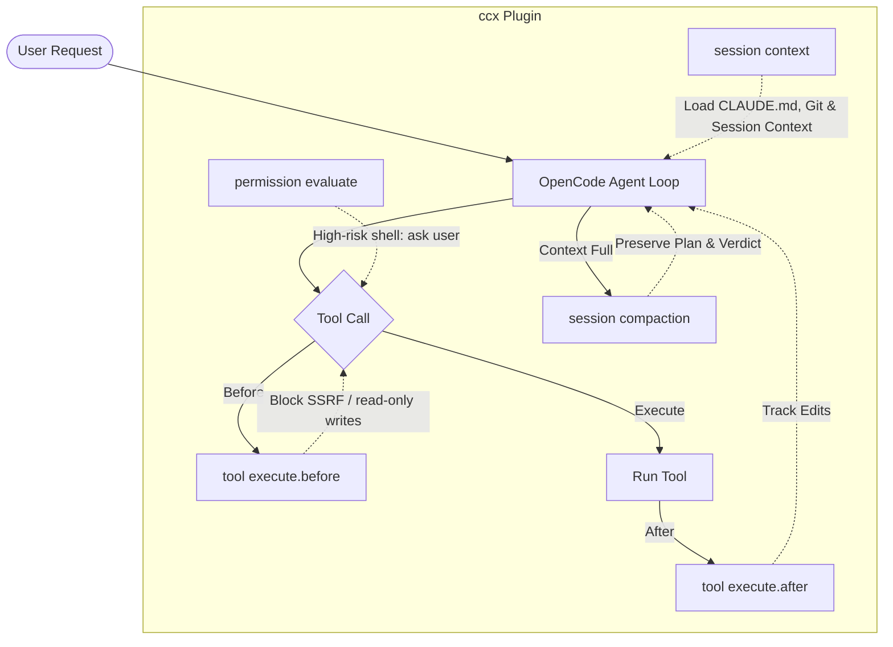
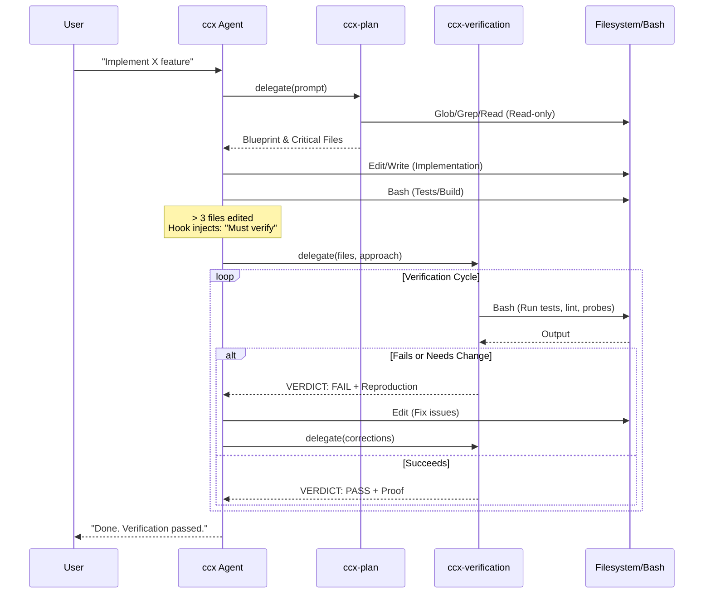

<p align="center">
  <h1 align="center">ccx</h1>
  <p align="center"><strong>Coding Copilot, eXtended</strong></p>
  <p align="center">
    An <a href="https://opencode.ai">OpenCode</a> plugin that brings Claude Code's behavioral discipline to any model.<br/>
    Built by reverse-engineering Claude Code's prompt architecture and adapting it for the OpenCode ecosystem.
  </p>
  <p align="center">
    <a href="https://www.npmjs.com/package/@ccx-agent/opencode-ccx"></a>
    <a href="https://github.com/Rejudge-F/ccx/blob/main/LICENSE"></a>
  </p>
</p>

---

## The Problem

LLM coding agents tend to over-engineer, skip verification, and run destructive commands without thinking. They add abstractions nobody asked for, report "done" without testing, and `rm -rf` without blinking.

Claude Code solved this with a sophisticated behavioral framework — but it's locked to Anthropic's CLI and pricing.

## The Solution

ccx extracts the core behavioral principles from Claude Code's prompt architecture and makes them work in OpenCode — with any model, any provider.

It's not a wrapper or a proxy. It's a complete behavioral framework: 8 composable system prompt sections, 4 default subagents (+ optional coordinator), and 10 runtime hooks that dynamically adapt the agent's behavior every turn.

**Before ccx:** Agent writes 200 lines, adds 3 helper files, says "done."

**After ccx:** Agent writes 40 lines, runs the tests, spawns a verification agent that tries to break it, then reports the VERDICT.

---

## Quick Start

> **Requires OpenCode 2.x.** ccx 1.x targets the OpenCode 2 plugin API (`@opencode/plugin`). On OpenCode 1.x, pin `@ccx-agent/opencode-ccx@0.8`.

```bash
opencode plugin add @ccx-agent/opencode-ccx
```

That's it. Restart OpenCode. ccx registers itself as the default agent; press `Tab` to switch between agents.

> **Important:** ccx registers as a standalone agent, not a modifier on another agent. If you prefer a different default, set `"default_agent": "build"` (or any agent id) in your `opencode.json`; your config always wins over ccx.

`opencode plugin add` writes to the global configuration. To enable ccx for a single project only, use the manual installation below in the project's `opencode.json`.

### Manual Installation

Add to your `opencode.json`:

```jsonc
// ~/.config/opencode/opencode.json (global) or ./opencode.json (project)
{
  "plugins": [
    "@ccx-agent/opencode-ccx"
  ]
}
```

### Development / Local Build

```bash
git clone https://github.com/Rejudge-F/ccx.git
cd ccx && bun install && bun run build
```

Then in `opencode.json` (OpenCode 2 loads local plugins from a package directory, not a file):

```jsonc
{
  "plugins": [
    "/path/to/ccx"
  ]
}
```

---

## What's Inside

### Architecture & Hook Integration

ccx intercepts the standard OpenCode execution loop at multiple points to inject discipline and safety:



### Primary Agent: `ccx`

The main agent comes with 8 composable system prompt sections derived from Claude Code's prompt architecture:

| Section | What it enforces |
|---------|-----------------|
| **intro** | Agent identity, trust boundary, prompt injection defense |
| **system-rules** | Permission model, context compression, prompt injection awareness |
| **doing-tasks** | Scope control — no unrequested features, no speculative abstractions, verify before declaring done |
| **actions** | Risk classification — reversible vs irreversible, local vs shared, ask before destroying |
| **using-tools** | Dedicated tools over Shell, parallel tool calls, structured progress tracking |
| **tone-style** | Concise output, no emojis, `file:line` references, `owner/repo#N` links |
| **output-efficiency** | Lead with the answer, skip filler, report at milestones not continuously |
| **environment** | Dynamic workspace context — cwd, git status, platform, shell |

### Subagents (Claude-like defaults)

| Agent | Mode | Default | Purpose |
|-------|------|---------|---------|
| **ccx-explore** | read-only | on | Fast codebase search — parallel glob/grep/read across large repos |
| **ccx-plan** | read-only | on | Software architect — produces step-by-step plans with critical file lists |
| **ccx-verification** | read-only | on | Adversarial verifier — VERDICT protocol (PASS/FAIL/PARTIAL), runs real commands, catches self-rationalizations |
| **ccx-general-purpose** | read-write | on | Multi-strategy worker for tasks outside other specialists |
| **ccx-coordinator** | orchestrator | off | Decomposes complex work into Research, Synthesis, Implementation, Verification across parallel workers. Tool surface is restricted to `subagent` |

### Runtime Hooks (OpenCode 2 plugin API)

ccx registers through `Plugin.define` and uses these OpenCode 2 extension points:

#### Startup Transforms

| Extension point | What it does |
|------|-------------|
| **agent.transform** | Registers the ccx agent (as default) + enabled subagents (coordinator is opt-in) with their system prompts, permission rules (read-only agents deny `edit`, which covers `edit` / `write` / `patch`) and optional model / sampling overrides. Your `opencode.json` agent settings are applied after ccx and win |
| **tool.transform** | Appends detailed per-tool usage notes, preferred alternatives, parallelism guidance, and safety rules to `shell` / `read` / `edit` / `write` / `glob` / `grep` / `webfetch` / `subagent` / `question` / `todowrite`, and registers the `worktree` tool |

#### `worktree` Tool

Moves the session into an isolated git worktree on a new branch, or back out of one. The model uses it only when you, or project instructions (AGENTS.md / CLAUDE.md), explicitly ask to work in a worktree; plain branch work still uses git commands.

- `enter` creates a worktree through OpenCode's worktree API (in OpenCode's managed worktree directory, configurable with `worktree.directory` in `opencode.json`), checks out a new branch named after it, and moves the session there. Relative paths, Shell commands, permissions, and ccx's git context then follow the worktree.
- `exit` moves the session back to the main checkout and keeps the worktree and branch. Delete it with `git worktree remove <path>`.
- Read-only subagents (explore, plan, verification) cannot use it.
- In the worktree, OpenCode reads configuration from the worktree's own files plus your global config. If ccx or your provider is configured only in an uncommitted project `opencode.json`, install ccx globally (`opencode plugin add`) or commit that config first.

#### Per-Turn Hooks (every LLM call)

| Hook | What it does |
|------|-------------|
| **session context** | Injects project instructions (CLAUDE.md tree, global CCX.md), git snapshot, session context (edited files list) and verification reminders as system parts; microcompacts older clearable tool outputs (keeps recent 5), trims long tool outputs (>8KB), collapses consecutive unsigned reasoning parts |

#### Event Hooks (reactive)

| Hook | What it does |
|------|-------------|
| **tool execute.before** | Three stages: (1) Context-Bundle injects cwd / git snapshot / recently changed files into `subagent` prompts so subagents share a baseline; (2) SSRF Guard pre-checks `webfetch` URLs against private, link-local, and cloud-metadata ranges (incl. IPv4-mapped IPv6) with async DNS resolution and **rejects** blocked calls; (3) Risk Guard **rejects** mutating shell commands from read-only agents and nested delegation from ccx subagents |
| **permission evaluate** | Runs AST-level shell analysis on every shell command OpenCode asks permission for, and turns high-risk ones (`rm -rf`, critical-path deletion, `find -delete`, pipe-to-shell, `git push --force`, `kubectl delete`, `terraform apply -auto-approve`, SQL `DROP`/`DELETE`-without-WHERE, … including wrapper unwrap `sudo`/`xargs`/`env`) into a native permission prompt. Never loosens a `deny`. Non-interactive runs reject the prompt |
| **tool execute.after** | Tracks completed file edits, feeds the dynamic verification reminder system |
| **session compaction** | Adds ccx preservation rules (original task, plan, edited files, verification status, decisions, …) to OpenCode's compaction template |
| **session prompt / idle** | Idle compaction: compacts a long session when you return to it after 30+ minutes idle |

#### Removed in 1.0 (OpenCode 2)

- The inline session workflow commands `/ccx-fork`, `/ccx-bg`, `/ccx-fullctx`, `/ccx-bg-status`. OpenCode 2 has native background subagents (`subagent` with `background: true`) and resumable subagent sessions (`sessionID`).
- Config keys `subagent_orchestration.session_workflows.*`, `compaction.*` (OpenCode 2 owns the compaction prompt and validates its template) and `risk_guard.ast_analysis` (AST analysis is always on). Old keys in an existing `ccx.json` are ignored, not rejected.
- Per-call sampling sanitization (`chat.params`). Subagent `temperature` / `top_p` overrides are now sent through the agent's request body; when both are set, `temperature` wins.

---

## Claude Code Alignment

ccx was built by studying Claude Code's prompt architecture and adapting its core behavioral principles for OpenCode. Here's what maps and what doesn't:

### What ccx replicates

| Claude Code Feature | ccx Implementation |
|--------------------|--------------------|
| 8-section system prompt | 8 composable prompt sections, near-identical content |
| Agent orchestration guidance | Same guidance style: use specialized subagents when appropriate, avoid overuse, avoid duplicate delegated work |
| Explore escalation threshold | `explore_min_queries=3` default (matches Claude CLI external default) |
| Coordinator default | Disabled by default, opt-in via config |
| Verification contract | Configurable. Strict contract is opt-in (`verification.enforce_contract=true`) |
| VERDICT protocol (PASS/FAIL/PARTIAL) | Identical format and adversarial strategies |
| Project instructions (CLAUDE.md) | Recursive upward discovery from cwd, merging every `CLAUDE.md` / `.claude/instructions.md` / `AGENTS.md` along the path plus a global `~/.config/opencode/ccx/CCX.md` (root-first ordering, budget-capped) |
| AST-level shell command analysis | Full AST inspection via `bash-parser` with wrapper unwrap (`sudo` / `xargs` / `env`), critical-path detection, `find -delete` / pipe-to-shell / eval-curl / `dd` to block device / `mkfs` / SQL DROP/DELETE-without-WHERE / `git push --force` / `kubectl delete` / `terraform apply -auto-approve` rules, plus user-level allow/block lists. High-risk findings become a native OpenCode permission prompt |
| SSRF defense for fetch tools | Pre-flight guard blocking private (10/8, 172.16/12, 192.168/16), CGNAT (100.64/10), link-local (169.254/16), IPv6 ULA (fc00::/7), link-local (fe80::/10), IPv4-mapped IPv6, and non-http(s) schemes; async DNS resolution with 2s timeout |
| Tool safety hints | `tool.transform` appends detailed per-tool usage notes, parallelism rules, git safety protocol, and preferred-alternative guidance for 9 tools (`shell` / `read` / `edit` / `write` / `glob` / `grep` / `webfetch` / `subagent` / `todowrite`) |
| Tool-output microcompact | Older `read/grep/glob/shell/webfetch` results are compacted automatically while preserving recent outputs |
| Context compaction preservation | Preservation rules added to OpenCode's compaction template via the `compaction` session hook |
| Trust boundary / prompt injection defense | Explicit section in system prompt |

### What only Claude Code has (engine-level)

| Feature | Why ccx can't replicate it |
|---------|---------------------------|
| Streaming tool execution (run tools while generating) | Engine-level, no plugin hook |
| Model fallback on 529 errors | Engine-level retry logic |
| Fork mode (shared prompt cache across subagents) | Engine-level session management |
| AI-powered safety classifier (YOLO mode) | Would require LLM call in hook, adds latency |
| Plan mode with user approval gate | Requires TUI integration (experimental) |

### Workflow parity summary (current defaults)

With the default ccx config shown below, workflow behavior is aligned to Claude CLI's external/default orchestration style:

- subagents are used when needed, not by default for every task
- broad exploration escalates after directed search becomes insufficient (`explore_min_queries=3`)
- coordinator-style multi-hop orchestration is off by default
- recursive subagent delegation is discouraged by default
- strict mandatory verification contract is off by default (opt-in)
- when enabled, coordinator runs orchestration-only with a constrained tool surface (`subagent`)
- every dispatched subagent receives an automatically injected context bundle (cwd / git snapshot / recently changed files) so it starts from the same baseline as the parent
- shell AST analysis, SSRF pre-flight check, recursive CLAUDE.md discovery, and detailed per-tool hints are on by default and can be toggled per-field in `ccx.json`

This is behavior-level parity, not engine-level identity. Engine internals (runtime schedulers, fork execution model, feature-flag infrastructure) are different and remain outside plugin scope.

---

## The Verification Agent

The most opinionated part of ccx. Key design decisions:



- **Execution over reading** — every check must include a `Command run` block with real terminal output. "I reviewed the code and it looks correct" is rejected.
- **Self-rationalization awareness** — the prompt lists excuses the agent will reach for ("the code looks correct", "the tests already pass", "this would take too long") and instructs it to do the opposite.
- **Type-specific strategies** — different verification approaches for frontend, backend, CLI, infrastructure, database migrations, refactoring, mobile, data pipelines, and more.
- **Adversarial probes required** — before issuing PASS, at least one probe must be attempted: concurrency, boundary values, idempotency, or orphan operations.

Output format:

```
VERDICT: PASS
```

or `FAIL` with reproduction steps, or `PARTIAL` with what couldn't be verified and why.

---

## Configuration

Config is loaded in this order (first hit wins):

1. `.opencode/ccx.json` (project-level)
2. `~/.config/opencode/ccx.json` (global)
3. built-in defaults

Notes:
- The config loader supports JSON with comments (`//` and `/* ... */`).
- Project config overrides global config (it does not deep-merge both files).

Create one of the following files:
- `.opencode/ccx.json` (project-level)
- `~/.config/opencode/ccx.json` (global)

Example:

```json
{
  "enabled": true,
  "disabled_sections": [],
  "disabled_hooks": [],
  "output_style": null,
  "verification": {
    "auto_remind": false,
    "enforce_contract": false,
    "min_file_edits": 3,
    "spot_check_min_commands": 2
  },
  "risk_guard": {
    "enforce_high_risk_confirmation": true,
    "extra_blocked_commands": [],
    "extra_allowed_commands": []
  },
  "ssrf_guard": {
    "enabled": true,
    "allow_loopback": true,
    "extra_blocked_hosts": [],
    "extra_allowed_hosts": []
  },
  "project_instructions": {
    "enabled": true,
    "recursive": true,
    "global_file": true,
    "max_depth": 8,
    "max_total_bytes": 64000,
    "filenames": ["CLAUDE.md", ".claude/instructions.md", "AGENTS.md"]
  },
  "tool_hints": {
    "enabled": true,
    "disabled_tools": []
  },
  "subagent_orchestration": {
    "explore_min_queries": 3,
    "coordinator_enabled": false,
    "allow_subagent_delegation": false,
    "agents": {
      "verification": {
        "model": "anthropic/claude-sonnet-4-5",
        "temperature": 0
      },
      "explore": {
        "model": "openai/gpt-5-mini",
        "temperature": 0.4
      }
    },
    "context_bundle": {
      "enabled": true,
      "include_cwd": true,
      "include_git": true,
      "include_recent_files": true,
      "max_recent_files": 8
    }
  }
}
```

| Field | Type | Default | Description |
|-------|------|---------|-------------|
| `enabled` | `boolean` | `true` | Master toggle for the entire plugin |
| `disabled_sections` | `string[]` | `[]` | Prompt sections to skip (e.g., `["tone-style"]`) |
| `disabled_hooks` | `string[]` | `[]` | Hooks to disable (e.g., `["risk-guard"]`) |
| `output_style` | `string \| null` | `null` | Custom output style name |
| `verification.auto_remind` | `boolean` | `false` | Auto-nudge verification after edits |
| `verification.enforce_contract` | `boolean` | `false` | Enable strict verification contract wording and reminder logic |
| `verification.min_file_edits` | `number` | `3` | File edit threshold before nudge |
| `verification.spot_check_min_commands` | `number` | `2` | Minimum verifier commands to re-run after PASS spot-check |
| `risk_guard.enforce_high_risk_confirmation` | `boolean` | `true` | Ask for permission (native OpenCode prompt) before running high-risk shell commands, even when shell is otherwise allowed |
| `risk_guard.extra_blocked_commands` | `string[]` | `[]` | Additional command names always flagged as high-risk (e.g., `["kubectl", "helm"]`) |
| `risk_guard.extra_allowed_commands` | `string[]` | `[]` | Command names to skip entirely (useful for per-project overrides) |
| `ssrf_guard.enabled` | `boolean` | `true` | Pre-check `webfetch` URLs and block private/link-local/cloud-metadata targets |
| `ssrf_guard.allow_loopback` | `boolean` | `true` | Allow `127.0.0.1` / `::1` / `localhost` for local dev servers |
| `ssrf_guard.extra_blocked_hosts` | `string[]` | `[]` | Hostnames (or IP literals) to always block |
| `ssrf_guard.extra_allowed_hosts` | `string[]` | `[]` | Hostnames (or IP literals) to allow even if they land in a private range — useful for internal infrastructure the agent legitimately needs to reach |
| `project_instructions.enabled` | `boolean` | `true` | Load project instruction files (CLAUDE.md / AGENTS.md / etc.) into the system prompt |
| `project_instructions.recursive` | `boolean` | `true` | Walk upwards from the working directory and merge every instruction file along the way. When `false`, only the current directory is inspected |
| `project_instructions.global_file` | `boolean` | `true` | Also load `~/.config/opencode/ccx/CCX.md` (or `instructions.md` / `CLAUDE.md` in the same directory) as a user-level preference file |
| `project_instructions.max_depth` | `number` | `8` | Maximum number of parent directories to scan during recursive discovery |
| `project_instructions.max_total_bytes` | `number` | `64000` | Total byte budget for the assembled instruction section. Later (more specific) files are prioritized; the tail is truncated when the budget is exceeded |
| `project_instructions.filenames` | `string[]` | `["CLAUDE.md", ".claude/instructions.md", "AGENTS.md"]` | Filenames to look for at each directory level |
| `tool_hints.enabled` | `boolean` | `true` | Append detailed per-tool usage notes to tool descriptions at startup |
| `tool_hints.disabled_tools` | `string[]` | `[]` | Tool names that should receive no hint (e.g., `["shell"]` if you prefer the raw description) |
| `subagent_orchestration.explore_min_queries` | `number` | `3` | Escalate to `ccx-explore` when directed lookup likely needs more than this query count |
| `subagent_orchestration.coordinator_enabled` | `boolean` | `false` | Register and advertise `ccx-coordinator` subagent |
| `subagent_orchestration.allow_subagent_delegation` | `boolean` | `false` | Permit subagents to delegate further. When `false`, runtime recursion guard rejects nested `subagent` calls from `ccx-*` subagents (except the coordinator) unless explicit delegation-approval metadata is present |
| `subagent_orchestration.agents.<name>.model` | `string` | unset | Override a registered ccx subagent model using OpenCode's `provider/model` format, e.g. `anthropic/claude-sonnet-4-5` |
| `subagent_orchestration.agents.<name>.variant` | `string` | unset | Model variant for that subagent; only applied together with `model` |
| `subagent_orchestration.agents.<name>.temperature` | `number` | unset | Override that subagent's temperature; must be non-negative. Takes precedence over `top_p` when both are set. Leave unset for models that reject sampling parameters |
| `subagent_orchestration.agents.<name>.top_p` | `number` | unset | Override that subagent's top-p sampling value; must be between 0 and 1. Ignored when `temperature` is set |
| `subagent_orchestration.context_bundle.enabled` | `boolean` | `true` | Inject a shared context bundle (cwd, git snapshot, recently changed files) into `subagent` prompts before execution |
| `subagent_orchestration.context_bundle.include_cwd` | `boolean` | `true` | Include the working directory in the injected bundle |
| `subagent_orchestration.context_bundle.include_git` | `boolean` | `true` | Include the per-session git snapshot in the injected bundle |
| `subagent_orchestration.context_bundle.include_recent_files` | `boolean` | `true` | Include `git ls-files --modified --others` output in the injected bundle |
| `subagent_orchestration.context_bundle.max_recent_files` | `number` | `8` | Cap the number of recent files included in the bundle |

---

## Project Structure

```
ccx/
├── src/
│   ├── index.ts              # Plugin entry — composes everything
│   ├── prompts/              # System prompt sections + composer
│   │   ├── tool-hints.ts              # Detailed per-tool usage guidance
│   │   └── project-instructions.ts    # Recursive CLAUDE.md + global CCX.md loader
│   ├── agents/               # 5 subagent definitions + shared subagent notes
│   ├── tools/                # ccx's own tools (worktree)
│   ├── hooks/                # Runtime hooks
│   │   ├── config-handler.ts         # Agent registration
│   │   ├── bash-analyzer.ts          # AST-level shell risk rules
│   │   ├── risk-guard.ts             # Read-only/nested-delegation guards + high-risk permission prompt
│   │   ├── ssrf-guard.ts             # Pre-flight URL/host SSRF check for webfetch
│   │   ├── context-bundle.ts         # Inject cwd/git/recent-files into subagent prompts
│   │   ├── verification-reminder.ts  # Edit tracking + nudge
│   │   ├── git-context.ts            # Per-session git snapshot
│   │   ├── dynamic-system-prompt.ts  # Per-turn system prompt injection
│   │   ├── idle-compaction.ts        # Compact long sessions after idle
│   │   ├── compaction.ts             # Compaction preservation rules
│   │   ├── tool-definition.ts        # Tool description enhancement
│   │   └── message-transform.ts      # Message history optimization
│   ├── config/               # Zod schema + JSONC config loader
│   ├── types/                # Local .d.ts for untyped dependencies (bash-parser)
│   └── plugin/               # OpenCode 2 plugin wiring (transforms + hooks)
├── .github/workflows/
│   └── publish.yml           # Auto-publish to npm on tag push
├── package.json
└── tsconfig.json
```

---

## Contributing

```bash
git clone https://github.com/Rejudge-F/ccx.git
cd ccx
bun install
bun run typecheck    # type check
bun run build        # build to dist/
```

To publish a new version:

```bash
# bump version in package.json, then:
git add -A && git commit -m "chore: bump to x.y.z"
git tag vx.y.z && git push origin main --tags
# GitHub Actions auto-publishes to npm
```

## License

MIT
