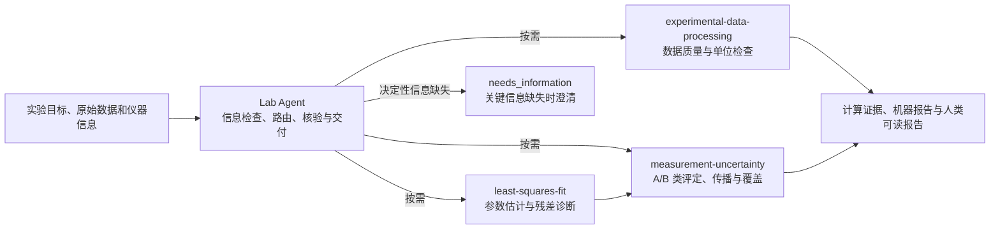
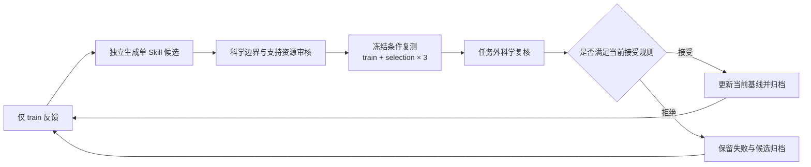

# Physics Lab Agent

**面向大学物理实验的可复现数据处理与测量不确定度分析智能体**

[](https://github.com/StargazeMoon/physics-lab-agent/actions/workflows/check.yml)

[](LICENSE)

Physics Lab Agent 研究如何将实验数据处理拆分为可检查、可执行和可复现的领域 Skill，并通过 Agent 按需调度这些 Skill，完成数据检查、模型拟合、不确定度评定、数值验证与结果报告。

项目的核心目标不是生成看似合理的物理解释，而是使每个数值结果都具有明确的测量模型、实际执行记录、机器可读输出和适用范围说明。当关键仪器或实验条件缺失时，系统应停止无依据的定量推断，明确指出需要补充的信息。

**当前公开发布版本：v3。** 本版本使用历史 24 题公开评测集，其中 train 10 题、selection 8 题、test 6 题。后续 60 题题库不在本发布分支中。

## 研究问题

通用语言模型能够解释物理概念，但仅凭文字生成不能保证实验数据处理的科学正确性。常见问题包括：

- 将扩展不确定度 \(U\) 直接当作标准不确定度 \(u\)；
- 忽略输入量之间的相关性、拟合参数协方差或覆盖因子条件；
- 混淆单次观测标准差与均值标准不确定度；
- 未说明有效自由度、分布假设、修正项和模型适用范围；
- 在仪器规格、校准记录或原始数据缺失时编造信息；
- 报告数字与计算文件不一致，或缺少可审计的执行证据。

本项目研究以下问题：**在固定模型、工具和评测条件下，模块化领域 Skill 能否比初始版本更稳定地产生可验证的实验数据处理结果？**

## 系统设计



系统由一个协调 Agent、三个领域 Skill 和共享数值工具组成。

| 组件 | 职责 | 入口 |
| --- | --- | --- |
| Lab Agent | 确认被测量和信息完整性；选择 Skill；检查模型、结果与证据交接；控制停止条件 | [AGENTS.md](AGENTS.md) |
| experimental-data-processing | 检查列定义、单位、重复条件、缺失值、重复记录和原始行号；记录转换与排除依据 | [SKILL.md](.agents/skills/experimental-data-processing/SKILL.md) |
| least-squares-fit | 调用 SciPy、lmfit 或 odrpack；返回参数顺序、协方差、残差、收敛和可辨识性诊断 | [SKILL.md](.agents/skills/least-squares-fit/SKILL.md) |
| measurement-uncertainty | 处理 A/B 类评定、相关性、传播、自由度、覆盖、蒙特卡洛、修约和不完整预算 | [SKILL.md](.agents/skills/measurement-uncertainty/SKILL.md) |
| `labcore/` | 提供数据画像、拟合、传播、报告和交付的共享数值接口 | [labcore/](labcore/) |

Skill 不按固定顺序机械调用。拟合需要权重时，可先评定观测不确定度；拟合完成后，参数与协方差交给不确定度模块；若题目缺少决定性事实，可提前进入澄清路径。

## 方法特征

- **数值计算由程序执行。** 均值、标准差、传播、拟合、自由度、覆盖因子、蒙特卡洛和修约均保留实际运行代码与输出。
- **模型与证据分离。** 模型选择依靠物理和统计依据，程序执行只证明计算步骤，不证明模型本身适用。
- **缺项处理显式化。** 仪器规格、校准、量程、重复性和实验特定条件不得由通用网页资料替代。
- **单位与量纲可追溯。** 输入、中间量和输出保留单位，换算过程写入计算记录。
- **协方差和相关性可见。** 拟合参数、共享校准和配对观测的相关信息不会被独立的方和根公式覆盖。
- **结果与限制同时交付。** 最终报告区分标准不确定度、扩展不确定度和缺失分量，并说明模型边界。
- **执行过程可审计。** 任务目录保存脚本、输入、未修约数值、报告和轨迹；评分绑定实际产物。

## 评测设计

历史公开开发评测集共 24 题：

| Split | 题数 | 用途 |
| --- | ---: | --- |
| train | 10 | 向候选生成过程提供失败反馈 |
| selection | 8 | 接受或拒绝候选版本 |
| test | 6 | 最终验收，不参与版本选择 |

train 和 selection 的每个版本各执行三次新会话，共 54 次初始运行。评测覆盖 NIST 认证拟合数据、GUM/JCGM 方法案例和明确标注的自编边界题。

科学评分由六个维度构成：

| 维度 | 权重 | 主要检查内容 |
| --- | ---: | --- |
| Data | 15 | 列、单位、条件、来源、转换和排除记录 |
| Model | 20 | 被测量、物理模型、修正、依赖关系和适用边界 |
| Outcome | 25 | 结果断言、必需字段和关键数值 |
| Method | 20 | A/B 类评定、传播、拟合、覆盖、MC、修约和诊断 |
| Reproducibility | 15 | 代码、命令、真实轨迹、产物和复算证据 |
| Reporting | 5 | 单位、不确定度含义、结论、限制和下一步 |

任务必须同时通过关键数值断言、证据要求和任务会话之外的逐项科学复核。较高的平均分不能抵消关键方法错误。

## RSI 迭代方法

本项目采用轻量 Recursive Self-Improvement（RSI）流程，每轮只修改一个 Skill，并保存三个 Skill 的完整版本快照。



当前接受规则：

- selection 平均分相对当前基线出现任意正增益；
- 单题平均分最多允许 3 分波动；
- 严格通过、关键门槛、证据完整性和运行边界仍须满足冻结规则；
- 固定输入篡改、越界输出、报告保存失败、进程未回收或同类任务连续失败直接阻断晋级。

测试题、私有题和 selection 细节不进入下一轮候选生成上下文。三次重复用于描述运行波动，不作为统计显著性证明。

## 实验结果

下表为历史 24 题开发集上的版本轨迹。分数仅适用于具有相同题目、评分、模型、预算和运行协议的批次。

| 版本 | 变更 | Train 均分 | Selection 均分 | Train 严格通过 | Selection 严格通过 | 结论 |
| --- | --- | ---: | ---: | ---: | ---: | --- |
| v0 | 初始三 Skill 系统 | 66.50 | 69.72 | 13/30 | 8/24 | 基线 |
| v1 | 不确定度 Skill 候选 | 55.92 | 60.17 | 9/30 | 5/24 | 拒绝 |
| v2 | 拟合 Skill 候选 | 48.65 | 63.02 | 6/30 | 6/24 | 拒绝 |
| v2.2 | 交付与运行修复 | 90.04 | 98.71 | 16/30 | 22/24 | 运行基线 |
| **v3** | **不确定度 Skill 候选** | **100.00** | **99.38** | **30/30** | **23/24** | **当前发布基线** |

v3 的 selection 唯一严格失败来自均匀分布案例：第三次运行误用了正态样本标准差抽样误差公式，并将对称等尾区间描述为非对称区间。该失败被保留，不通过重跑挑选更高分。

更完整的实验记录、评分方式和限制见 [v3 结果与基线](docs/V3-READINESS.md) 与 [评测量表](docs/EVALUATION-RUBRIC.md)。

## 快速开始

### 环境要求

- Python 3.12 或 3.14；
- Windows 上进行真实 Agent 任务运行时需要 Windows Job Object 资源限制；
- Linux 和 macOS 可运行数值模块与测试，但真实任务资源隔离和模型执行仍以其冻结运行记录为准；
- OpenCode CLI 和模型 API 凭据仅用于实际 Agent 会话，不会写入仓库。

### 安装

```powershell
git clone https://github.com/StargazeMoon/physics-lab-agent.git
cd physics-lab-agent
python -m venv .venv
.\.venv\Scripts\python.exe -m pip install -r requirements.txt
.\.venv\Scripts\python.exe -m pip check
```

可选安装 Punpy 蒙特卡洛后端：

```powershell
.\.venv\Scripts\python.exe -m pip install -r requirements-mc.txt
```

### 验证安装

```powershell
.\.venv\Scripts\python.exe -m unittest discover -s tests -v
.\.venv\Scripts\python.exe -m evaluation.oracles --out results/reference-check.json
.\.venv\Scripts\python.exe -m labcore.demo --out results/demo
```

第二条命令对 24 个公开参考案例执行数值和判据自检，不调用语言模型。第三条命令生成一个模拟单摆数据处理示例，包括机器报告、人类可读报告、预算表和计算记录。

### 运行 Agent

首次运行前，在本机配置 OpenCode 和模型凭据：

```powershell
.\.venv\Scripts\python.exe -m tools.opencode_cli configure
$env:DEEPSEEK_API_KEY = [Net.NetworkCredential]::new('', (Read-Host 'API Key' -AsSecureString)).Password
.\.venv\Scripts\python.exe -m tools.opencode_cli
```

仓库中的 `.env.example` 仅说明变量名，Python 不会自动加载它。本机 `.opencode/opencode.jsonc`、`rsi/config.local.json`、API 密钥、运行结果和私有数据均被忽略。

详细配置见 [OpenCode 使用说明](docs/OPENCODE-CLI.md)。

## 一个处理任务包含什么

一次完整任务通常产生以下产物：

```text
results/<run-id>/
├── report.json          # 机器可读状态、未修约结果、证据和必需字段
├── report.md            # 人类可读方法、结果、限制与复现说明
├── analysis.py          # 实际执行的计算代码，如任务需要
├── analysis.json        # 中间量、统计量、诊断和未修约结果
└── 其他任务专用证据文件
```

`report.json.status` 使用四种状态：

| 状态 | 含义 |
| --- | --- |
| `complete` | 当前约定任务完成，必需数值与证据齐全 |
| `limited` | 存在结果，但受关键假设、缺失分量或模型限制约束 |
| `needs_information` | 决定性事实不足，不能负责任地完成定量分析 |
| `failed` | 执行、计算或交付失败 |

`complete` 仅表示任务约定完成，不表示物理真值已被证明。

## 仓库结构

```text
.
├── .agents/skills/      三个领域 Skill、参考说明与脚本
├── .opencode/agents/    OpenCode Agent 入口与权限配置
├── data/                模拟案例与可公开来源数据
├── docs/                架构、评测、运行协议、资源控制和历史结果
├── evaluation/          公开题目、参考值、评分器和 24 题自检
├── examples/            拟合、传播和 OpenCode 配置示例
├── labcore/             数据处理、拟合、不确定度和报告实现
├── references/          信息入口与计量来源登记
├── rsi/                 RSI 流程、版本归档、冻结与评测编排
├── templates/           报告模板
├── tests/               数值、评测、运行边界与可移植性测试
├── AGENTS.md            Agent 运行规则
└── LICENSE              MIT 许可证
```

## 复现与质量保证

- GitHub Actions 在 Ubuntu 与 Windows、Python 3.12 与 3.14 上运行测试和模拟示例；
- 可选 Punpy 作业在 Linux/Python 3.14 上验证蒙特卡洛后端；
- CI 不配置模型密钥，也不调用付费 API；
- 公开参考自检使用程序核对，不把 Agent 自行生成的答案作为标准答案；
- 每个候选保存 Skill bundle、输入哈希、评分、复核、运行预算和模型标识；
- 相同随机种子不承诺跨平台、跨库版本逐位一致，数值容差与运行环境随结果记录。

测试与迁移说明见 [未完成能力与验证边界](docs/VALIDATION.md) 和 [环境与可移植性](docs/PORTABILITY.md)。

## 科学边界

- 本仓库是研究阶段的实验软件，不是经验证的计量认证系统，也不替代实验教师或计量人员的判断。
- 24 题公开集是开发评测集，公开题不能作为隐藏泛化证据。
- v3 的公开 test 结果和仓库外私有案例完整验收尚未随本发布版提供。
- 三次重复只描述当前运行波动，不构成统计显著性结论。
- 科学复核由任务会话之外的操作者执行，并可借助 AI 辅助；该过程不等同于同行评审、教师认证或双人盲评。
- 系统检查数值、单位、模型、传播和证据，但无法自动证明未知物理模型在真实实验中的适用性。
- Windows Job Object 约束保护本机资源；对文本约定的只读限制不等同于操作系统级防篡改隔离。

## 文档导航

| 目的 | 文档 |
| --- | --- |
| 系统架构与设计边界 | [完整方案](docs/PLAN.md) · [项目结构](docs/STRUCTURE.md) |
| Agent 与 Skill 接口 | [Agent 规则](AGENTS.md) · [数据契约](docs/CONTRACTS.md) |
| 安装与模型配置 | [使用说明](docs/USAGE.md) · [OpenCode CLI](docs/OPENCODE-CLI.md) |
| 评测题目与评分 | [案例索引](evaluation/CASES.md) · [科学六维量表](docs/EVALUATION-RUBRIC.md) |
| RSI 流程 | [RSI 入口](rsi/README.md) · [实验协议](rsi/PROTOCOL.md) |
| 方法依据 | [计量学来源与版本](references/metrology-sources.md) |
| 历史结果 | [验证记录](docs/VALIDATION.md) · [v3 基线](docs/V3-READINESS.md) |

## 引用

当前版本尚未关联 DOI 或正式论文。引用本软件时，请包含项目名称、版本标签 `v3`、仓库 URL 和访问日期。例如：

```bibtex
@software{stargazemoon_physics_lab_agent_2026,
  author       = {{StargazeMoon}},
  title        = {Physics Lab Agent},
  year         = {2026},
  version      = {v3},
  url          = {https://github.com/StargazeMoon/physics-lab-agent}
}
```

作者、机构和长期归档标识确定后，应补充 `CITATION.cff` 与 DOI。

## 致谢

计算方法与参考来源包括 BIPM/JCGM 计量指南、NIST Statistical Reference Datasets、NIST Uncertainty Machine、国家标准公开信息以及项目课程材料。具体版本、读取范围和适用限制记录在 [references/metrology-sources.md](references/metrology-sources.md)。

## 许可证

本项目采用 [MIT License](LICENSE)。第三方数据、标准摘录和引用材料仍以各自来源的许可与署名要求为准。
