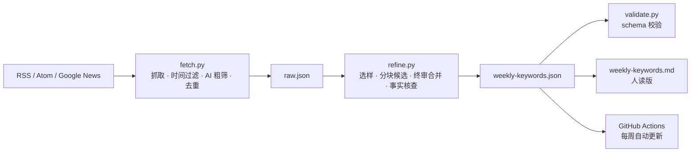

# Weekly AI Keyword Radar

> 每周 AI 与具身智能关键词雷达。RSS 粗筛 + LLM 精炼 + 固定 JSON schema，关键词随当周信源更新，不是一张写死的词表。

[](https://github.com/Zed-111/weekly-ai-keyword-radar/actions/workflows/weekly.yml)

## 这是什么

一个可以每周跑一次的“选题雷达”：

- 从 40+ 个中英文信源抓取最近 7 天的 AI/科技内容；
- 按时间窗口、AI 相关性、URL/标题相似度做粗筛和去重；
- 用 LLM 分块提取候选关键词，再合并、去重、做一次事实核查；
- 按固定 27 个板块输出 JSON，包含“大佬采访座谈分享”和创作者侧板块；
- 可以本地跑，也可以挂在 GitHub Actions 上每周自动更新。

它不是新闻聚合器，也不是摘要生成器。它输出的是**能直接拿去做选题/封面/视频标题/行业判断的关键词**。

## 三层结构



| 层 | 文件 | 职责 |
| --- | --- | --- |
| 数据层 | `scripts/fetch.py` | 拉取、解析 RSS/Atom、按 7 天窗口过滤、AI 粗筛、URL/标题去重 |
| 智能层 | `scripts/refine.py` | 选样、分块候选提取、终审合并、事实核查、归一化、校验 |
| 复用层 | `SKILL.md` + `references/output-schema.json` | 固定调用方式、固定 27 个板块、固定验收标准 |

## 27 个板块

| 字段 | 中文 |
| --- | --- |
| `ai_model_and_product` | AI 模型与产品 |
| `ai_agent_and_governance` | AI Agent 与治理 |
| `ai_infrastructure_and_business` | AI 基础设施与商业 |
| `ai_regulation_and_safety` | AI 监管与安全 |
| `company_event_keywords` | 公司事件关键词 |
| `embodied_ai_metrics` | 具身智能指标与临界点 |
| `embodied_ai_models_and_os` | 具身模型与操作系统 |
| `embodied_ai_hardware_and_deployment` | 具身硬件与部署 |
| `embodied_ai_funding_and_capital` | 具身融资与资本 |
| `embodied_ai_standards_and_policy` | 具身标准与政策 |
| `ai_creation_and_workflow` | AI 创作与工作流 |
| `ai_open_source` | AI 开源 |
| `world_models` | 世界模型 |
| `3d_game_ai` | 3D 与游戏 AI |
| `ai_tools_and_tech_life` | AI 工具与科技生活 |
| `reveal_and_expose` | 揭露与曝光 |
| `disruption` | 颠覆与重构 |
| `tech_shock` | 技术冲击 |
| `ai_pet_ip_博主自创` | AI 宠物/IP 博主自创 |
| `vibe_video_博主自创` | Vibe Video 博主自创 |
| `ai_art_and_music_博主自创` | AI 艺术与音乐博主自创 |
| `ai_coding_agent_博主自创` | AI Coding Agent 博主自创 |
| `ai_short_drama_and_fail_博主自创` | AI 短剧与翻车博主自创 |
| `3d_game_and_agent_博主自创` | 3D/游戏与 Agent 博主自创 |
| `viral_lexicon` | 传播热词 |
| `creator_viral_lexicon` | 创作者圈层热词 |
| `executive_interviews_and_talks` | 大佬采访座谈分享 |

`executive_interviews_and_talks` 没有合格条目时返回 `[]`。这是硬规则，不是失败。

## 快速开始

```bash
git clone https://github.com/Zed-111/weekly-ai-keyword-radar.git
cd weekly-ai-keyword-radar

python3 -m venv .venv
source .venv/bin/activate
pip install -r requirements.txt

cp .env.example .env
# 编辑 .env：LLM_API_KEY / LLM_BASE_URL / LLM_MODEL
```

运行：

```bash
# 一步到位
python scripts/run_weekly.py --days 7 --archive --fallback-on-error

# 或者分开跑
python scripts/fetch.py --days 7
python scripts/refine.py --input output/raw.json --feedback config/feedback.yaml
python scripts/validate.py --input output/weekly-keywords.json --schema references/output-schema.json
```

输出：

- `output/weekly-keywords.json`：完整结构化结果（27 个字段）。
- `output/weekly-keywords.md`：人读版，按板块列条目。
- `output/raw.json`：抓取与去重后的原始条目，便于核查。
- `output/run-meta.json`：本次运行的模式、模型、token 用量、审计状态。

`output/raw.json`、`candidates.json`、`run-meta.json` 默认不提交；GitHub Actions 会把它们作为 artifact 上传。

## 常用命令

```bash
# 只抓取，不调用 LLM
python scripts/fetch.py --days 7 --verbose

# 只精炼已有的 raw.json
python scripts/refine.py --input output/raw.json --max-items 160 --verbose

# 没有 API key 时的抽取式兜底（会明确标注 heuristic）
python scripts/refine.py --input output/raw.json --no-llm

# 先看提示词，不花钱
python scripts/refine.py --dry-run --input output/raw.json

# 换时间窗口
python scripts/fetch.py --since 2026-10-01T00:00:00+08:00 --until 2026-10-08T00:00:00+08:00

# 只抓某几个信源
python scripts/fetch.py --source qbitai --source gn-embodied

# 列出启用的信源
python scripts/fetch.py --list-sources
```

## 配置

### `config/sources.yaml`

- `fetch.ai_filter`：粗筛词。只用于减少噪声，不影响最终关键词。
- `fetch.exclude_patterns`：招聘、活动报名、促销等噪声。
- `sources[].weight`：来源权重，参与选样排序。
- `sources[].ai_only`：该信源是否默认全量视为 AI 相关。
- `sources[].tags`：给 LLM 的辅助标签。
- `sources[].max_items`：单个信源最多保留多少条。
- `sources[].timeout`：单信源超时（秒）。
- `type: google_news`：用查询构造 Google News RSS，适合没有 RSS 的中文站点。
- 文件末尾有自建 RSSHub 的可选信源示例，默认关闭。

当前默认信源包括：量子位、IT之家、爱范儿、雷峰网、钛媒体、InfoQ 中文、开源中国、智东西、OpenAI、Google DeepMind、Google AI、Hugging Face、GitHub Blog、IEEE Spectrum、arXiv cs.AI/cs.RO、TechCrunch、The Verge、WIRED、MIT Technology Review、The Decoder、Simon Willison、Ars Technica，以及 20 组中英文 Google News 查询。

### `config/feedback.yaml`

用于“调教”雷达，不需要改代码：

- `editorial.priorities`：选题优先级。
- `editorial.avoid_in_keywords`：禁止出现在关键词里的空词。
- `editorial.routing_rules`：板块路由纠错。
- `watchlist.people/companies/creators`：关注名单，参与选样加权。
- `source_weights`：覆盖来源权重。
- `learned_rules`：每周可以追加一条经验。

关键词本身不写在这里。每周的候选必须从当周 `raw.json` 里提取。

### `.env`

```dotenv
LLM_API_KEY=sk-...
LLM_BASE_URL=https://api.deepseek.com/v1
LLM_MODEL=deepseek-chat
LLM_TEMPERATURE=0.2
LLM_MAX_TOKENS=8000
LLM_TIMEOUT=180
```

任何 OpenAI-compatible `/chat/completions` 服务都可以：DeepSeek、OpenAI、Moonshot、Qwen、vLLM、Ollama（OpenAI 兼容层）等。也支持 Anthropic 原生 Messages API：

```dotenv
LLM_PROVIDER=anthropic
LLM_BASE_URL=https://api.anthropic.com/v1
LLM_MODEL=claude-sonnet-4-20250514
```

不要把 `.env` 提交到 Git。

## 质量规则

`references/prompt.md` 和 `config/feedback.yaml` 共同约束 LLM：

1. 只使用输入材料中的事实，不调用记忆、不补全。
2. 优先具体人物、公司、模型、产品、场景。
3. 优先硬数字：参数、上下文、价格、播放量、融资额、订单量、工时、成功率。
4. 优先对抗性张力：封锁/反制、起诉/回应、开源/闭源、替代/被替代、翻车/修复。
5. 一条只讲一件事；同一事件不按来源重复。
6. 没有合格条目就留空；空数组是合格输出。
7. 大佬采访必须有具体人物 + 具体场合 + 可复述观点。
8. 创作者板块只收个人/小团队案例，不收公司通稿。

LLM 之后还有一次“事实核查/版面审计”：只允许删除无证据条目、移动明显错放板块的条目、合并同板块重复；不允许新增事实。

## 部署到 GitHub

```bash
# 先登录（repo + workflow 权限）
gh auth login --hostname github.com --git-protocol https --web --scopes repo,workflow

# 再一键创建仓库并推送
./scripts/deploy_github.sh

# 可选：配置每周自动运行
gh secret set LLM_API_KEY --repo <owner>/weekly-ai-keyword-radar --body "sk-..."
gh variable set LLM_BASE_URL --repo <owner>/weekly-ai-keyword-radar --body "https://api.deepseek.com/v1"
gh variable set LLM_MODEL --repo <owner>/weekly-ai-keyword-radar --body "deepseek-chat"
```

脚本会读取当前登录账号，创建 `weekly-ai-keyword-radar`，推送 `main`，并补上仓库描述/topics。它不会自动上传你的 API key。

## GitHub Actions 每周自动跑

`.github/workflows/weekly.yml`：

- 每周四 09:00 UTC（北京时间 17:00）运行；
- 也支持手动 `workflow_dispatch`；
- 抓取结果作为 artifact 上传；
- 校验通过后，把 `output/weekly-keywords.json`、`output/weekly-keywords.md` 和归档提交回仓库。

在 GitHub 仓库设置里添加：

```bash
gh secret set LLM_API_KEY --body "sk-..."
gh variable set LLM_BASE_URL --body "https://api.deepseek.com/v1"
gh variable set LLM_MODEL --body "deepseek-chat"
```

如果没有设置 `LLM_API_KEY`，工作流会显式使用 `--no-llm` 的抽取式兜底，并在提交信息/日志里标注，不会伪装成 LLM 结果。

> 如果默认分支有保护规则，需要允许 GitHub Actions 推送，或改成“提交到新分支 + 开 PR”。

## 安装为 OpenCode / Claude 技能

OpenCode 全局技能目录：

```bash
mkdir -p ~/.config/opencode/skills
ln -s "$PWD" ~/.config/opencode/skills/weekly-ai-keyword-radar
```

Claude Code 兼容目录：

```bash
mkdir -p ~/.claude/skills
ln -s "$PWD" ~/.claude/skills/weekly-ai-keyword-radar
```

技能 ID 由目录名决定：`weekly-ai-keyword-radar`。之后可以直接说“跑一下关键词雷达”。

也可以只把仓库当普通脚本用，不需要安装成技能。

## 测试

```bash
python -m unittest discover -s tests -v
```

覆盖：RSS/Atom/Google News 解析、时间窗口、AI 粗筛、URL/标题去重、选样、候选证据校验、归一化、schema 校验。

## 失败与降级

| 情况 | 行为 |
| --- | --- |
| 单个 RSS 超时/403 | 跳过该信源，其他继续；`raw.json.sources` 记录错误 |
| 没有 LLM key | 默认报错；显式 `--no-llm` 才用抽取式兜底 |
| LLM 429/超时 | 重试；仍失败且带 `--fallback-on-error` 时降级并写 meta |
| 抓取 0 条 | 退出码 2；不拿旧闻/记忆补 |
| 输出校验失败 | 写 `weekly-keywords.invalid.json`，退出码 4 |
| 36氪直连返回 HTML | 已改为 Google News `site:36kr.com` 查询兜底 |
| 公共 RSSHub 超时 | 默认不启用；自建后再打开可选信源 |

## 方案 B：TrendRadar / AI News Hub

方案 A（本仓库）正常工作时不需要方案 B。如果 RSS 长期不可用，或你希望接热榜/推送：

- 首选 [TrendRadar](https://github.com/sansan0/TrendRadar)：聚合热榜 + RSS + 关键词筛选 + 推送，支持 Docker 和 GitHub Actions。
- 备选 AI News Hub：RSS 聚合 + 兴趣评分 + 日报/周报；不同仓库差异较大，安装前先确认维护状态。
- 迁移方式：把 TrendRadar 的输出映射成 `raw.json` 的 `items` 结构，继续复用 `refine.py` 和固定 schema，输出结构不变。

详细步骤见 [`docs/plan-b.md`](docs/plan-b.md)。

## 目录结构

```text
weekly-ai-keyword-radar/
├── SKILL.md                     # 技能定义 / 调用方式 / 验收标准
├── README.md
├── .env.example
├── requirements.txt
├── Makefile
├── scripts/
│   ├── common.py                # 日期、URL、标题、YAML、JSON 工具
│   ├── fetch.py                 # 第一层
│   ├── refine.py                # 第二层
│   ├── validate.py              # schema 校验
│   └── run_weekly.py            # 一键流水线
├── config/
│   ├── sources.yaml
│   └── feedback.yaml
├── references/
│   ├── output-schema.json
│   └── prompt.md
├── tests/
├── docs/
│   ├── architecture.md
│   └── plan-b.md
├── .github/workflows/weekly.yml
└── output/
    ├── weekly-keywords.json     # 最新结果（提交）
    ├── weekly-keywords.md       # 人读版（提交）
    └── archive/                 # 每周归档
```

## License

MIT。见 [LICENSE](LICENSE)。
