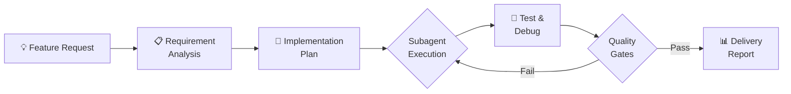

[](README_zh.md)
[](https://opencode.ai)
[](https://github.com/obra/superpowers)
[](LICENSE)

# Autonomous Feature Developer

> **"Add a login page" — done in 5 minutes.**

An autonomous AI agent that takes feature requests for webapp projects and handles the full lifecycle: requirement analysis, implementation, testing, debugging, iteration, and delivery with a development report.

## How It Works



## Why Autonomous Feature Developer?

| Traditional Development | Autonomous Feature Developer |
|---|---|
| Hours of manual coding | Minutes of AI-powered implementation |
| You write tests, fix bugs, iterate | Agent handles testing, debugging, and iteration |
| Context switching breaks flow | Describe once, get production-ready code |
| No documented development path | Full development report with every feature |

## Key Features

### 🤖 Automated Implementation
From requirement to production-ready code with minimal user intervention. Just describe what you want — the agent plans, codes, tests, and delivers.

### 🧪 Full Testing Pipeline
Integrates Playwright for frontend testing, backend API testing, and LLM integration testing. Tests are part of every deliverable.

### 🔍 Intelligent Debugging
Automatic error diagnosis with iterative fixes. When tests fail, the agent diagnoses the root cause, applies fixes, and re-runs until green.

### ✅ Quality Gates
Code review and verification before delivery. Each feature passes through automated checks: test coverage, code quality, and functional correctness.

### 📊 Development Report
Every feature comes with a comprehensive report documenting what was built, how it was implemented, issues encountered and resolved, and test results.

### 🔌 Superpowers Integration
Built on the superpowers workflow engine — leverages 8 proven sub-skills (brainstorming, writing-plans, TDD, webapp-testing, systematic-debugging, and more).

## Quick Start

<details>
<summary>📖 Click to expand</summary>

### Install

1. Ensure `opencode` is installed
2. Install the superpowers skill package:
   ```bash
   # Follow instructions at https://github.com/obra/superpowers
   ```
3. Clone this skill to your skills directory:
   ```bash
   git clone https://github.com/ZelinZhou-THU/autonomous-feature-developer.git
   mv autonomous-feature-developer ~/.opencode/skills/
   ```

### Use

Simply describe your feature in OpenCode:

> "I want to add a user profile page with avatar upload and editing capabilities"

The skill will:
1. Clarify requirements if needed
2. Create an implementation plan
3. Execute tasks using subagents
4. Run tests and debug issues
5. Iterate until quality standards are met
6. Deliver a complete feature with development report

</details>

## Skill Dependencies

<details>
<summary>📖 Click to expand</summary>

This skill requires the following sub-skills from the superpowers package:

| Skill | Purpose |
|---|---|
| `brainstorming` | Requirement clarification |
| `writing-plans` | Implementation planning |
| `subagent-driven-development` | Task execution |
| `test-driven-development` | Test-first implementation |
| `webapp-testing` | Playwright-based frontend testing |
| `systematic-debugging` | Error diagnosis and fixes |
| `requesting-code-review` | Code quality review |
| `verification-before-completion` | Final verification |

</details>

## Project Structure

<details>
<summary>📖 Click to expand</summary>

```
autonomous-feature-developer/
├── SKILL.md                    # Core skill definition
├── docs/
│   └── design.md               # Design document
├── LICENSE
├── README.md                   # English
└── README_zh.md                # Chinese
```

</details>

## Supported Project Types

- **FastAPI + vanilla JavaScript** webapps
- **Playwright** for frontend testing
- Adaptable to other tech stacks with minor configuration

## Decision Boundaries

**User intervention required for:**
- Architecture decisions (component connections, design patterns)
- System-level operations (file permissions, environment setup)
- Data security decisions (API keys, sensitive data)
- Third-party service configuration

**Automated (no user intervention):**
- Implementation details
- Test scenarios and edge cases
- Bug diagnosis and fixes
- UI/UX refinements within existing patterns

## License

Apache 2.0 — see [LICENSE](LICENSE)
